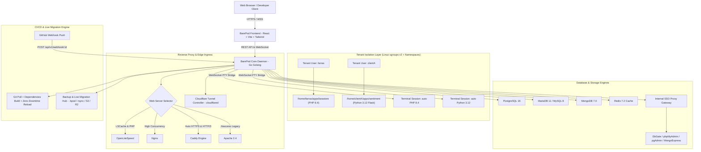

# Master Architecture & Development Plan: BarePod Panel
> **Versi Dokumen:** 2.4 (Status: Frontend UI Prototype Selesai — Backend Go Daemon & Engine OS Belum Dikerjakan)  
> **Terakhir Diperbarui:** 10 Oktober 2026  
> **Status:** Active & Maintained

Dokumen ini merupakan cetak biru (blueprint) arsitektur teknis, spesifikasi modul, dan roadmap pengembangan lengkap untuk **BarePod Panel**, platform manajemen web hosting, reverse proxy gateway, dan container hosting hybrid generasi baru yang aman, terisolasi, dan mudah digunakan.

---

## 1. Visi & Konsep Produk

**BarePod Panel** dirancang untuk memecahkan dilema panel server tradisional (seperti cPanel, Plesk, AaPanel, CyberPanel, Coolify, dan EasyPanel):
1. **User Experience Bersih, Modern & Intuitif**: Antarmuka responsif dan estetis berbasis palet warna modern, tata letak rapi tanpa hierarki menu bertumpuk yang membingungkan.
2. **Isolasi Multi-Tenant Total (Linux cgroups v2 + Namespaces)**: Setiap tenant user memiliki user system Linux sendiri, direktori terisolasi (`/home/<tenant>/apps/<app>`), dan kuota resource yang aman.
3. **Automasi CLI Cerdas (Auto-Switch Runtime)**: Ketika user membuka web terminal pada suatu website, perintah CLI seperti `php -v`, `node -v`, atau `python -v` secara otomatis menyesuaikan versi runtime yang terkonfigurasi pada situs tersebut tanpa saling bertabrakan antar-tenant.
4. **Fleksibilitas 4 Engine Web Server**: Mendukung OpenLiteSpeed (OLS + LSCache), Nginx, Caddy (Auto-HTTPS & HTTP/3), dan Apache 2.4 sesuai kebutuhan arsitektur aplikasi pengguna.
5. **Dukungan Database & In-Memory Lengkap**: PostgreSQL 16, MariaDB 11/MySQL 8, MongoDB 7.0, dan Redis 7.2 langsung siap pakai dari satu panel dengan opsi *Shared Daemon* atau *Dedicated Pod*.
6. **Built-in Database Web GUI (SSO)**: Akses GUI (DbGate, phpMyAdmin, pgAdmin, Mongo Express) terlindungi di balik proxy internal dan otomatis login tanpa perlu menginput kredensial database berulang kali.
7. **Proteksi Password Kredensial**: Password database terenkripsi dan disembunyikan. Untuk menampilkan password dalam bentuk teks, pengguna wajib memasukkan password akun panel terlebih dahulu.
8. **File Manager Pro (cPanel / VS Code Grade)**:
   - Checkbox di setiap file/folder dengan master checkbox *Select All*.
   - Multi-file batch actions: Download terpilih, Hapus terpilih, Copy/Cut terpilih.
   - Menu klik kanan (Context menu) lengkap (Open/Preview, Copy, Cut, Paste, Duplicate, Rename, Download, Delete).
   - In-browser Visual Previewers (SVG / Vector graphics, Image viewer, PDF viewer dengan zoom control).
   - In-browser Code Editor dengan persistent volume sync & syntax styling.
9. **GitHub Push-to-Deploy & 1-Click Redeploy**: Webhook otomatis saat push commit ke GitHub serta tombol redeploy manual dengan streaming build logs secara *zero-downtime*.
10. **Multi-Tenant Cloudflare Tunnel Isolation**: Ekspos domain dan container ke internet publik cukup dengan memasukkan Tunnel Token pribadi per tenant tanpa perlu IP publik statis atau port forwarding.
11. **Dedicated Reverse Proxy Mode & Multi-Engine Path Routing**: Kemudahan membuat gateway proxy murni untuk mem-forward traffic domain ke internal port lengkap dengan WebSocket pass-through, real IP preservation, auto-SSL, upstream ping connectivity test, dan live vhost preview (OpenLiteSpeed, Nginx, Caddy).
12. **World Traffic Map & Streaming Telemetry**:
    - Peta dunia interaktif dengan visual pulsing radar pins (ID, US, SG, DE, JP, AU, dll).
    - Filter lalu lintas per negara dengan info latency dan ISP.
    - Console log dengan Light/Dark toggle, log text wrap toggle, dan expandable request detail inspector.
13. **Backup & 1-Click Server-to-Server Live Migration Hub**:
    - 1-Click Server-to-Server Live Migration Wizard (Pull from Old VPS via IP & Secret Token, live rsync & DB dump streaming).
    - Source VPS Token Generator (2-hour TTL).
    - Instant Portable Snapshot (`.bpod` / `.tar.gz`) dengan SHA-256 checksum & AES-256 encryption.
    - Restore from File (Drag-and-drop bundle restore + manifest inspector).
    - Remote Cloud Storage Sync & Scheduled Cron (Cloudflare R2, AWS S3, Google Cloud Storage, Wasabi / MinIO) dengan retensi 7-90 hari.
    - Per-App Export (`barepod-<app>.bpod`) di App Detail Page dan Per-Database Export (`.sql`) di Database Details Modal.

---

## 2. Arsitektur Sistem (High-Level Architecture)



---

## 3. Rincian Modul & Fitur Teknis

### 3.1. Web Server & Reverse Proxy Switching
- **OpenLiteSpeed (OLS)**:
  - Modul LSCache terintegrasi untuk performa PHP & WordPress ultra-cepat.
  - Vhost syntax generator yang benar (`context / { type proxy; handler backend-primary; }`, `extprocessor`).
- **Nginx**:
  - Konfigurasi virtual host dinamis untuk reverse proxy (Next.js, FastAPI, Flask, Go, Rust).
- **Caddy**:
  - Engine otomatis Let's Encrypt / ZeroSSL dan HTTP/3 tanpa konfigurasi sertifikat manual.
- **Apache 2.4**:
  - Kompatibilitas file `.htaccess` dan `mod_rewrite` untuk aplikasi PHP konvensional.

### 3.2. Bahasa, Framework, & Otomatisasi CLI
- **Bahasa & Framework Didukung**:
  - **Python**: Flask, FastAPI, Django, script mandiri (Python 3.10, 3.11, 3.12).
  - **PHP (27 Frameworks & CMS Templates)**:
    - *Modern*: Laravel 12, Laravel 13, Symfony 7, Symfony 8, CodeIgniter 4, CakePHP 5, Slim 4, Laminas, Yii 2, Generic PHP.
    - *E-Commerce*: WooCommerce, Magento 2, PrestaShop 1.7, Shopware 6.
    - *CMS*: WordPress, Drupal 10, Drupal 11, Joomla 6, Contao 4, Neos 9, TYPO3 14.
    - *Cloud & Portals*: Nextcloud 34, OwnCloud 12, Moodle 5 (LMS), Matomo 5 (Analytics), Mautic 7 (CRM), WHMCS.
    - *Versi*: PHP 7.4, 8.0, 8.1, 8.2, 8.3, 8.4.
  - **Node.js**: Next.js, Express, NestJS, Astro, Nuxt (Node 18, 20, 22 LTS).
  - **Lainnya**: Go (Gin/Fiber), Rust (Axum/Actix), Ruby on Rails, Static HTML.
- **Polyglot Hybrid Monorepo Sandbox**:
  - Sandbox tenant mendukung eksekusi backend PHP (versi pilihan), build tool Node.js 22 LTS (Vite & npm), dan task Python 3.12 secara harmonis dalam satu terminal session.
- **PHP Extensions & Configuration Studio**:
  - 1-Click Extension Toggle (`redis`, `imagick`, `gd`, `intl`, `bcmath`, `zip`, `pdo_mysql`, `pdo_pgsql`, `pdo_sqlite`, `mongodb`, `swoole`, `opcache`, `pcntl`, `exif`, `sodium`, `soap`, `ioncube`).
  - PECL package installer & form `php.ini` directives.

### 3.3. Database Suite & SSO Web GUI
- **4 Engine Terintegrasi**: PostgreSQL 16, MariaDB 11 / MySQL 8, MongoDB 7.0, Redis 7.2.
- **Mode Isolasi**:
  - *Shared Engine Daemon*: Berbagi daemon server yang dioptimasi untuk menghemat RAM (cocok untuk database kecil/menengah).
  - *Dedicated Pod Container*: Container mandiri dengan resource CPU/RAM terisolasi (cocok untuk database heavy workload).
- **Max Connections Controller**:
  - Pengaturan batas koneksi maksimum (`max_connections`) per database agar database tidak membebani kapasitas RAM server.
- **Zero-Login Web GUI (SSO)**:
  - Akses DbGate, phpMyAdmin, pgAdmin, Mongo Express tanpa perlu memasukkan password berulang kali.
- **Password Vault Challenge & Connection String**:
  - Password disembunyikan di balik proteksi akun panel.
  - Direct connection string URL (`postgresql://...`, `mysql://...`, `mongodb://...`, `redis://...`).
  - Export Logical SQL Dump instan per database.

### 3.4. File Manager Pro (Visual & Multi-Selection)
- **Checkbox & Batch Actions**:
  - Checkbox per file/folder dan master *Select All*.
  - Batch download (`.zip`) dan batch delete.
- **Right-Click Context Menu**:
  - Preview, Copy, Cut, Paste, Duplicate, Rename/Move, Download, Delete.
- **Visual Previewers**:
  - SVG previewer dengan rendering langsung.
  - Image viewer (PNG, JPG, WebP, GIF, ICO) dengan zoom control.
  - PDF viewer interaktif.
- **Code Editor**:
  - Live editing file `.env`, PHP, JS, Python, JSON langsung di browser dengan persistent volume sync.

### 3.5. World Traffic Map & Streaming Telemetry
- **Peta Pengunjung Interaktif**:
  - Vector world map dengan live pulsing radar pins.
  - Tooltip negara, kota, IP, jumlah request, latency (ms), dan nama ISP.
  - Filter log instan berdasarkan negara yang diklik di peta.
- **Console Log Studio**:
  - Default Light Mode (`bg-white`) dengan toggle Dark Mode (`bg-slate-950`).
  - Toggle Log Text Wrapping (mencegah teks terpotong).
  - Expandable Request Detail Inspector (`ChevronRight`/`ChevronDown`) untuk melihat headers, cookies, dan user-agent lengkap.

### 3.6. Backup & Migration Hub (Plug and Play)
- **1-Click Server-to-Server Live Migration**:
  - Mode *Pull from Old Server*: Masukkan IP server lama dan Migration Token.
  - Transfer terenkripsi via rsync stream berkecepatan tinggi tanpa perlu download ke laptop.
  - Mode *Source VPS Node*: Generator token migrasi sementara (berlaku 2 jam).
- **Portable Snapshot (`.bpod` / `.tar.gz`)**:
  - Paket bundle menyimpan codebase (`/var/www/apps/<app>`), `.env`, vhost routing config, logical database dump, dan volume data.
  - Enkripsi AES-256 opsional dan validasi SHA-256 checksum.
- **Restore from File**:
  - Drag-and-drop file `.bpod` dengan manifest inspector.
- **Remote Cloud Storage Sync**:
  - Otomatis sinkronisasi ke Cloudflare R2, AWS S3, Google Cloud Storage, atau Wasabi/MinIO dengan jadwal cron berkala dan kebijakan retensi 7-90 hari.

### 3.7. Hardware Health & Real-time Network Telemetry
- **S.M.A.R.T. Physical Disk Health Diagnostics**:
  - Status NVMe (`/dev/nvme0n1`) dan SATA SSD (`/dev/sda`).
  - Wear index / persentase umur drive %, TBW, TBR, Power-on hours, unsafe shutdowns, temperatur (°C).
  - Fitur S.M.A.R.T. Self-Test interaktif (`smartctl -t short`).
- **Network Telemetry**:
  - Live sparklines Ingress (Rx Mbps) dan Egress (Tx Mbps).
  - Monitoring per-interface (`eth0`, `docker0`, `cloudflared0`, `lo`).
  - ICMP Edge Latency prober ke Cloudflare (1.1.1.1), Google DNS (8.8.8.8), dan gateway.
  - TCP socket states counter dan open listening ports inspector (`ss -tulpn`).

---

## 4. Status Implementasi & Roadmap Pengembangan

> [!IMPORTANT]
> **Kondisi Riil Saat Ini:**
> Seluruh fitur yang tampak pada panel saat ini berada pada **Fase 1: Frontend UI & Interactive Simulation (React 19 + Vite 8 + TypeScript)**.
> Interaksi tombol, form wizard, file manager, dan simulasi proses saat ini berjalan pada **client-side state (mock data)**.
> **Backend Core Daemon (Go / Linux OS Engine)** yang akan mengeksekusi perintah asli di server (seperti daemon systemd, container Docker asli, engine database riil, rsync stream asli, dan vhost generator ke file sistem Linux) **BELUM DIKERJAKAN** dan merupakan milestone teknis selanjutnya.

### 4.1. Tabel Status Komponen: Frontend Simulasi vs Backend Riil

| Fitur / Modul | Frontend UI & Simulasi (React) | Backend Riil & OS Engine (Go / Linux) | Status Riil Keseluruhan |
|---|---|---|---|
| **Design System & Layout Panel** | ✅ Selesai (Responsive, Modern UI) | N/A (Frontend Only) | **Selesai (Frontend)** |
| **Apps & Runtime Selector** | ✅ Selesai (27 Template PHP, Node, Python) | ⏳ Belum (Chroot / Docker Runtime Engine) | **Simulasi UI Selesai** |
| **Hybrid Upstream Routing** | ✅ Selesai (Form, Ping mock, vhost preview) | ⏳ Belum (Write config ke `/usr/local/lsws/conf/`) | **Simulasi UI Selesai** |
| **Database Suite & SSO** | ✅ Selesai (Detail modal, vault mask, export dump) | ⏳ Belum (Provisioner DB asli & SSO proxy token) | **Simulasi UI Selesai** |
| **File Manager Pro** | ✅ Selesai (Checklist, batch action, previewer, edit) | ⏳ Belum (API Host FS `/home/<user>/apps/`) | **Simulasi UI Selesai** |
| **World Traffic Map & Logs** | ✅ Selesai (Vector map, pulsing pin, log viewer) | ⏳ Belum (Real-time daemon log streamer / WSS) | **Simulasi UI Selesai** |
| **Backup & Migration Hub** | ✅ Selesai (Wizard UI, Token gen, .bpod download) | ⏳ Belum (Rsync daemon stream & S3 backend upload) | **Simulasi UI Selesai** |
| **Hardware S.M.A.R.T. & Network** | ✅ Selesai (Diagnostic visual, mock self-test, ping) | ⏳ Belum (CLI `smartctl` & `/proc/net/dev` parser) | **Simulasi UI Selesai** |
| **Web Terminal PTY** | ✅ Selesai (Mock terminal & CLI shim command) | ⏳ Belum (Go `creack/pty` bridge via WebSocket) | **Simulasi UI Selesai** |

---

### 4.2. Rencana Tahapan Eksekusi Nyata (Roadmap):

* **Fase 1: Frontend UI Prototyping (SELESAI ✅)**:
  Merancang seluruh user interface, interaksi pengguna, arsitektur data tipe (TypeScript), dan alur navigasi agar developer experience (DX) teruji sempurna sebelum backend dibangun.
* **Fase 2: Backend Core Daemon Go (MILESTONE BERIKUTNYA 🚀)**:
  Inisialisasi service daemon di Go (Golang):
  - Setup SQLite lokal (WAL mode) untuk database internal panel.
  - REST API & WebSocket router (menggantikan mock data di React).
  - JWT Authentication & RBAC (Multi-tenant user manager).
* **Fase 3: Host OS & Container Integration (TERJADWAL 📋)**:
  - Integrasi Docker Engine SDK (`docker/moby`) untuk manajemen container pod.
  - File Manager backend API (membaca/menulis direktori Linux asli dengan hak akses tenant user terisolasi).
  - WebSocket PTY terminal bridge (`creack/pty` + Xterm.js).
* **Fase 4: Web Server & Network Automations (TERJADWAL 📋)**:
  - Generator konfigurasi vhost asli (OpenLiteSpeed, Nginx, Caddy).
  - Automated Let's Encrypt / ZeroSSL.
  - Daemon `cloudflared` controller.
* **Fase 5: Engine Database & SSO Gateway (TERJADWAL 📋)**:
  - Automated database user creation & grant schema di PostgreSQL, MySQL, Mongo, Redis.
  - Internal reverse proxy gateway untuk autologin DbGate / phpMyAdmin.
* **Fase 6: Live Migration Daemon & Installer (TERJADWAL 📋)**:
  - Daemon-to-daemon encrypted stream transfer via rsync.
  - Snapshot packager `.bpod` (tar.gz + metadata + dump sql).
  - Skrip instalasi 1-baris untuk VPS Ubuntu/Debian (`curl -fsSL https://get.barepod.com | bash`).

---

## 5. Struktur Repositori Terpadu

```
BarePod-Panel/
├── frontend/                     # Dashboard Web UI (React + Vite + Tailwind)
│   ├── src/
│   │   ├── components/           # AppsView, AppDetailPage, DatabasesView, BackupMigrationView,
│   │   │                         # FileManagerModal, WebTerminalView, ServerMonitoringView, etc.
│   │   ├── types/                # TypeScript Interfaces & Model Definitions
│   │   ├── App.tsx               # Root Navigation & Layout Controller
│   │   ├── index.css             # Tailwind Design System & Custom Utilities
│   │   └── main.tsx              # React Entrypoint
│   └── package.json
├── backend/                      # Core Daemon (Go / Golang) [Planned]
│   ├── cmd/
│   │   └── barepod-daemon/       # Entrypoint binary daemon
│   ├── internal/
│   │   ├── api/                  # REST API & WebSocket handlers
│   │   ├── docker/               # Docker SDK & Container execution
│   │   ├── tenant/               # Linux user jail & cgroups v2 isolation
│   │   ├── proxy/                # Caddy / Nginx / OLS config generator
│   │   ├── database/             # PostgreSQL, MySQL, MongoDB, Redis driver
│   │   ├── backup/               # Snapshot, rsync migration & S3/R2 sync engine
│   │   ├── git/                  # Webhook & build runner
│   │   └── pty/                  # Pseudo-terminal WebSocket bridge
│   └── go.mod
├── scripts/
│   └── install.sh                # Script instalasi 1-baris untuk VPS Ubuntu/Debian
├── MASTER_PLAN.md                # Dokumen Master Plan & Arsitektur Utama
├── README.md
└── LICENSE
```
