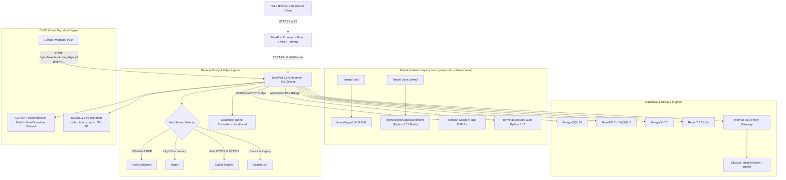

# Master Architecture & Development Plan: BarePod Panel
> **Document Version:** 0.3 (Prototype) — databases & caches module live end-to-end (SQLite file engine, Redis multi-tenant ACL, AES-256-GCM vault, live Reveal & Rotate, and Recycle Bin)
> **Last Updated:** October 13, 2026  
> **Status:** Active & Maintained

## Versioning policy

The number describes **completed milestones, not effort** — and nothing may
invent its own version.

- **0.x = prototype line.** The line is at **0.3** (the databases module) and stays
  in 0.x while the panel is a prototype (some views still mock, dry-run provisioning,
  no release artefact).
- **0.1 → 0.2 (reached):** the milestone was *"a website really runs end-to-end on
  a Linux host"*. Verified on Ubuntu 24.04 in an LXC container: unit active,
  service running as the tenant, cgroup limits applied, health check green, files
  created through the API owned by the tenant, per-site metrics from the cgroup.
  **What that claim covers, precisely: the daemon and its API.** The milestone was
  reached by driving `POST /websites` end-to-end, not by clicking the panel's
  Add-Website wizard — that wizard was prototype state (it updated local state and
  called nothing; the API client had no create call at all) until it was wired. A
  milestone is a claim about the daemon; a screen that does not call the daemon is
  still mock, and saying so is the point of this section.
- **0.2 → 0.3 (reached):** the milestone was *"databases and caches module"*. Verified
  end-to-end: SQLite file database in site directory owned by tenant, live size reporting,
  Redis ACL user per cache with key prefix and password rotation via resetpass, Recycle Bin
  with suspend & restore, AES-256-GCM password vault with elevated session, and UI Reveal /
  Rotate click-through.
- **It only moves when a milestone is finished**, e.g. `0.2` = a website really
  runs end-to-end on a Linux host; `0.3` = databases module; `1.0` = first
  release with the installer and a supported upgrade path. Commits, features in
  progress, and "looks almost done" never bump it.
- **One source of truth:** the daemon carries the version (`api.Version`,
  reported by `GET /health`) and the UI displays *that*; in simulation mode the
  UI falls back to `frontend/src/version.ts`. No component hardcodes its own
  version string (the footer previously drifted to "v0.6" — that is exactly
  what this rule prevents).

### Keeping these documents in sync

**The note is part of the change, not a follow-up.** A commit that alters
behaviour must update the documentation in the *same* commit:

| What changed | What must be updated with it |
|---|---|
| Any user-visible behaviour | §0 Frontend Changelog (a bullet, one line) |
| A module's real status | §4.1 Component Status Table (simulation / partially live / live) |
| An endpoint, payload or rule | `API_CONTRACT.md`: §4.x for the endpoint **and** §1 conventions when the shape moved |
| A module's design | the matching §3.x section |
| A milestone finishing | the version above **and** the phase checklist in §4.2 |

A claim in these documents that cannot be verified in the code is a **bug** —
fix the text or the code in the same commit. (Known drift so far: the status
table claimed metrics, files and the terminal were unbuilt after they shipped,
and the footer invented its own version. Both are why this rule exists.)

This document is the complete technical architecture blueprint, module specification, and development roadmap for **BarePod Panel**, a new-generation web hosting management, reverse proxy gateway, and hybrid container hosting platform that is secure, isolated, and easy to use.

---

## 0. What is live, and the decisions behind it

The detailed build log of every fix — with its measurements — is in this file's history (`git log -- MASTER_PLAN.md`). What follows is the durable part: what is real, and the decisions a later change must not undo. **Current state, architectural decisions, and the working loop live in this document; endpoints live in `API_CONTRACT.md`.**

**Real, verified on a Linux host (LXC, Ubuntu 24.04):** the daemon and its API (`mode: real`), sign-in with Argon2id + session cookies + CSRF + audit, websites deployed end to end (unit, tenant ownership, cgroup limits, health check) with redeploy and delete, a jailed tenant terminal, host and per-site metrics, a host file manager whose system paths are read-only by policy, databases and caches (0.3) with a vault, a web port that answers a status page instead of "connection refused", and **Domains & Automated SSL/TLS (1.0)** with ACME Let's Encrypt automated issuance, pre-flight DNS verification, high-grade ECDSA P-256 self-signed generator, custom certificate validator/uploader, 301 Force HTTPS redirection, and multi-webserver vhost hot-reload. **Still mock, and badged as such:** Pods/Docker, API & MCP, Backup & Migration, Cloudflare Tunnels, and most of Panel Settings.

**Decisions that must not be silently reversed**

- **Domains & Automated SSL/TLS Engine (Multi-Webserver & Pre-flight Protection):** Automated ACME challenge verification uses a shared webroot directory (`/var/lib/barepod/acme/.well-known/acme-challenge`) exposed across all vhosts on port 80. To prevent severe Let's Encrypt rate limiting (5 failures/hr per domain), BarePod executes a DNS pre-flight resolution check (`ssl.PreflightDNS`) before invoking Certbot. If unresolvable (local lab, staging, unpointed DNS), BarePod issues an internal high-grade ECDSA P-256 self-signed certificate with an informational diagnostic warning so HTTPS immediately works without crashing the web server or getting blocked by Let's Encrypt. Deleting a website's primary domain is guarded and blocked; only alias domains can be detached. Custom certificates validate PEM structure and keypair match before installation. All changes gracefully test and reload the active web server (Nginx, Caddy, Apache, OpenLiteSpeed).

- **The isolation boundary is the tenant**, one Linux UID per account: the kernel refuses another tenant outright. A website's shell is opened in its own mount namespace with the tenant's other paths masked and the system bound read-only — and the namespace is made **private before masking**, because a shared propagation once published 12 298 mounts into the host's namespace and hid a tenant's real files behind them.
- **Uninstalling is a first-class operation, and it backs up before it deletes.** `barepod uninstall` is guided by default: it reads websites, tenant accounts, ledger records, containers and the lockout's table from the daemon's own state (never inferring them from unit files), prints the plan, and asks: the backup level is an arrow-key menu, the removals are one checklist the space bar toggles, and the last question is a box carrying the summary with **No preselected**, so pressing Enter can never be the destructive answer. Where a box cannot be drawn — a bare LXC console with `TERM=linux` — the same questions are asked in plain text and the typed word comes back as the last line of defence. With `--yes` nothing irreversible happens unless a flag names it (`--purge-data`, `--remove-tenants`, `--remove-tenant-data`, `--remove-volumes`). Two rules are structural rather than polite: the backup is written with the panel already stopped (SQLite in WAL mode loses its tail to a plain copy of a live database) and is **read back before the first deletion** — a failed backup followed by a delete is the worst possible order — and a backup directory inside anything the run deletes is **refused**, not quietly relocated, because the operator's reason for choosing a path may be the reason that path matters. A backup holds the panel database (accounts, records, settings, audit log) and the certificate, and with `--backup=full` also `/etc/barepod` and the unit files; it deliberately does **not** hold database contents, whose credentials are encrypted inside that same database, so the panel's Export is the honest tool for those. `scripts/uninstall.sh` and `scripts/restore.sh` remain for a host whose binary is gone, and the installer detects a backup left behind and says so.
- **A mock is a plan: kept and marked, never deleted and never silent.** Every unbuilt field carries a one-line caption in the same shape as the measured ones (`Not applied: nothing reads this choice yet.`); an unmarked mock is a bug, and so is a caption that contradicts a control elsewhere on the screen.
- **Manager GUIs are panel paths, never ports of their own**: `browser` (ours), pgweb, phpMyAdmin and DbGate — one container **per database** (a shared one could not serve two people), loopback only, credentials injected server-side, session-gated, stopped when idle. Adminer was left out rather than shipped without a zero-login; pgAdmin and redis-commander were dropped as too heavy or unnecessary. The DbGate image is pinned to 7.3.1 after measuring four candidates.
- **The panel talks to engines with pure-Go drivers** as that database's own user, with the clients needed only for the administrator steps of a host install. Quoting is per engine (backticks for MySQL/MariaDB). An engine refusal surfaces as the engine's own error, not as a one-column grid.
- **Engines can be containers or host installs, and the panel says which** (`mode` per engine), brings a container up on demand single-flight, keeps its admin credential encrypted, and treats suspend as per-database (never a container stop, which would take other tenants down with it).
- **Exposure is per record and applied in each engine's authorisation**, not its port; `public` is refused with `409 guard_required` unless the watchdog is enforcing. MariaDB is opened by the panel itself (it writes `bind-address` and restarts, restoring the file if MariaDB does not come back). MongoDB and Redis are honest exceptions where the panel cannot restrict per database.
- **The address shown is the one that demonstrably works** — the one the browser used, or a manual setting for a VPS. No external echo service: behind NAT it cannot be discovered from the inside, and it would add a dependency. Labels say what an address *is* (Private / Public / Loopback only).
- **HTTPS by default with a self-signed certificate** (honest about being self-signed), generated beside the panel database; port 80 stays free for websites. Behind a tunnel, `X-Forwarded-Proto` is believed, so a manager on an HTTPS page does not build HTTP URLs.
- **One version, from the daemon** (`api.Version`, surfaced by `/health`), never a number a component invents.
- **Credential hygiene a later change must not undo:** panel passwords are **Argon2id** hashes; secrets that must be read back (database passwords, tokens) are **AES-256-GCM** with the key in a separate `0600` file beside the database, never in it; **only a hash of a session token is stored** (`sha256` in `sessions.id`), so a leaked database holds no usable session; and the panel database with its WAL/SHM siblings is `0600`.
- **Suspending an account is not a label.** It stops the account's services and marks their websites `suspended`, and a start is refused (`409 owner_suspended`) until the account is active again — otherwise "suspended" would be cosmetic. Reactivating releases the sites to `stopped` and leaves the decision to start them to the operator.
- **An account without a Linux account is a bug, not a state to live with.** Creating a panel account — from the panel or from the CLI, `barepod admin create` included — creates its Linux account **first**, and a host that cannot make one refuses rather than recording an account with no OS identity. Deleting one removes the Linux account and its home too, so the two cannot drift apart. `POST /users/{id}/provision` reconciles an account that predates the rule, and the screen offers it whenever `osExists` is false. (The directory layout and the account are separate steps — `EnsureSiteDir` mkdirs for real — which is how an orphan `/home/<name>` without an account used to appear.) **A capability must not be claimed without the thing it names:** "disk quota" is reported only when the tools exist **and** the filesystem really has user quotas enabled — `setquota` fails on a filesystem that was never mounted with `usrquota`, and a false capability is worse than a missing one.
- **Where the kernel cannot enforce a disk quota, the panel does — and labels it.** On a host whose filesystem has no user quotas (an unprivileged LXC cannot enable them), the panel measures each account's home, reports it in `GET /users` (`disk{usedBytes,maxBytes}`), and refuses its **own** writes — editor saves and uploads — that would exceed the package allowance with `409 quota_exceeded { enforcedBy: "panel" }`. It covers what the panel writes; a process writing from inside the site is not stopped, which is exactly what a kernel quota is for. When the filesystem does have quotas the kernel is the authority and the panel is redundant, so it steps aside.
- **Global PHP Tuning Blueprint & Extension Preset (Host Baseline + Per-Project Independence):** The admin Settings screen (`/settings/php_defaults`) acts as a global baseline blueprint preset for all installed PHP versions on the host. It does **not** force a single global "Default PHP Version" (each project retains independent version selection and per-pool `php_admin_value[...]` override capability in project settings). Persisted in SQLite `panel_settings` (`php_defaults`). When the operator chooses **Apply Tuning to All Versions**, the daemon writes `/etc/php/<version>/mods-available/99-barepod-tuning.ini` across all installed PHP runtimes, executes `phpenmod -v <version> 99-barepod-tuning`, and gracefully reloads `php<version>-fpm` pools.
- **Polyglot Runtime Configuration Studio (Equal First-Class Support for All Stacks):** The project detail interface must not privilege PHP over other runtimes with a single PHP-only tuning tab. Every supported runtime stack gets its own dedicated, native per-project tuning panel in `AppDetailPage`: PHP tunes FPM pools (`pm.max_children`, `memory_limit`, `upload_max_filesize`, extensions); Node.js manages Node versions, package managers (`npm`/`pnpm`/`yarn`), startup commands, and V8 memory flags (`--max-old-space-size`); Python manages Python versions, virtualenv (`.venv`) lifecycle, and WSGI/ASGI options (Gunicorn/Uvicorn workers & timeouts); Ruby manages Ruby versions, Bundler, and Puma workers; Go/Rust manages binary entrypoints and restart hooks; Proxy/Static manages upstream URLs, WebSocket passthrough, and SPA fallback rewrites.
- **Settings Layout & Sub-Navigation Architecture:** Sub-menus within Panel Settings use a modern **horizontal Top Tab Bar** matching the application detail layout, eliminating the nested vertical sidebar that left an empty 256px whitespace column when scrolling tall settings forms. Content containers span the full width (`w-full`) with responsive grid systems, eliminating artificial half-width (`max-w-*`) cutoffs.
- **Automated Environment (.env) Injection & Non-Destructive Merging:** The Add-Website wizard and backend deploy pipeline (`stepWriteEnv`) inject runtime `.env` configurations automatically from user selections: database credentials (`DB_CONNECTION`, `DB_HOST`, `DB_PORT`, `DB_DATABASE`, `DB_USERNAME`, `DB_PASSWORD`, `DATABASE_URL`), Redis cache configurations (`CACHE_STORE`, `REDIS_HOST`, `REDIS_PORT`, `REDIS_PASSWORD`), application encryption keys, and custom key-value pairs. During redeployment or subsequent configuration updates, the existing `.env` is treated as the source of truth and merged non-destructively: tenant-defined variables and existing secrets are never wiped out or overwritten by blank defaults.
- **Deep Framework Version Detection & Runtime Compatibility Guardrails:** BarePod inspects composer lockfiles (`composer.lock`), package manifests (`package.json`), Python requirements/pyproject files, and CMS manifests (`wp-includes/version.php`) to extract exact framework versions (e.g. `Laravel 12 (12.70.0)`). It derives minimum runtime version constraints (`minPhpVersion`, `compatiblePhp`). In the project detail view (`AppDetailPage`), incompatible runtime versions (e.g. PHP 7.1–8.1 on Laravel 12 requiring PHP ≥ 8.2) are proactively locked and disabled (`disabled={true}`, badge `Req ≥ 8.2`) with clear visual alert notices, preventing operator misconfiguration and fatal syntax crashes.
- **Certbot & Automated ACME Tooling in Host Baseline:** To support zero-configuration Let's Encrypt automated issuance, `certbot` is included in the host baseline engine installer (`scripts/install-engines.sh`). If certbot is missing or DNS resolution fails during issuance, BarePod gracefully falls back to an internal high-grade ECDSA P-256 self-signed certificate accompanied by actionable diagnostics, ensuring HTTPS availability without crashing web server daemons or triggering Let's Encrypt rate limits.

> **Versioning note:** the panel is still a prototype, so the document stays in the 0.x line (**0.3** — the databases module; see the policy at the top).

> **Note for the Go backend:** since URLs are path-based, the server MUST implement SPA fallback (unknown paths serve `index.html`) while `/api/*` answers JSON `404`. The contract is in §4 and `API_CONTRACT.md`.

## 1. Product Vision & Concept

**BarePod Panel** is designed to solve the dilemma of traditional server panels (such as cPanel, Plesk, AaPanel, CyberPanel, Coolify, and EasyPanel):
1. **Clean, Modern & Intuitive User Experience**: A responsive and aesthetic interface based on a modern color palette, with a tidy layout free of confusing stacked menu hierarchies.
2. **Total Multi-Tenant Isolation (Linux cgroups v2 + Namespaces)**: Each tenant user has its own Linux system user, isolated directory (`/home/<tenant>/apps/<app>`), and safe resource quotas.
3. **Smart CLI Automation (Auto-Switch Runtime)**: When a user opens a web terminal on a website, CLI commands such as `php -v`, `node -v`, or `python -v` automatically match the runtime version configured for that site without conflicting between tenants.
4. **Flexibility of 4 Web Server Engines**: Supports OpenLiteSpeed (OLS + LSCache), Nginx, Caddy (Auto-HTTPS & HTTP/3), and Apache 2.4 according to the user's application architecture needs.
5. **Complete Database & In-Memory Support**: PostgreSQL 16, MariaDB 11/MySQL 8, MongoDB 7.0, Redis 7.2, and file-based SQLite ready to use from a single panel, with databases and caches provisioned independently with a *Shared Daemon* or *Dedicated Pod* option.
6. **Built-in Database Web GUI (SSO)**: the panel hosts **pgweb** (PostgreSQL) and **phpMyAdmin** (MySQL/MariaDB) behind its own gated path — one loopback process each, no Apache or extra port, credentials injected server-side, closed when idle — plus its own in-panel **Data Browser & SQL** for every engine. DbGate is hosted for every engine as an on-demand container; pgAdmin and Adminer were dropped.
7. **Credential Password Protection**: Database passwords are encrypted and hidden. To display a password as plain text, the user must first enter their panel account password.
8. **File Manager Pro (cPanel / VS Code Grade)**:
   - Checkbox on every file/folder with a master *Select All* checkbox.
   - Multi-file batch actions: Download selected, Delete selected, Copy/Cut selected.
   - Complete right-click (context) menu (Open/Preview, Copy, Cut, Paste, Duplicate, Rename, Download, Delete).
   - In-browser Visual Previewers (SVG / Vector graphics, Image viewer, PDF viewer with zoom control).
   - In-browser Code Editor with persistent volume sync & syntax styling.
9. **Universal Multi-Tenant Git CI/CD & Push-to-Deploy**:
   - Per-user Git provider connections (GitHub, GitLab Cloud & Self-hosted, Bitbucket, Gitea/Forgejo, and Custom Git), strictly isolated per tenant account with AES-256-GCM encrypted tokens.
   - Per-website ED25519 SSH Deploy Keys (`0600` in `/home/<tenant>/.ssh/id_ed25519_<slug>`) for clean read-only access to private repositories across any Git provider without requiring user-level tokens.
   - Auto-repository & branch discovery via provider APIs.
   - Universal push-to-deploy webhooks (`POST /api/v1/webhooks/deploy/:slug?token=...`) with streaming build logs and *zero-downtime* service reload.
10. **Multi-Tenant Cloudflare Tunnel Isolation**: Expose domains and containers to the public internet simply by entering a private Tunnel Token per tenant, with no need for a static public IP or port forwarding.
11. **Dedicated Reverse Proxy Mode & Multi-Engine Path Routing**: The ease of creating a pure proxy gateway to forward domain traffic to internal ports, complete with WebSocket pass-through, real IP preservation, auto-SSL, upstream ping connectivity test, and live vhost preview (OpenLiteSpeed, Nginx, Caddy).
12. **World Traffic Map & Streaming Telemetry (IMPLEMENTED IN CODE 🟡 — PENDING LIVE HOST VERIFICATION)**:
    - Real-time access log ingestion from active web servers (Caddy JSON, Nginx, Apache).
    - Dynamic GeoIP resolution without static limits: resolves country, real city, ISP, and equirectangular SVG (x, y) coordinates.
    - Automatic server host node detection (e.g. host location in Samarinda) and private IP mapping to `Local Network` (🏠).
    - SSE streaming (`GET /api/v1/websites/:slug/telemetry/stream`) for real-time beacon pings and streaming logs console.
    - *Status Note*: Fully implemented in Go backend (`internal/telemetry`) and React frontend (`AppDetailPage`), verified via unit tests; pending live host verification on remote Linux host (`172.19.1.26`) following power outage.
13. **Backup & 1-Click Server-to-Server Live Migration Hub**:
    - 1-Click Server-to-Server Live Migration Wizard (Pull from Old VPS via IP & Secret Token, live rsync & DB dump streaming).
    - Source VPS Token Generator (2-hour TTL).
    - Instant Portable Snapshot (`.bpod` / `.tar.gz`) with SHA-256 checksum & AES-256 encryption.
    - Restore from File (Drag-and-drop bundle restore + manifest inspector).
    - Remote Cloud Storage Sync & Scheduled Cron (Cloudflare R2, AWS S3, Google Cloud Storage, Wasabi / MinIO) with 7-90 day retention.
    - Per-App Export (`barepod-<app>.bpod`) on the App Detail Page and Per-Database Export (`.sql`) in the Database Details Modal.

---

## 2. System Architecture (High-Level Architecture)



---

## 3. Module Details & Technical Features

### 3.1. Web Server & Reverse Proxy Switching
- **OpenLiteSpeed (OLS)**:
  - Integrated LSCache module for ultra-fast PHP & WordPress performance.
  - Correct vhost syntax generator (`context / { type proxy; handler backend-primary; }`, `extprocessor`).
- **Nginx**:
  - Dynamic virtual host configuration for reverse proxying (Next.js, FastAPI, Flask, Go, Rust).
- **Caddy**:
  - Automatic Let's Encrypt / ZeroSSL and HTTP/3 engine without manual certificate configuration.
- **Apache 2.4**:
  - `.htaccess` file and `mod_rewrite` compatibility for conventional PHP applications.

### 3.2. Languages, Frameworks, & CLI Automation
- **Supported Languages & Frameworks**:
  - **Python**: Flask, FastAPI, Django, standalone scripts (Python 3.10, 3.11, 3.12).
  - **PHP (27 Frameworks & CMS Templates)**:
    - *Modern*: Laravel 12, Laravel 13, Symfony 7, Symfony 8, CodeIgniter 4, CakePHP 5, Slim 4, Laminas, Yii 2, Generic PHP.
    - *E-Commerce*: WooCommerce, Magento 2, PrestaShop 1.7, Shopware 6.
    - *CMS*: WordPress, Drupal 10, Drupal 11, Joomla 6, Contao 4, Neos 9, TYPO3 14.
    - *Cloud & Portals*: Nextcloud 34, OwnCloud 12, Moodle 5 (LMS), Matomo 5 (Analytics), Mautic 7 (CRM), WHMCS.
    - *Versions*: PHP 7.4, 8.0, 8.1, 8.2, 8.3, 8.4.
  - **Node.js**: Next.js, Express, NestJS, Astro, Nuxt (Node 18, 20, 22 LTS).
  - **Others**: Go (Gin/Fiber), Rust (Axum/Actix), Ruby on Rails, Static HTML.
- **Polyglot Hybrid Monorepo Sandbox**:
  - The tenant sandbox supports running a PHP backend (chosen version), Node.js 22 LTS build tools (Vite & npm), and Python 3.12 tasks harmoniously within a single terminal session.
- **Polyglot Runtime Configuration Studio (Per-Project Tuning for All Stacks)**:
  - **Dynamic Runtime Tab**: The application detail view renders a native **Runtime Configuration** tab tailored to `app.runtime`, removing the single-runtime bias toward PHP.
  - **PHP Project Tuning**:
    - Per-pool `php_admin_value[...]` tuning form: `memory_limit`, `upload_max_filesize`, `post_max_size`, `max_execution_time`, `max_input_vars`.
    - FPM process manager controls: `pm.max_children`, `pm.process_idle_timeout`.
    - 1-Click Extension Toggle per project matching host availability (`redis`, `imagick`, `gd`, `intl`, `bcmath`, `zip`, `pdo_mysql`, `pdo_pgsql`, `pdo_sqlite`, `mongodb`, `swoole`, `opcache`, `pcntl`, `exif`, `sodium`, `soap`).
    - One-click *Restore Global Baseline* restoring values to admin `/settings/php_defaults`.
  - **Node.js Project Tuning**:
    - Node version selector (18, 20, 22 LTS).
    - Package manager selection (`npm`, `pnpm`, `yarn`).
    - Entrypoint / script selector (`npm start`, `node server.js`, `next start`, custom script).
    - V8 memory ceiling toggle (`--max-old-space-size=<megabytes>`).
  - **Python Project Tuning**:
    - Python version selector (3.10, 3.11, 3.12).
    - Virtual environment status & inspection (`.venv` path, package manager `pip`, `requirements.txt`).
    - WSGI/ASGI server runner configuration (Gunicorn / Uvicorn worker count, worker class, timeout).
  - **Ruby Project Tuning**:
    - Ruby version selector & Bundler environment.
    - Application server runner (Puma / Rails server workers & thread limits).
  - **Go & Rust Project Tuning**:
    - Binary executable path, custom start flags, listening port binding, and auto-restart triggers on rebuild.
  - **Proxy & Static Project Tuning**:
    - Upstream target URL & WebSocket pass-through toggle.
    - Custom SPA fallback rewrite rules (`try_files $uri /index.html`).

### 3.3. Database Suite & SSO Web GUI
- **5 Integrated Engines**: PostgreSQL 16, MariaDB 11 / MySQL 8, MongoDB 7.0, Redis 7.2, and SQLite (file-based, no daemon). Databases and caches are separate resources — provision either, both, or neither.
- **Isolation Modes**:
  - *Shared Engine Daemon*: Shares an optimized server daemon to save RAM (suitable for small/medium databases).
  - *Dedicated Pod Container*: A standalone container with isolated CPU/RAM resources (suitable for heavy workload databases).
- **Max Connections Controller**:
  - Configures the maximum connection limit (`max_connections`) per database so that the database does not overload the server's RAM capacity.
- **Shared-engine naming isolation**:
  - On a shared daemon, database and user names are automatically prefixed with the tenant (`<tenant>_<name>`, `<tenant>_<user>`) so two tenants can both create `laravel_db` without colliding. The panel stores a friendly alias for display; the UI keeps showing the short name. Dedicated pods use their own instance and need no prefix.
- **Zero-Login Web GUI (SSO)**:
  - A manager is opened **behind the panel's own path**, never on a port of its own: `GET /databases/:id/gui/:tool/…` starts it on first access, injects that database's credential server-side, requires the panel session and is audited.
  - **pgweb** (one Go binary) is hosted for PostgreSQL, **phpMyAdmin** for MySQL/MariaDB (PHP's own built‑in server, one process), and **DbGate** for every engine (one container, its port on loopback only and scoped to a single database) — all started on demand, credentials injected server-side, closed when idle. The panel's own **Data Browser & SQL** (plus the Redis key inspector) needs no process. pgAdmin was dropped as the heavy Python service, and Adminer — though light — has no zero‑login in version 5, so it is not shipped pretending otherwise.
  - A manager that is not hosted answers `501` with the reason rather than pretending, and one that is installed costs nothing while unused (it is stopped after the idle window).
- **Password Vault Challenge & Connection String**:
  - Passwords are hidden behind panel account protection.
  - Direct connection string URL (`postgresql://...`, `mysql://...`, `mongodb://...`, `redis://...`, `sqlite:///...`).
  - **Rotate password** per database: confirm with the panel password, then generate a random password or type a custom one (min. 12 chars).
  - Instant Logical SQL Dump export per database.
- **Recycle Bin (soft delete)**:
  - Deleting a database suspends it and moves it to a Recycle Bin instead of dropping it: apps lose access (connections refused, grants/route withdrawn) while the data is retained.
  - Restore clears the suspension; items can also be purged manually or via "Empty Recycle Bin".
  - Automatic purge after a **30-day** retention window.
  - SQLite files are moved/renamed the same way (file kept until purge).

### 3.4. File Manager Pro (Visual & Multi-Selection)
- **Checkbox & Batch Actions**:
  - Checkbox per file/folder and master *Select All*.
  - Batch download (`.zip`) and batch delete.
- **Right-Click Context Menu**:
  - Preview, Copy, Cut, Paste, Duplicate, Rename/Move, Download, Delete.
- **Visual Previewers**:
  - SVG previewer with direct rendering.
  - Image viewer (PNG, JPG, WebP, GIF, ICO) with zoom control.
  - Interactive PDF viewer.
- **Code Editor**:
  - Live editing of `.env`, PHP, JS, Python, JSON files directly in the browser with persistent volume sync.

### 3.5. World Traffic Map & Streaming Telemetry
- **Interactive Visitor Map**:
  - Vector world map with dynamic equirectangular projection (`LatLonToXY`) rendering live pulsing radar pins on a 1000x500 SVG.
  - Dynamic GeoIP resolution without static limits: queries `ip-api.com` with in-memory caching (`sync.Map`) to resolve country, city, ISP, and coordinates without static country tables.
  - Automatic Host Physical Location Detection: dynamically resolves server's outbound public IP (`ip-api.com`) to map host node coordinates (e.g. Samarinda, East Kalimantan).
  - Private IP & Local Loopback Mapping: maps RFC1918 addresses (`10.0.0.0/8`, `172.16.0.0/12`, `192.168.0.0/16`, `127.0.0.0/8`) to the host's coordinates with `Local Network` label (🏠).
  - Tooltip with country, city, IP, request count, latency (ms), and ISP name.
  - Instant log filter based on the country clicked on the map.
- **Console Log Studio & Log Parsing**:
  - Ingests and parses web server access logs in real-time: Caddy JSON format and Nginx / Apache Combined Log Format (CLF).
  - Heuristic threat scan detection: flags 403 Forbidden responses, path traversal attacks, exploit probes (`.env`, `.git`, `eval-stdin.php`, `wp-login.php`, `phpmyadmin`).
  - Default Light Mode (`bg-white`) with a Dark Mode toggle (`bg-slate-950`).
  - Log Text Wrapping toggle (prevents text from being cut off).
  - Expandable Request Detail Inspector (`ChevronRight`/`ChevronDown`) for viewing complete headers, cookies, and user-agent.
  - Server-Sent Events (SSE) streaming (`GET /api/v1/websites/:slug/telemetry/stream`) for real-time beacon pings and log records.
- **Verification Status**:
  - Backend `internal/telemetry` and frontend streaming UI are fully coded and pass all Go unit tests.
  - *Pending Live Host Verification*: Live end-to-end verification against active traffic on host `172.19.1.26` will be executed as soon as the host is powered on following the power outage.

### 3.6. Backup & Migration Hub (Plug and Play)
- **1-Click Server-to-Server Live Migration**:
  - *Pull from Old Server* mode: Enter the old server's IP and Migration Token.
  - Encrypted transfer via high-speed rsync stream without needing to download to a laptop.
  - *Source VPS Node* mode: Temporary migration token generator (valid for 2 hours).
- **Portable Snapshot (`.bpod` / `.tar.gz`)**:
  - The bundle package stores the codebase (`/var/www/apps/<app>`), `.env`, vhost routing config, logical database dump, and data volumes.
  - Optional AES-256 encryption and SHA-256 checksum validation.
- **Restore from File**:
  - Drag-and-drop a `.bpod` file with a manifest inspector.
- **Remote Cloud Storage Sync**:
  - Automatic sync to Cloudflare R2, AWS S3, Google Cloud Storage, or Wasabi/MinIO with a periodic cron schedule and a 7-90 day retention policy.

### 3.7. Hardware Health & Real-time Network Telemetry
- **S.M.A.R.T. Physical Disk Health Diagnostics**:
  - NVMe (`/dev/nvme0n1`) and SATA SSD (`/dev/sda`) status.
  - Wear index / drive age percentage %, TBW, TBR, Power-on hours, unsafe shutdowns, temperature (°C).
  - Interactive S.M.A.R.T. Self-Test feature (`smartctl -t short`).
- **Network Telemetry**:
  - Live Ingress (Rx Mbps) and Egress (Tx Mbps) sparklines.
  - Per-interface monitoring (`eth0`, `docker0`, `cloudflared0`, `lo`).
  - ICMP Edge Latency prober to Cloudflare (1.1.1.1), Google DNS (8.8.8.8), and the gateway.
  - TCP socket states counter and open listening ports inspector (`ss -tulpn`).

---

### 3.9. The Stack (host-level choices)
The platform a host runs is one admin screen, because these are **host-level** facts: which web server is the primary edge ingress (`:80`/`:443`), and which database / PHP / Node versions are installed. While public ports `:80` and `:443` belong to the designated primary edge ingress (Nginx or Caddy), backend engines (Apache 2.4 on internal `:8080`, OpenLiteSpeed on internal `:8088`, and Caddy on internal `:8081` when Nginx is ingress) run actively and concurrently alongside the ingress in systemd. When creating or configuring a website (`AddAppModal` and `POST /websites`), tenants can freely choose among all 4 engines according to application architecture needs (e.g., Apache for `.htaccess` compatibility, OpenLiteSpeed for LSCache, Nginx for concurrency, Caddy for modern HTTP/3). Databases follow the rule of **one active version per engine at a time**, and switching it is an install of the new version plus a migration — which the panel previews first (`/system/stack/plan`) and refuses while databases exist on the old one, because a database holds data.

- **Installs are the panel's, from an allowlist.** `POST /system/stack/install` accepts only known components (the web servers, `php`+version, `node`+major, `python`+version, `ruby`+version, `go`+minor, `rust`, the database engines, and `repositories` — one step that adds every extra source) and runs the apt/docker commands itself as a job with a live log over SSE. A client can never hand the daemon a free-form command. **One install runs at a time** (they share one dpkg lock, and the second is refused by name), every job starts with `dpkg --configure -a` (a daemon restart under a running apt leaves dpkg half-done), and **each step runs as its own transient systemd unit** — so a deploy that restarts the daemon no longer kills an install: verified by restarting the daemon mid-install of PHP 8.2 and finding it installed afterwards. When an install is running, `activeJobId` is returned in `GET /system/stack`, allowing the frontend to auto-reconnect to the SSE stream seamlessly if the browser page is refreshed.
- **Dynamic Full Extension Discovery for ANY PHP Version.** Installing any PHP version (`POST /system/stack/install` with component `php` and any version 5.6–8.5) does not rely on static hardcoded package subsets. The daemon dynamically queries repository availability via `apt-cache search --names-only "^php<version>-[a-z0-9]+$"` to discover and install all available extension packages (~75–85 modules per version). Conflicting package alternatives (`gmagick` vs `imagick`, `yac` vs `apcu`, `openswoole` vs `swoole`, `phalcon5` vs `phalcon`) and non-extension binaries (`-fpm`, `-cli`, `-dev`, `-dbg`, `-pear`, `lib*`) are safely filtered. All modules are automatically activated via `phpenmod -v <version> ALL` and FPM reloaded, making them instantly available for toggle in project settings.
- **The repositories come from the projects, not from the distribution.** Ubuntu carries one version of everything, so the panel adds the sources that carry several: Sury (PHP), deadsnakes (Python), PGDG (PostgreSQL 10–18), MariaDB, MongoDB, Redis (6.2–8.10), nginx.org, Cloudsmith for Caddy — plus rustup. `GET /system/stack` reports which are present, per tab, and the "Prepare repositories" card is drawn only while one is missing and only in the tab whose versions it fills.
- **Versions are read, never kept.** A runtime's list comes from its repository or its vendor's own index (nodejs.org's schedule gives Node's Current plus the LTS lines, each named; Go's and Rust's feeds give the toolchains and the released versions; `ruby-build` is gone — Ruby is the distribution's **prebuilt** `ruby3.x` packages, because compiling it took minutes per version). Direct binary tarball installations (Node.js, Go) dynamically determine host CPU architecture (`uname -m` mapped to `x64`/`arm64` and `amd64`/`arm64`) rather than hardcoding x86_64. Frontend wizards and `AddAppModal` query `GET /system/stack` for live installed/available versions instead of using static hardcoded lists. Python virtual environment scaffolding uses the chosen runtime version (`python<version> -m venv .venv`) instead of the unversioned system default. The screen draws a short list first (`supported`) and keeps the rest behind a click. `upToDate` is resolved by the daemon, because a Rust channel is a moving name.
- **Detection follows real executables and configurations, avoiding ghost directories.** In `phpext.InstalledVersions()`, detection verifies that either the FPM binary (`/usr/sbin/php-fpm<version>`), CLI interpreter (`/usr/bin/php<version>`), or valid configuration (`/etc/php/<version>/fpm/php.ini`, `/etc/php/<version>/cli/php.ini`) exists. Empty leftover skeleton directories in `/etc/php/` left by partial package operations are never mistakenly treated as installed versions.
- **A version switch is an install of that version.** Web servers and database engines have a picker and a Switch; the daemon resolves the full package version from what the repository carries (`apt-cache madison`) instead of trusting a number. The Web server tab draws two tables: the **ingress** (nginx or caddy, with "Set as ingress" always offered for the engine that is not it) and a **version manager** for every engine the panel keeps versions for (Nginx, Caddy, Apache, and OpenLiteSpeed).
- **Detection follows the package, not PATH.** OpenLiteSpeed installs into `/usr/local/lsws/bin` and its unit is `lshttpd`: asking PATH turned a real install into "not installed", which is the kind of quiet lie this project is meant to avoid.
- **A container engine is versioned by its image.** MongoDB's Active version is the tag of the container that is running (or the images on disk when none is), and available tags are fetched from Docker Hub and local images matching release lines and patch tags (`^\d+\.\d+(\.\d+)*$`). Floating single-digit alias tags (`7`, `8`, `9`) are stripped so they do not duplicate `7.0`, `8.0`, `9.0`. In the frontend dropdown, options are deduplicated against the active version line so that exact active releases and their corresponding branch lines never appear twice or falsely share `(active)` tags, and switching between patch levels or minor lines remains properly enabled. The panel is explicit that a Switch pulls the image without replacing the container — that swap, with MongoDB's one-major-at-a-time rule for data, is not built yet.
- **Nothing is left half-done.** Every apt call is non-interactive (`DEBIAN_FRONTEND=noninteractive`, `--force-confold`), because an upgrade that stops at a configuration prompt with no terminal aborts mid-transaction — that is how MariaDB was left unpacked with seven packages unconfigured, since repaired. A MariaDB install runs `mariadb-upgrade` afterwards, and a job the daemon restarts under is marked interrupted at the next start.
- **Database Engine Migration Plan vs Dedicated Uninstall Confirmation Modal.** `GET /system/stack/plan` is specifically designed as the pre-flight dry run for **Database Engine Version Switches**: previewing migration steps, database dump recommendations, active database preservation, and checking dependent resources. In contrast, **Uninstalls** (runtimes, unused web servers, inactive database versions) use a dedicated **Uninstall Confirmation Modal** in `StackView`: it checks dependent websites (`site.runtime`, `site.webServer`), active edge ingress, and active database engines directly. If in use, the modal blocks removal and names the exact dependent resources; if safe, it confirms removal with a single action without invoking irrelevant dry-run migration steps.
- **Removal has exactly one condition: nothing uses it.** A runtime version a site runs on, a database engine any database is on, or the active ingress (every site is served by it) are refused, naming what is in the way. Everything else goes, and a database engine's data directories are named in the log and left in place. Uninstalling a PHP version explicitly cleans up associated configuration directories (`rm -rf /etc/php/<version>`) post-purge so no ghost directories remain.
- **Switching the ingress is atomic in effect.** Every site's vhost is written for the new engine, validated once, then the old engine is stopped and the new one started (a reload alone cannot work: the new engine is not running while the old one holds `:80`). A failed validation or start restores the files, the site ownership and the previous engine.
- **Concurrent 4-Web-Server Execution & Port Collision Prevention (Nginx, Caddy, Apache, OpenLiteSpeed).** All 4 web server engines can remain actively running (`active (running)`) simultaneously on the host. Public edge ports `:80` and `:443` are managed exclusively by the designated Primary Edge Ingress (Nginx or Caddy). Backend engines are automatically assigned dedicated internal loopback ports: Apache 2.4 listens on `127.0.0.1:8080` (and `8443`), OpenLiteSpeed listens on `127.0.0.1:8088` (and admin `:7080`), and Caddy on `127.0.0.1:8081` when Nginx is ingress. Edge ingress routes traffic for sites choosing these backends transparently via reverse proxy. When installing Apache or Caddy, post-install hooks reconfigure their port listeners to their respective internal ports before starting, ensuring that rebooting or updating the host never results in port collision or failed service states.
- **Nothing is claimed that is not measured.** The screen shows what is installed and running (`nginx -v`, `caddy version`, `php-fpm*`, `node --version`, `dbengine.Detect`), never a stored intention; and the capability report keeps the same honesty (see §0).

### 3.8. Additional UI Modules (outside §3.1–§3.7)

- **Docker Pods & Container Hosting**: deploy from an image / Dockerfile / docker-compose, env vars, volume mounts, port mapping, web-domain routing, restart policy.
- **Per-App Access Control**: HTTP 503 Maintenance Mode (with preview + IP bypass) and HTTP Basic Auth (`.htpasswd` + login simulator), plus **Anti-Brute Force** (max attempts + IP ban duration).
- **Unified Cron & Scheduled Tasks (Settings & Websites)**: centralized cron jobs management in Panel Settings (`/settings` -> Tab 'Cron & Scheduled Tasks'). Unifies both host-level system maintenance recommendations (SSL auto-renew, metric pruning, logrotate, DB maintenance, security checks) and website-scoped cron commands (Laravel `schedule:run`, WordPress `wp-cron.php`, Django, queue jobs). Website tasks run strictly isolated under tenant UID/GID (`Runner.RunAs`) within the website root directory with timeout protection and manual 'Run Now' execution with live stdout/stderr capture.
- **RBAC & Groups**: tenant groups have a 10-capability matrix (deploy apps, file manager, terminal, databases, backups, domains, cloudflare tunnels, monitoring, user management, API tokens & automation).
- **Panel Settings**: 10 tabs (general, monitoring policy, security, reverse proxy & SSL, backup policy, notifications, database defaults, PHP defaults, system & cleanup, cron & scheduled tasks).
- **Domains & SSL** as well as **Overview/VPS Dashboard**.
- **URL routing per menu & deep-linking**: all menus and app sub-tabs are bookmark/refresh-safe; the production server must implement SPA fallback.
- **Guided Deploy wizard & provision presets**: 5-step deploy flow with source selection (scaffold / GitHub / upload / existing) and per-framework install + automation steps (`src/data/frameworkProvision.ts`).
- **Database, Cache & SQLite semantics**: databases and caches are separate resources; SQLite is a file database (path, no credentials) rather than a shared daemon.
- **API & MCP**: menu with API tokens, webhooks and the MCP tool catalog; API tokens are a new RBAC capability (10 total).
- **Profile & Account**: dedicated page (identity, password, 2FA, sessions, permissions) plus an app footer.
- **Site-type relevance**: the panel must not offer a control a site type cannot use. A **Reverse Proxy Only** site has no runtime of its own (its process lives in the upstream container), so its Terminal, File Manager, Environment, Deploy/Build and CI-CD entries are **hidden — not greyed out** — and the API refuses them with `409 not_applicable`. A **Static HTML** site keeps its files and shell but has no environment tab. The rules live in one place (`frontend/src/utils/siteRuntime.ts` and `validate.HasRuntime`) instead of being re-guessed per screen.
- **Recycle Bin**: soft delete for databases — suspend (apps cannot connect), restore, permanent delete, empty bin, 30-day retention.
- **Accounts, Groups & Permissions (per account, not global)**: the panel has **no built-in account** — the operator creates the root admin with `barepod admin create` at install time. The only built-in data is **two packages** (`Unlimited` / `Basic`), and a group doubles as the **resource package** (CPU, RAM, tasks, disk quota, inodes, max sites, max databases — 0 = unlimited). Every endpoint is gated on a capability from the caller's group (`deployApps`, `fileManager`, `terminal`, `databases`, `backups`, `domains`, `cloudflareTunnels`, `monitoring`, `users`, `apiTokens`) and every resource endpoint is scoped to the caller's own resources — **admins are the single exception** and see all tenants. Backup, migration and every future module follow the same rule. A **capacity guard** rejects any package plan whose total exceeds the server's live capacity (so a scale-down is caught automatically).

### 3.10. Universal Multi-Tenant Git CI/CD & Deploy Key Engine

- **Multi-Tenant Git Isolation & Privacy Boundary**:
  - Git provider credentials and Personal Access Tokens (PATs) are **strictly isolated per tenant account** (`user_id`). User A cannot see, list, or use Git accounts or repositories configured by User B.
  - All sensitive provider access tokens and SSH credentials stored in `user_git_providers` are encrypted using **AES-256-GCM** via `internal/secrets`, with the key stored in a host `0600` file outside the database.
- **Universal Provider Matrix**:
  - **GitHub**: GitHub Cloud and GitHub Enterprise instances.
  - **GitLab**: GitLab.com (SaaS) and private self-hosted GitLab CE/EE instances via custom `baseUrl`.
  - **Gitea / Forgejo**: Self-hosted lightweight Git servers via custom `baseUrl`.
  - **Bitbucket**: Bitbucket Cloud workspaces.
  - **Custom Git / Generic SSH**: Any private Git server or VPS accessed via standard SSH repository URLs (`git@host:user/repo.git`).
- **Private Repository Authentication Architecture**:
  - **Per-Website ED25519 SSH Deploy Key (Standard & Recommended)**:
    - Every website generates a dedicated, isolated ED25519 keypair on creation: public key and private key stored at `/home/<tenant>/.ssh/id_ed25519_<slug>` with strict `0600` permissions owned by the tenant.
    - The public key is cleanly exposed in the website's Git Settings UI, allowing developers to paste it into their repository's **Deploy Keys** (read-only access).
    - Deploy keys require zero provider API tokens and work universally across GitHub, GitLab, Gitea, Bitbucket, and custom SSH servers.
    - One-click key rotation supported (`POST /api/v1/websites/:slug/git/deploy-key/rotate`).
  - **Per-User Personal Access Token (PAT) / API Key**:
    - Optional integration allowing the panel to auto-discover user repositories (`GET /api/v1/me/git/providers/:id/repos`), list available branches, and automatically register webhook hooks.
- **Push-to-Deploy & Webhook Security**:
  - Universal push webhook endpoint: `POST /api/v1/webhooks/deploy/:slug?token=<deployHookToken>`.
  - Authenticates via the website's unique, vaulted `deployHookToken` (URL-safe string or HMAC token).
  - Webhook triggers asynchronous deploy pipeline: executes `git fetch` and `git checkout <branch>` as the tenant user (`Runner.RunAs`), executes post-deploy build hooks (e.g. `composer install`, `npm run build`), and reloads the service with *zero-downtime*.
  - Real-time build progress and stdout/stderr logs are streamed over SSE.

## 4. Implementation Status & Development Roadmap

> [!IMPORTANT]
> **Current Real Condition:**
> **Phase 1 (frontend)**: complete as a **prototype**, and now **wired to the API where the daemon already covers it** — sign-in, the website list, per-website metrics, the file manager, databases & caches, monitoring and a real terminal are live. Pods, backups, domains, tunnels and the traffic-map telemetry still run on mock data.
> **Phase 2 (Go daemon)**: SQLite/WAL + migrations · Argon2id + opaque session cookies with CSRF, instant revoke, elevated mode, audit log · per-account RBAC where a group is also the resource package, with a **live capacity guard** · the `barepod` CLI (+ the `fs-exec` privilege-drop helper) · an **8-step asynchronous deploy pipeline** with a persisted job log over SSE · a **file manager** with a separator-safe path jail and tenant-credential helper · **PTY terminals** with one-time tickets · **host and per-website metrics** (raw numbers) · **LXC-aware capability reporting** with reasons and advice.
> **Execution modes are honest:** real work only on Linux with systemd; everywhere else **dry-run** — units and `.env` are written, nothing is started, and the API reports `mode: "dry-run"` instead of a fake success.
> **Next:** The single source of truth is maintained in `MASTER_PLAN.md` and `API_CONTRACT.md`. Tenants & User Groups, one PHP website end to end (nginx + php-fpm pool writer), databases & caches, watchdog, and The Stack (dynamic runtimes, dynamic CPU arch, ingress collision prevention, hybrid multi-engine, dry-run plan modal) are live and measured. Next scheduled modules: domains & TLS, backups, pods and tunnels.

### 4.1. Component Status Table: Simulated Frontend vs Real Backend

| Feature / Module | Frontend UI & Simulation | Real Backend & OS Engine (Go / Linux) | Overall Real Status |
|---|---|---|---|
| **Design System & Panel Layout** | ✅ Complete (responsive) | N/A (frontend only) | **Complete (frontend)** |
| **Auth, Session & Profile** | ✅ Complete (profile, sessions **wired** to the daemon, 2FA mock, permissions) | ✅ Login/logout/me, verify (elevated), session list + revoke, **`GET /audit`** (own entries, or all for an admin); API tokens not yet | **Live (tokens/2FA pending)** |
| **RBAC, Groups & Packages** | ✅ Complete (Tenants screen wired live: users, packages, capability matrix, package limits) | ✅ Capability middleware per account, built-in groups, package limits applied to systemd + quota, capacity guard, **account CRUD** (`users` list/create/patch/delete + password reset) that provisions the Linux account and applies the disk quota from the panel, and group create/delete; the role follows the Root package | **Live** |
| **Websites & Runtime Selector** | ✅ Complete (27 PHP/Node/Python templates) | ✅ List/detail + deploy pipeline live; **all 4 web server vhost writers (Nginx, Caddy, Apache 2.4, OpenLiteSpeed)** + per-site php-fpm pools live; runtime installers (PHP 5.6–8.5, Node Current/LTS, Python, Ruby, Go, Rust) live | **Live** |
| **Guided Deploy Wizard** | ✅ Complete (5 steps, source choice, presets) | ✅ `202` + job log + SSE, 8 steps incl. `.env`, DB/cache step, systemd unit render, health check — **verified end-to-end on a real Linux host** (see below) | **Live (verified on LXC)** |
| **Real-host verification (LXC)** | — | ✅ Ubuntu 24.04 LXC on Proxmox: `mode: real`, unit active, service runs as the tenant, cgroup limits applied (memory.max 1 GiB / cpu.max 100000 / pids.max 256), health check green, app answers, files created through the API owned by the tenant, per-site metrics from the cgroup | **Verified** |
| **Stack (host choices)** | ✅ Complete (web server, runtimes, databases; install with a live log, a version picker + switch per engine, removal, dry run) | ✅ `GET /system/stack` + `plan` (dry run) + `install`/`uninstall` (allowlisted, one at a time, each step under systemd), the ingress switch (rewrite all vhosts → validate → stop old/start new), 10 sources added on request, per-version removal refused while in use, PHP extensions read from the host (`phpenmod`/`phpdismod`) | **Live (all measured on the LXC: PHP 5.6–8.6, Python 3.7–3.15, Node Current+LTS, Go 1.27, Rust stable, Ruby prebuilt, PostgreSQL 10–18, Redis 6.2–8.10)** |
| **Site-type relevance** | ✅ Complete (proxy hides shell/files/env/CI) | ✅ `409 not_applicable` for `runtime: "proxy"` on files/PTY | **Live** |
| **File Manager Pro** | ✅ Site scope **and** an admin Host Files view (scope selector, Protected badges, dead buttons inside system trees) | ✅ Full API for a site, plus the scoped host/tenant-home family with a read-only system policy and `GET /tenants` for the picker | **Live** |
| **Databases & Caches** | ✅ List/create/bin/restore/reveal/rotate plus the **Data Browser & SQL tab** and the Detected (app-managed) badge, all wired and verified against a real host; the manager buttons call the real gate and open a hosted one on the panel's own path | ✅ Engines detected + probed with their **mode (docker/host/none)**, SQLite file-based (with size), PostgreSQL/MySQL/MariaDB plans with safe quoting, **Redis caches as ACL users scoped to their prefix**, engine containers with an on-demand orchestrator and a vaulted admin credential, recycle bin, rotate & reveal (elevated), audit, and a **reverse proxy that hosts pgweb for PostgreSQL and phpMyAdmin for MySQL/MariaDB** under `/databases/:id/gui/…` (session-gated, credential injected server-side on loopback only, sweeper + Reconcile) — MongoDB's user lifecycle runs through the panel's own driver (created inside its container, rotated, dropped on bin and recreated on restore), and Redis in a container is administered with its admin credential over loopback; **DbGate is hosted for every engine** (one container on first access, loopback port only, scoped to one database, SQLite file mounted as the tenant, removed when idle) | **Live** |
| **Web Terminal PTY** | ✅ Complete (session picker, real xterm pane, confinement reported) | ✅ `creack/pty` over ticket-authenticated WebSocket, tenant UID/GID, resize, idle timeout, process-group cleanup, **jailed into the site by a mount namespace + chroot — a minimal read-only system around the website and nowhere else to go** (`pty-exec`, `jailed`/`jailMode`/`masked` in the ready frame and the audit) | **Live** |
| **Metrics & Monitoring** | ✅ Complete (live when the daemon answers, clearly labelled simulation otherwise) | ✅ Host (`/proc`, statfs, `/proc/net/dev`) + per-website cgroup v2 sampler, ranges, honest "unavailable + reason" | **Live** |
| **Hardware S.M.A.R.T. & Network** | ✅ Complete (visual diagnostics, mock self-test) | 🟡 Capability detection + disk/network counters live; `smartctl` runs and fstrim are gated by capability | **Partially live** |
| **LXC / container support** | ✅ Complete (limits card) | ✅ Live detection (systemd/LXC/Docker/SMART/fstrim/quota) + `limitations[]` with reasons and advice | **Live** |
| **Database Suite & SSO** | ✅ Complete (detail modal, vault, export, Data Browser & SQL) | ✅ Provisioner (SQLite file engine; PostgreSQL/MySQL/MariaDB plans with safe quoting; MongoDB through the panel's own driver), rotate, reveal, connection-string, logical export, and a gated reverse proxy hosting **pgweb**/**phpMyAdmin** under `/databases/:id/gui/…` | **Live** |
| **Caches (Redis) & SQLite** | ✅ Complete (Caches tab, file-based SQLite) | ✅ Redis caches as multi-tenant ACL users scoped to their key prefix, SQLite file-based with live size reporting | **Live** |
| **Recycle Bin (Databases)** | ✅ Complete (soft delete, restore, purge) | ✅ Suspend & restore (grants and route withdrawn, data retained), manual purge and empty-bin, 30-day retention | **Live** |
| **Docker Pods & Containers** | ✅ Complete (PodsView, deploy/config modals) | ⏳ Not yet (Docker Engine SDK) | **UI Simulation** |
| **Backup & Migration Hub** | ✅ Complete (wizard, token, `.bpod`) | ⏳ Not yet (rsync stream, S3/R2) | **UI Simulation** |
| **World Traffic Map & Streaming Telemetry** | ✅ Complete (vector map with equirectangular projection, pulsing pins, live SSE listener, light/dark console) | 🟡 Ingests Caddy/Nginx access logs, dynamic GeoIP (`ip-api.com`), host physical detection, private IP mapping, SSE stream handler mounted (`/api/v1/websites/:slug/telemetry/stream`). All unit tests pass; pending live verification on host 172.19.1.26 (offline/blackout). | **Implemented in Code (Pending Live Verification 🟡)** |
| **Universal Multi-Tenant Git CI/CD** | ⏳ Deploy tab UI & wizard source selector | ⏳ Contract designed: ED25519 per-site deploy key generator (`0600`), AES-256-GCM user token vault, webhook push-to-deploy runner (`POST /api/v1/webhooks/deploy/:slug?token=...`) | **Scheduled (Contract Planned 📋)** |
| **Per-App Access Control & Security** | ✅ Complete (503 maintenance mode, HTTP Basic Auth, IP allowlist/denylist, rate limiting, live preview) | ✅ `GET|PUT /websites/:slug/security`, `POST .../maintenance/toggle`, `POST .../basic-auth/toggle`. Generates dark-mode 503 HTML with pulse badge & countdown, `.htpasswd` with bcrypt, IP matchers, rate-limiting across all 4 web servers (Nginx, Caddy, Apache, OpenLiteSpeed) + atomic hot-reload. Verified live on host. | **Live (verified on LXC)** |
| **Panel Settings & PHP Defaults** | ✅ Complete (horizontal top tabs, w-full responsive layout, php blueprint editor & module inspector) | ✅ `GET|PUT /system/settings/php-defaults` (persisted in SQLite `panel_settings`, generates `/etc/php/<ver>/mods-available/99-barepod-tuning.ini`, runs `phpenmod -v <ver>` and enables blueprint extensions, reloads `php<ver>-fpm`), `GET|PATCH /system/settings`, `GET|POST /system/ports/*` | **Live** |
| **Panel Own Domain (Cloudflare) & Host Binding** | ✅ Complete (Settings → General: “Use Cloudflare” toggle + zone picker from the admin's account) | ✅ `GET /panel/tunnel`, `POST /panel/tunnel/publish`, `POST /panel/tunnel/unpublish` (admin only), `panel_fqdn` + `panel_use_cloudflare` in `panel_settings`, host-binding middleware (`403 host_not_allowed` while Cloudflare is on; IP access always works), Cloudflare run/API tokens are never returned | **Live** |
| **URL Routing & Deep-link** | ✅ Complete (`/apps/<slug>/<tab>`, `/settings/<tab>`, …) | ✅ SPA fallback in the daemon | **Live** |

---

### 4.2. Real Execution Phase Plan (Roadmap):

* **Phase 1: Frontend UI Prototyping (DONE ✅)**:
  Designing the entire user interface, user interactions, typed data architecture (TypeScript), and navigation flows so that the developer experience (DX) is perfectly validated before the backend is built.
* **Phase 2: Go Backend Core Daemon (IN PROGRESS 🚧)**:
  Initialize the daemon service in Go (Golang). **Skeleton landed in `backend/` and verified end-to-end**:
  - ✅ Local SQLite (WAL mode, `busy_timeout`, foreign keys) + schema migrations. **No seed data**: the panel starts empty and the operator creates their own account with `barepod admin create`.
  - ✅ HTTP router (`net/http` `ServeMux` patterns) with request logging and **SPA fallback** so the path-based UI routes survive a refresh.
  - ✅ Auth: **Argon2id** password hashing, opaque **session cookie + CSRF** (decision #4, *not* JWT), instant session revoke, **5-minute elevated (sudo) mode**, one-time WebSocket tickets, audit log.
  - ✅ `internal/secrets`: **AES-256-GCM** with an auto-generated `0600` key file.
  - ✅ `GET /system/capabilities` (systemd / LXC / Docker / S.M.A.R.T. / fstrim detection).
  - ✅ Pilot module **Websites**: list/detail from real rows, plus `POST /websites` → `202 Accepted` + `deployId`, an **8-step async provisioning pipeline** with a persisted job log, `GET .../deploy/{id}` polling and an **SSE stream** (`GET .../deploy/stream`) that ends with `event: done`.
  - ✅ **`barepod` CLI**: `admin create` (the operator creates their own root account — the panel refuses to start without one and has **no default user/password**), `admin passwd`, `user create --group`, `user list`, `user suspend|activate`.
  - ✅ **RBAC that is per account**: the only built-in data is **two packages** (Unlimited / Basic). Every endpoint is gated on a capability resolved from the caller's group, and website endpoints are scoped to the caller's own resources — **admins are the exception** and see all tenants.
  - ✅ **Honest execution modes**: privileged commands run for real only on Linux+systemd; elsewhere the daemon is in **dry-run**, writes units/`.env`, reports `mode: "dry-run"` and leaves the website `stopped` instead of faking success. `POST /websites/prepare-directory` exists because tenants have no shell access.
  - ✅ **Resource packages & the capacity guard**: a group is also the tenant package (CPU / RAM / tasks / disk quota / inodes / max sites / max databases). Limits are applied to the systemd drop-in (cgroup v2 `MemoryMax`, `CPUQuota`, `TasksMax`) and to the tenant's disk quota; `PATCH /groups/:name` refuses a plan larger than the server with the numbers (`409 insufficient_capacity`); `GET /system/capacity` re-measures the host **live** (cgroup `cpu.max`, `cpu/online`, `/proc/meminfo`, `statfs`) so a scale up/down is detected without a daemon restart and a plan that stops fitting is reported + audited once. Pods will reuse the same `Limits` model for their Docker spec.
  - ✅ **`internal/tenant`**: Linux account lifecycle (`useradd --create-home`, `chmod 0750`/`chown`, `setquota`, `usermod --lock/--unlock`) behind the same real/dry-run runner, wired to `user create` / `user suspend|activate` and to `barepod tenant provision`; unsafe account names are rejected before the OS is touched.
  - ✅ **Bounded job history**: deploy jobs + logs are pruned to the newest 10 per website, so a site that redeploys often cannot grow the database without limit.
  - ✅ **File manager** (`internal/files`): listing, read/save for the editor (text or base64), create, mkdir, rename, copy, move, delete, multipart upload, download and batch `.zip`. Two-layer safety: a **separator-safe path jail** (`IsLocal` + `EvalSymlinks` on the deepest existing ancestor + `root+"/"` prefix test, so `/apps/site-evil` can never pass as `/apps/site`) and operations executed **as the tenant UID/GID** through a helper process (`barepod fs-exec`), so new files belong to the tenant instead of root.
  - ✅ **Terminal (PTY)** (`internal/terminal`): `WS /websites/:slug/pty` spawns an allow-listed shell **as the tenant** in the site directory, `WS /system/pty` is an admin-only host shell. One-time ticket auth (never a token in the URL), `{"type":"resize"}` → `pty.Setsize`, binary stdin/stdout, 30-minute idle timeout, process-group cleanup and audit on open/close.
  - ✅ **LXC-aware degradation**: `GET /system/capabilities` also returns a **`limitations[]`** list (reason + advice) for what an unprivileged container cannot do — S.M.A.R.T. (no block device), fstrim (no discard; use host `fstrim.timer` or pool `discard`/`autotrim`), `setquota` (use host-side quotas) — instead of showing an error. CPU/RAM capacity stays container-aware.
  - ✅ **Metrics** (`internal/metrics`): a background sampler (default 15s, ring buffer in memory) serves `GET /system/metrics?range=1h` and `GET /websites/:slug/metrics`. Host figures come from `/proc` (stat deltas, meminfo, diskstats, net/dev) with real deltas — the first sample reports rates as 0 instead of averaging over uptime — and per-website figures from cgroup v2 (`memory.current`, `memory.max`, `pids.current`, `cpu.stat`). Raw numbers + RFC3339 only; a metric the host cannot provide is **unavailable with a reason**, never a fake zero. The host **core count has one source** — `resources.DetectCPUCores` (cgroup `cpu.max` → `cpu/online` → `NumCPU`), shared with the capacity guard — instead of counting `/proc/stat` `cpuN` lines, whose set differs inside a container (a cpuset like `cpu4,cpu12,cpu13,cpu21` made `max+1` report 22 for a 4-core box, and drifting as the host moved the container between cores).
  - ✅ **Frontend wired to the API**: `src/api/client.ts` (session, websites, deploy SSE, files, terminal ticket, metrics, capacity), `useSession` (daemon reachable → real login; otherwise the prototype stays in simulation mode with its mock data), a real **sign-in screen** (with the `barepod admin create` hint), the website list loaded from the daemon with per-site metrics, a **live terminal pane** (`@xterm/xterm`) over the ticketed WebSocket — tenant shell per website, host shell switch for admins — and the **File Manager tab on real files** (list/save/create/rename/copy/move/delete/upload/zip/preview with a Live badge, mock tree only when no daemon answers).
  - ✅ **Website lifecycle**: `DELETE /websites/:slug` tears a site down for real (stop + disable the unit, remove the drop-in and reload systemd, delete the app directory **inside the sites root only**, forget the secrets and the row) and `POST /websites/:slug/redeploy` re-runs the pipeline from the source recorded at create time, keeping the existing database and cache. No more cleaning up by hand after a failed deploy.
  - ✅ **Version has one source**: `api.Version` (0.3.0-prototype) is what `/health` reports, what the CLI prints and what the footer shows.
  - ✅ **Self-install as a systemd service**: `barepod service install` writes the daemon unit from the same flags as `serve`, enables + starts it, and `service status|uninstall` manage it. Verified on the LXC: active + enabled, and killing the process by force brings it straight back (`Restart=always`).
  - ✅ **Deploys own their files as the tenant** (fixed): `Runner.RunAs` runs a command with the tenant's UID/GID and HOME, `RunInSite` and the GitHub clone go through it, and the source step ends with a `chown -R <tenant>` on the site directory — so a scaffolded `.venv` or a cloned repo belongs to the tenant instead of root, and sites deployed before the fix are repaired by their next deploy. Verified on the LXC: the old `root:root` `.venv` came back as `bptest:bptest` after a redeploy, and a fresh Flask scaffold had zero root-owned files. Install scripts no longer run as root either (a supply-chain win, not just tidiness).
  - ✅ **Databases & Caches module (0.3 reached)**: SQLite file engine with live `os.Stat` size reporting & `.trash` Recycle Bin, Redis multi-tenant ACL users with key prefix restrictions and password rotation, AES-256-GCM vault with elevated sessions, and live UI Reveal/Rotate click-through.
  - ✅ **A database manager is hosted for PostgreSQL**: `internal/dbtools` (one `Spec` per tool + a single-flight `Supervisor`) and a reverse proxy serve **pgweb** under `/api/v1/databases/:id/gui/pgweb/…` — started on first access, credential injected server-side, session-gated (401 without one), audited as `database.gui_open`, stopped after the idle window (`database.gui_idle`) with leftovers reconciled at start. Verified on the LXC (page + assets 200, a `select` through the proxy, loopback-only `127.0.0.1:8790`, Reconcile and idle stop both seen). MySQL/MariaDB/MongoDB/Redis use the panel's own Data Browser until DbGate ships.
  - ✅ **Tenants & User Groups (control plane)**: a real users/groups HTTP API — `GET|POST /users`, `PATCH|DELETE /users/{id}`, `POST /users/{id}/password`, `GET|POST /groups`, `PATCH|DELETE /groups/{name}` — gated on the `users` capability. Creating an account also provisions its Linux account and applies the package's disk/inode quota (dry-run safe); suspending mirrors `usermod --lock` and revokes that account's sessions; deleting one that still owns websites/databases is refused with `409 has_resources`. Hardened alongside: an unknown owner is refused on every create path, `maxSites` now answers `409 quota_exceeded` (matching databases), and a package edit re-applies the quota to its members. The `UsersView` screen is wired live (raw numbers, live/mock badge). The capability matrix, package limits and capacity guard are unchanged. Suspending an account also stops and marks its websites `suspended` (a start is then refused with `409 owner_suspended`), and reactivating releases them to `stopped`. The Linux account is created **before** the panel account and is mandatory where the host can make one — the CLI `barepod admin create` provisions too — and `POST /users/{id}/provision` reconciles an account that predates this rule (the screen offers it whenever `osExists` is false). Session tokens are stored only as a hash, and the panel database with its WAL/SHM siblings is `0600`.
  - ✅ **PHP website end to end**: `internal/phpfpm` writes the pool (`<site>/php-fpm.conf`, tenant-owned, unix socket inside the site, `open_basedir` = site + `/tmp`), `internal/webserver` writes the nginx/caddy vhost (`fastcgi_pass` to socket, read access granted to `www-data` via setgid). Verified on LXC: `php-demo.test` answers "Hello from PHP 8.3.6 as bptest" through both nginx and caddy.
  - ✅ **The Stack (host-level package management)**: detection and dynamic discovery of runtimes (Node, Go, Python, PHP 5.6–8.5 with dynamic extension discovery, Ruby, Rust), databases, and 4 web servers. Hybrid multi-engine concurrent execution (ports 8080/8088/8081) and primary edge ingress switching (Nginx/Caddy) without port collisions. Dynamic CPU architecture resolution (x64/arm64). Database migration pre-flight plan modal (`GET /system/stack/plan`) and dedicated runtime uninstall confirmation modal.
  - 🟡 **World Traffic Map & Streaming Telemetry (implemented in code, pending live host verification)**: `GET /api/v1/websites/:slug/telemetry` & `GET /api/v1/websites/:slug/telemetry/stream` (SSE). Real-time access log ingestion (Caddy JSON, Nginx/Apache CLF), threat detection, dynamic GeoIP lookup (`ip-api.com` with in-memory cache), automatic host location detection, and RFC1918 private IP mapping. All unit tests pass; awaiting live traffic test on host 172.19.1.26.
* **Phase 3: Universal Git CI/CD, Container Pods & Integrations (SCHEDULED 📋)**:
  - 📋 **Universal Multi-Tenant Git CI/CD & Deploy Key Engine**: Per-user Git accounts (`user_git_providers` table, AES-256-GCM encrypted tokens) for GitHub, GitLab (Cloud & Self-hosted), Gitea/Forgejo, Bitbucket, and Custom SSH. Per-website ED25519 deploy keypair (`0600`) for private repos without user tokens, and webhook push-to-deploy runner (`POST /api/v1/webhooks/deploy/:slug?token=...`) with streaming build logs.
  - Docker Engine SDK (`docker/moby`) integration for container pod management.
  - Pod lifecycle (create, start, stop, rebuild, env, volumes, port mapping).
* **Phase 4: Web Server & Network Automations (PARTIALLY LIVE 🟡)**:
  - ✅ All 4 web server vhost generators (Nginx, Caddy, Apache 2.4, and OpenLiteSpeed) live & verified.
  - Automated Let's Encrypt / ZeroSSL ACME certificate issuance.
  - `cloudflared` daemon controller & Cloudflare Tunnels integration.
* **Phase 5: Database Engine & SSO Gateway (LIVE ✅)**:
  - ✅ Automated database user creation & schema grants in PostgreSQL, MySQL, MariaDB, Mongo, Redis.
  - ✅ Internal reverse proxy gateway for autologin to DbGate, pgweb, and phpMyAdmin under `/api/v1/databases/:id/gui/...`.
* **Phase 6: Live Migration Daemon & Backups (SCHEDULED 📋)**:
  - Daemon-to-daemon encrypted stream transfer via rsync.
  - `.bpod` snapshot packager (tar.gz + metadata + sql dump).
  - 1-line installation script for Ubuntu/Debian VPS (`curl -fsSL https://get.barepod.com | bash`).

---

## 5. Installation Support (AMD64 / ARM64 / LXC)

BarePod Panel is designed for **64-bit Linux** and is verified to run on **both AMD64 and ARM64**, whether on bare metal, a VPS, or an **LXC/LXD** container.

- **Architecture**: `linux/amd64` (x86_64) and `linux/arm64` (aarch64). 32-bit ARM is not supported.
  - All components (Node.js/Vite frontend, Go daemon, highlight.js/react-icons) have official arm64 builds.
  - `scripts/install.sh` detects the architecture automatically (`uname -m` → `amd64` / `arm64`).
- **LXC/LXD Containers** — important notes:
  - cgroups **v2 (unified)** is required for tenant isolation.
  - Docker-in-LXC (container pods) requires `security.nesting=true` (+ `keyctl=1`).
  - Cloudflare Tunnel requires `/dev/net/tun` (`lxc.cgroup2.devices.allow: c 10:200 rwm`).
  - S.M.A.R.T. disk diagnostics and `fstrim` are generally unavailable in unprivileged containers — the UI must display a "not available" status (not an error) when the backend detects this.
- **Install script**: `scripts/install.sh` performs environment checks (OS, arch, virtualization, cgroups v2, Node.js, Docker) and already rejects unsupported platforms with a clear message.

---

## 6. Unified Repository Structure

```
BarePod-Panel/
├── frontend/                     # Dashboard Web UI (React + Vite + Tailwind)
│   ├── src/
│   │   ├── components/           # AppsView, AppDetailPage, DatabasesView, BackupMigrationView,
│   │   │                         # FileManagerModal, WebTerminalView, ServerMonitoringView, etc.
│   │   ├── types/                # TypeScript Interfaces & Model Definitions
│   │   ├── data/                 # Static data (worldMapPath, defaultPhpExtensions, databaseEngines, permissions, frameworkProvision)
│   │   ├── hooks/                # useSubRoute (URL tabs), usePanelSize (S/M/L presets)
│   │   ├── utils/                # Helpers (zip.ts, highlight.ts)
│   │   ├── App.tsx               # URL Routers (/apps, /apps/<name>/<tab>) & Layout Controller
│   │   ├── index.css             # Tailwind Design System & Custom Utilities
│   │   └── main.tsx              # React Entrypoint
│   └── package.json
├── backend/                      # Core Daemon (Go / Golang) — Phase 2 skeleton
│   ├── cmd/
│   │   └── barepod/              # Single binary: `serve`, `admin`, `user`
│   ├── internal/
│   │   ├── api/                  # Router, middleware (logging, auth+CSRF, capability), handlers
│   │   ├── rbac/                 # Capability set + built-in permission groups
│   │   ├── config/               # Flags + environment configuration
│   │   ├── store/                # SQLite (WAL), migrations, queries, groups
│   │   ├── resources/            # Limits/Capacity model, live detection, overcommit guard
│   │   ├── metrics/              # Host (/proc, sysctl) + per-website (cgroup v2) sampling
│   │   ├── tenant/               # Linux account lifecycle (useradd, quota, lock/unlock)
│   │   ├── files/                # File manager: path jail, ops, zip
│   │   ├── terminal/             # PTY sessions (tenant credentials, resize)
│   │   ├── deploy/               # Async provisioning pipeline + persisted job log
│   │   ├── host/                 # Privileged operations (real vs dry-run runner)
│   │   ├── dbengine/             # Engine detection, provision/rotate/purge plans, container recipes
│   │   ├── dbtools/              # On-demand managers (pgweb): Spec + single-flight supervisor
│   │   ├── supervisor/           # systemd template unit + per-site drop-in
│   │   ├── provision/            # Runtime/framework package & start commands
│   │   ├── auth/                 # Argon2id password hashing
│   │   ├── secrets/              # AES-256-GCM for stored credentials (0600 key file)
│   │   ├── sysinfo/              # Host capability detection (systemd / LXC / Docker / SMART / fstrim)
│   │   ├── validate/             # Input rules (FQDN, slug, tenant, runtime, engine)
│   │   └── id/                   # ULID & token generation
│   ├── go.mod
│   └── .gitignore
│   # implemented: api/ rbac/ config/ store/ dbengine/ dbtools/ resources/ metrics/
│   #   tenant/ files/ terminal/ deploy/ host/ supervisor/ provision/ auth/ secrets/
│   #   sysinfo/ validate/ id/ webserver/ stack/ phpext/  ·  planned: pods/ (Docker SDK), backup/
├── scripts/
│   └── install.sh                # 1-line installation script for Ubuntu/Debian VPS
├── MASTER_PLAN.md                # Master Plan & Main Architecture Document
├── README.md
└── LICENSE
```

---

## 7. Agent Automation & Integration (REST API · Webhook · MCP Server)

The panel must be automatable without the UI — for users, CI/CD, and **AI agents**.

- **Per-user API Token**: `bp_live_<random>` (only the hash is stored), limited scope = the intersection with the owner's group permissions, with expiry/revoke/IP allowlist, rate limit, and an **audit log** for every request. New capability: `apiTokens` in `GroupPermissions`.
- **Open specification**: `GET /openapi.json` (OpenAPI 3) covering all §4 endpoints.
- **Outgoing webhooks**: events `website.deployed`, `backup.completed`, `migration.completed`, `cleanup.completed`, `cert.expiring`, `disk.threshold` (HMAC-SHA256 `X-BarePod-Signature`). **Incoming webhooks**: `POST /hooks/:token/run?action=…`.
- **MCP Server (Model Context Protocol)**: a **standalone** MCP server that wraps the REST API (runs on the agent/CI machine, authenticates with an API token) so that Claude/Command Code/Cursor can call tools such as `list_websites`, `create_website`, `redeploy_website`, `create_backup`, `run_cleanup`, `list_users`.
  - **Read-only** by default; write/delete requires an explicit scope; destructive actions are 2-step (`preview_*` → `apply_*`).
  - Resources: `barepod://websites`, `barepod://system/capabilities`. Prompts: `deploy-website`, `migrate-server`.
- **Security principles**: MCP never receives the panel password (only tokens); all agent actions remain constrained by tenant cgroup/capabilities; the panel server can disable automation per group (`apiTokens=false`).

> Contract details (token/webhook endpoints, MCP tool list, client configuration examples) are in [`API_CONTRACT.md`](./API_CONTRACT.md) §7.

---

## 8. Architecture Decisions (backend kickoff)

Locked decisions to be implemented in Phase 2/3:

1. **Tenant isolation model — Hybrid (LOCKED).**
   - **Websites** run **native**: one Linux user per tenant, app directory `/home/<tenant>/apps/<site>`, per-app service, resource limits via **cgroups v2**. Native-first because it is light, instant to start, and works in **LXC without `security.nesting`** (AMD64/ARM64 friendly).
   - **Pods** run as **Docker containers** (Phase 3, Docker SDK): images / Dockerfile / compose for heavier services and prebuilt images.
   - Consequence: two operational paths (files, terminal, logs, backup) — the daemon must abstract them behind one interface so the UI stays the same.
2. **Process supervision — Hybrid (LOCKED).**
   - **Long-running services** (Node, Python, Go, Rust, Ruby, and other daemons) run as **systemd units**, generated from a **template** `barepod-app@<site>.service` with a per-site drop-in: `User=<tenant>`, `WorkingDirectory=/home/<tenant>/apps/<site>`, `EnvironmentFile=.env`, `Restart=always`, `RestartSec=3`, `MemoryMax=`, `CPUQuota=`, `ProtectSystem=strict`, `ReadWritePaths=/home/<tenant>`, `PrivateTmp=yes`. Units are `enable`d so apps come back after a reboot; logs are read via `journalctl -u`.
   - **PHP websites** get their **own php-fpm master**, started by the site's unit with `--fpm-config <site>/php-fpm.conf`. One master per site is deliberate: the unit is what carries the package's cgroup limits (RAM/CPU/tasks) and the per-tenant isolation, so a shared system-wide FPM service with pools would leave a PHP site the only kind without limits. (This supersedes the earlier "no per-app unit" wording; the pool is a `[www]` section inside the panel-owned config, and a reload is a restart of that one master.)
   - **One-shot jobs** (build/deploy, migrations, rsync backup, prune, terminal sessions) are **managed by the daemon itself** as short-lived jobs in their own cgroup session — they are not daemons.
   - Fallback: if systemd is unavailable (minimal containers), the daemon can supervise long-running services internally; this capability is reported by `GET /system/capabilities`.
3. **Web server config ownership — global defaults + per-site override (LOCKED).** Admin manages **global defaults** in Panel Settings (default engine, global snippets/templates, shared-daemon versions & ports, PHP extension blueprint). Each website stores a **custom override diff** on top of the template; the effective config is resolved as *global template → per-site override*. Precedent already in the UI: global PHP blueprint vs per-app PHP tab.
   **Evolution (2026-10-13): Hybrid Multi-Engine allows per-site engine selection.** While Edge Ingress (`:80`/`:443`) is a host-level choice (Nginx or Caddy), backend engines (Apache 2.4 on internal `:8080`, OpenLiteSpeed on internal `:8088`, Caddy on internal `:8081`) run concurrently in systemd. Websites can freely select any of the 4 engines; the Edge Ingress transparently reverse-proxies traffic to the chosen backend engine port. What stays per site is both engine choice and *configuration* (PHP version, snippets, routing, TLS).
   **Evolution (2026-10-15): Ingress Switching & Zero-Collision Port Management (LOCKED).**
   - When switching Edge Ingress from Caddy to Nginx: Nginx takes `:80` and `:443`. Caddy moves to internal loopback with both `http_port 8081` and `https_port 8443` in global Caddyfile options, completely releasing both ports 80 and 443 to avoid port collision (`bind() failed: Address already in use` -> `502 Bad Gateway`).
   - When Caddy is Edge Ingress: Nginx shifts to internal loopback `127.0.0.1:8082` (HTTP) and `127.0.0.1:8444 ssl` (HTTPS), while Apache2 stays on `127.0.0.1:8080` and OpenLiteSpeed on `127.0.0.1:8088`. All 4 web engines run simultaneously without port conflicts.
   - Port remapping utilizes strict delimiter-aware Python regex replacements across `/etc/nginx/sites-enabled/*.conf` to prevent port prefix repetition (e.g. preventing `80` inside `8082` from turning into invalid ports like `808282`).
   - Nginx configuration guarantees `include /etc/nginx/sites-enabled/*.conf;` so stock or distribution Nginx packages consistently load panel-managed virtual hosts.
   - Nginx virtual hosts cleanly isolate `listen 80;` and `listen 443 ssl;` into two distinct `server { ... }` blocks rather than combined listeners, eliminating `400 Bad Request: The plain HTTP request was sent to HTTPS port`. ACME challenge location `/.well-known/acme-challenge/` is rendered inside `if hasSSL && s.ForceHTTPS` or within `nginxServerBody`, strictly avoiding Nginx `duplicate location "/.well-known/acme-challenge/"` test failures.
   - **Log Permission Auto-Healing & Stack Repair:** Access logs in `/var/log/caddy`, `/var/log/nginx`, `/var/log/apache2`, and `/usr/local/lsws/logs` are guaranteed `0664` file mode with proper daemon ownership (`caddy:caddy`, `www-data:adm`, `nobody:nogroup`) to prevent service startup crashes (`open log: permission denied`). The Stack Auto-Repair and background watchdog automatically heal permissions and reset failed systemd units.
   - **Stack Installer 'latest' Auto-Resolution:** When installing or updating engines (e.g. Nginx, Caddy) without an explicit version or requesting `latest`, the installer resolves the newest version offered by the upstream repository instead of rejecting valid updates.
   - When Edge Ingress is switched, all site domains, aliases, and SSL certificate specs are loaded from the database (`ListDomainsForSite`) and re-applied to the target engine.
4. **Cloudflare Zero Trust Ingress & Anti-Redirect Loop Pattern (LOCKED).**
   - **Ingress Target Auto-Mapping:** Ingress routes for web applications automatically default to Primary Edge Ingress (`http://127.0.0.1:80`) rather than direct backend daemon ports (e.g., 8088), ensuring all incoming hostnames are resolved through Caddy/Nginx vhost routing, FastCGI unix sockets, and telemetry interceptors.
   - **Anti-Redirect Loop (`ERR_TOO_MANY_REDIRECTS` Prevention):** Caddy vhosts are rendered using a shared snippet `(barepod_<slug>_common)` mapped to both `<domain>` (TLS 443) and `<domain>:80` (explicit HTTP port 80). Because port 80 is explicitly declared without Caddy's Automatic HTTPS 308 redirect, Cloudflare Tunnel forwarding to `http://127.0.0.1:80` terminates directly with `200 OK` instead of redirect looping.
   - **Flexible Ingress Route Management:** Full CRUD support for tunnel routes (`PUT /api/v1/tunnels/routes/:id`), real-time synchronization with Cloudflare API, preset shortcuts for Edge Ingress (`:80`) and HTTPS (`:443`), and optional `noTLSVerify` flag to bypass origin SSL validation on local self-signed certificates.
   - **Routes are lifecycle-managed:** the UI offers **no per-route delete** — a route follows the thing behind it. Deleting a website removes its ingress rule **and DNS record** from Cloudflare (via `Client.DeleteHostname`, best-effort), and the panel's own hostname is removed by unpublish, so a hostname is never left pointing at a tunnel for something that no longer exists.
   - **Proxy Visitor IP & GeoIP Preservation:** Telemetry parser inspects `Cf-Connecting-Ip` and `Cf-Ipcountry` before falling back to local IP/GeoIP headers, correctly attributing metrics to external visitors instead of `127.0.0.1 LAN`.
   - **The panel's own hostname (admin only):** the panel itself can be published through the administrator's Cloudflare Tunnel from Settings → General, reusing the zones already in that account. It is reached at its public address by default; ticking **Use Cloudflare** (shown only once Cloudflare is configured) picks a domain and publishes it. While that mode is on the daemon **binds to the configured hostname** — any other hostname pointed at the box is refused (`403`), while IP access and loopback still work — so the tunnel hostname cannot be bypassed by hitting the address directly.
   - **Tokens are never read back:** no endpoint returns the saved Cloudflare run token or API token (only `tokenMasked` / `apiTokenMasked` and `hasToken` / `hasApiToken`). The UI can replace a token but not reveal or copy it.
5. **Secrets & auth — LOCKED.**
   - **Panel passwords:** **Argon2id** (memory-hard, per-user salt). Login is rate-limited/locked out (ties into Anti-Brute Force); optional TOTP 2FA.
   - **Secrets that must be readable back** (database passwords, tunnel tokens, git/R2/S3 credentials): **AES-256-GCM** at rest, random nonce per secret, key file `/etc/barepod/secret.key` (`0600`, root-only) auto-generated at install, with a `key_id` to allow rotation. Revealing a secret requires panel re-auth and is written to the audit log; secrets never appear in logs. On a full `.bpod` export the secrets are decrypted and re-embedded as self-contained config, not shipped as the raw key.
   - **Browser session:** **opaque session cookie** (random id stored in SQLite WAL, `HttpOnly` + `Secure` + `SameSite`) with a CSRF token for state-changing requests. Sessions are revocable instantly — this powers the Active Sessions list on the Profile page. (Stateful sessions are chosen over stateless JWT precisely so `DELETE /sessions/:id` and user suspension take effect immediately.)
   - **Elevated (sudo) mode:** after `POST /auth/verify`, elevated access (reveal/rotate credentials) lives for **5 minutes** in the session, so users are not re-prompted for every modal.
   - **API/MCP tokens:** bearer tokens `bp_live_…` stored as `sha256` + prefix, scoped (intersection with group permissions), expirable, revocable, IP allowlist, rate-limited, audited.
   - **WebSocket:** short-lived one-time ticket from `POST /ws/ticket` (never a token in the URL, which would end up in logs).
   - Every sensitive action is audited; the UI keeps its 60-second secret reveal auto-lock.
6. **Redis caches — one shared daemon, a user per app (LOCKED).**
   - **ACL users are persisted.** Every ACL change (create, rotate, suspend, restore, delete) ends with `ACL SAVE`, so a cache user survives a Redis restart. Before this they lived in memory only: a plain host reboot silently removed them, and the app whose `.env` still named its user got `WRONGPASS` — measured on the test host, where one reboot took out every website cache user at once.
   - **Dangerous commands are denied, and only those.** A cache user gets its keys plus every command *except* an explicit deny list (`flushall`, `swapdb`, `restore`, `config`, `acl`, `shutdown`, `module`, `replicaof`/`migrate`, …) — several of these reach past the user's own keys, so the key pattern alone would not have stopped them. `FLUSHDB` is deliberately **kept** (Laravel's `php artisan cache:clear` calls it), and so are `KEYS` and `INFO`, which libraries also call — a "safe" list that breaks the app it protects is worse than none. Known gap: on one shared index a `FLUSHDB` still clears every app; isolating it needs a per-app index, which is not built yet.
   - **A website's cache is scoped to every key.** The deploy wizard cannot know how an app names its keys (Laravel prefixes its own: `laravel_database_…`), so a website-linked cache record is provisioned with `~*` and never the panel's `<user>:` scope — re-provisioning one with the prefix is what handed an app "NOPERM … to access a key" and a 500 page.
   - **A website's cache is a first-class record.** The deploy wizard writes a cache row (`databases`, `kind='cache'`) carrying the same credentials as the app's `.env`, so the cache appears on the Caches screen and DbGate can attach to it like any other. A rotate from the panel does not rewrite the app's `.env` (the same as a database): the app is re-synced by redeploying.

All kickoff decisions are **LOCKED** — Phase 2 can start.

---

## 9. Development Working Loop & Operational Traps

### 9.1. The Working Loop
- **Backend (Go, `backend/`)**: `go build ./...` then `go test -timeout 250s ./...` (ensure tests pass before committing).
- **Frontend (`frontend/`)**: `npx tsc -b` **and** `npx vite build` (both are required; TypeScript type-check alone cannot verify rollup bundle resolution).
- **Deployment**:
  1. Build stripped `linux/amd64` binary: `CGO_ENABLED=0 GOOS=linux GOARCH=amd64 go build -ldflags="-s -w" -o dist/barepod ./cmd/barepod`
  2. Build frontend: `npm run build`
  3. Copy binary to host `/usr/local/bin/barepod` and unpack dist to `/var/lib/barepod/dist`.
  4. Restart daemon: `systemctl restart barepod`.
  5. Verify by host measurement: `systemctl is-active barepod`, journalctl logs, listening sockets (`ss -tulpn`), and database state.

### 9.2. Traps & Rules
- **Direct, honest claims**: A mock is labelled `Not applied: ...`. Every "done" must be measured on the host, not just compiled.
- **Credential hygiene**: Passwords, SSH keys, and secret tokens must NEVER be committed to git.
- **Commits**: Commits carry no co-author trailers. Changes to behavior must update documentation in the same commit.
- **The type-checker cannot see placement**: A component can be valid TypeScript but rendered outside its tab condition block. Check tab placement order in JSX.
- **Read before patching**: Verify context before applying replacements; avoid assumptions.
- **nftables syntax**: `nft add element` with comma-separated lists silently adds nothing. Add elements individually with per-element timeouts.
- **Timestamps**: The panel stores UTC; system logs may follow host-local timezone (e.g., WITA UTC+8). Use read-time ordering, not parsed log timestamps.

