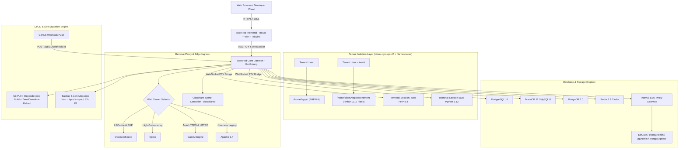

# Master Architecture & Development Plan: BarePod Panel
> **Document Version:** 0.3 (Prototype) — databases & caches module live end-to-end (SQLite file engine, Redis multi-tenant ACL, AES-256-GCM vault, live Reveal & Rotate, and Recycle Bin)
> **Last Updated:** October 11, 2026  
> **Status:** Active & Maintained

## Versioning policy

The number describes **completed milestones, not effort** — and nothing may
invent its own version.

- **0.x = prototype line.** The line is at **0.3** (the databases module) and stays
  in 0.x while the panel is a prototype (some views still mock, dry-run provisioning,
  no release artefact).
- **0.1 → 0.2 (reached):** the milestone was *"a website really runs end-to-end on
  a Linux host"*. Verified on Ubuntu 24.04 in an LXC container: unit active,
  service running as the tenant, cgroup limits applied, health check green, files
  created through the API owned by the tenant, per-site metrics from the cgroup.
- **0.2 → 0.3 (reached):** the milestone was *"databases and caches module"*. Verified
  end-to-end: SQLite file database in site directory owned by tenant, live size reporting,
  Redis ACL user per cache with key prefix and password rotation via resetpass, Recycle Bin
  with suspend & restore, AES-256-GCM password vault with elevated session, and UI Reveal /
  Rotate click-through.
- **It only moves when a milestone is finished**, e.g. `0.2` = a website really
  runs end-to-end on a Linux host; `0.3` = databases module; `1.0` = first
  release with the installer and a supported upgrade path. Commits, features in
  progress, and "looks almost done" never bump it.
- **One source of truth:** the daemon carries the version (`api.Version`,
  reported by `GET /health`) and the UI displays *that*; in simulation mode the
  UI falls back to `frontend/src/version.ts`. No component hardcodes its own
  version string (the footer previously drifted to "v0.6" — that is exactly
  what this rule prevents).

### Keeping these documents in sync

**The note is part of the change, not a follow-up.** A commit that alters
behaviour must update the documentation in the *same* commit:

| What changed | What must be updated with it |
|---|---|
| Any user-visible behaviour | §0 Frontend Changelog (a bullet, one line) |
| A module's real status | §4.1 Component Status Table (simulation / partially live / live) |
| An endpoint, payload or rule | `API_CONTRACT.md`: §4.x for the endpoint **and** §1 conventions when the shape moved |
| A module's design | the matching §3.x section |
| A milestone finishing | the version above **and** the phase checklist in §4.2 |

A claim in these documents that cannot be verified in the code is a **bug** —
fix the text or the code in the same commit. (Known drift so far: the status
table claimed metrics, files and the terminal were unbuilt after they shipped,
and the footer invented its own version. Both are why this rule exists.)

This document is the complete technical architecture blueprint, module specification, and development roadmap for **BarePod Panel**, a new-generation web hosting management, reverse proxy gateway, and hybrid container hosting platform that is secure, isolated, and easy to use.

---

## 0. Frontend Changelog (Prototype — v0.1)

Changes in Phase 1 (React UI prototype):

- **Live API wiring & session**: on load the panel asks `/api/v1/health`; if the daemon answers it shows a real sign-in screen and takes the website list + per-site metrics from the API, otherwise it falls back to the prototype's mock data (and restores it when leaving live mode).
- **Real terminal pane**: `@xterm/xterm` over the ticket-authenticated WebSocket — tenant shell per website, container session (`docker exec` style) per pod, one picker listing **Websites and Containers** together.
- **Site-type relevance**: controls a site type cannot use are hidden rather than disabled (see §3.8).
- **Historical Trends**: the charts fill the card they are given (measured width, no letterboxing) and hovering shows the timestamp as well as the value.
- **Version discipline**: one source — the daemon's version from `/health`, else `frontend/src/version.ts`; the footer no longer invents its own number.
- **Navigation rules**: menu changes start at the top of the page, the Terminal menu always starts at the session picker, the black "Terminal root" button scrolls the shell into view, and switching tabs does not move the page.
- **The address bar always matches the screen**: a path that is not a panel route (e.g. `/asdasdasd`) is corrected to the route actually shown and explained with a toast, and `/apps/<unknown>` returns to the website list instead of half-loading it. The daemon answers an unknown `/api/*` route with a JSON `404` (never the SPA), while page paths keep the SPA fallback deep links need. **Signed out, the URL is `/login`** — never a protected path — and a bare `/` is only normalized to the default page once the visitor is signed in, so a login form can no longer sit under `/apps`. The path you asked for is remembered and the sign-in screen says so ("Signing in takes you back to `/overview`"), so a deep link still lands there after signing in. Verified in a real browser: `/` and `/overview` unauthenticated → `/login`; sign in → back to `/overview`; sign out → `/login`; refresh → stays on `/login`.
- **Monitoring shows the daemon's numbers**: CPU (with real cores and load average), memory, host filesystem, disk/network rates and the trend charts come from `GET /system/metrics` + `GET /system/capabilities`; anything the daemon cannot provide is labelled instead of faked, and without a daemon the page says "Simulation (mock data)".
- **0.2 — first real deploy, plus the lifecycle around it**: on a Linux LXC the daemon runs `mode: real` and a scaffolded Flask site is genuinely live (unit active, running as the tenant, cgroup limits from the package, health check green, app answering). The three bugs only a real host could reveal are fixed — **two `ExecStart=` settings** (systemd refused the unit), **root-owned `.env`** (breaks runtime dotenv), and **presets without an entrypoint** (scaffold produced a site that could not start) — each with a regression test. Teardown and redeploy arrived: `DELETE /websites/:slug` stops the unit, removes the drop-in, deletes the app directory (guarded to stay inside the sites root) and forgets the rows, and `POST /websites/:slug/redeploy` re-runs the pipeline from the source recorded at create time while keeping the existing database and cache. The version now has one source (`api.Version`, surfaced by `/health` and the footer).
- **The daemon installs itself as a service**: `barepod service install|status|uninstall` writes `/etc/systemd/system/barepod.service` (from the same flags as `serve`), reloads systemd and enables + starts it — no more `nohup` keeping the panel alive only while an SSH session lasts. `Restart=always`, logs in `journalctl -u barepod`. The unit is deliberately unsandboxed (no `ProtectSystem`/`PrivateTmp`/`NoNewPrivileges`): the daemon is a privileged control plane that writes units, creates accounts and drops privileges per request.
- **File Manager works on real files**: the Files tab of a website is wired to `/files/*` — it lists the site directory (real sizes, `%04o` permissions, real timestamps), opens and saves text files in place, creates files/folders, renames, copies/moves/pastes, duplicates, deletes (single and batch) and uploads, and previews images/PDF/audio/video through the authenticated download URL. Directories are navigable with a clickable breadcrumb. Everything drops to the tenant account: a folder created from the panel came out `bptest:bptest` on the host, and a file saved through the editor landed as the tenant with the typed bytes. Without a daemon the tab keeps its mock tree and says **Simulation (mock data)**; with one it says **Live** and shows nothing fake.
- **A deploy used to run its own commands as root**: the pipeline created files *inside the tenant's site* as root, so a scaffolded `.venv` (and its packages) belonged to root — the site kept serving, but the tenant could not `pip install` into its own app, and a `git clone` would have been root-owned too. Fixed with `Runner.RunAs` (tenant UID/GID + HOME) for site commands and the clone, plus a `chown -R` at the end of the source step that also repairs older sites. Verified on the host: the pre-existing `root:root` `.venv` came back as `bptest:bptest` after a redeploy, a fresh scaffold left no root-owned file, and both apps stayed healthy.
- **Bug caught by that wiring — CSRF after reload**: the client only kept the CSRF token from `login()`, so a page that restored its session from `/auth/me` (i.e. any refresh, or a new tab on a live cookie) failed **every** write with `403 csrf` — saving a file, creating a folder, start/stop, terminal tickets. `/auth/me` re-issues the token; the client now stores it on every session read. The contract states the rule.
- **Activity log, real sessions, and they are wired**: `GET /audit` reads the audit log the daemon has been writing all along (`auth.*`, `terminal.*`, `files.*`, `website.*`, `group.update`, `system.capacity_exceeded`) — the caller's own entries, or every account's for an admin, with an `everything` flag saying which view was returned. **Overview** now shows Recent Activity from that log (real sign-ins with IP, deploys, terminal opens, file edits/deletes) plus an Active Sessions card; **Profile** lists the live sessions with device, IP and last-seen and can revoke them. Verified in a browser: the feed showed real entries, the session list read "Chrome · macOS — This device" and "curl", and revoking a `curl` session made its cookie fail with `401` immediately. The fake "Debian 12 · Kernel 6.1" subtitle is gone too — the line now comes from `GET /system/capabilities` ("linux · Ubuntu 24.04.5 LTS · kernel 7.0.14-20-pve · LXC container" on the test host). Downloads were not audited at all; `files.download` now records the path and the bytes.
- **Isolation boundary is the tenant — and a site shell is now confined inside it too**: sites of one tenant share a Linux UID, so the kernel refuses another tenant outright, while (before this change) a shell opened for one site could still read, write and delete inside that *same* account's other sites and its home. That gap is closed: the shell is opened inside its own mount namespace with the tenant's other paths masked. Rule that still stands: **two customers' sites must be two tenants** (the panel models a customer as one account, like cPanel does).
- **A website's terminal is jailed into the website**: `barepod pty-exec` (started by the daemon with `CLONE_NEWNS`, so nothing can leak to the host) builds a minimal root inside that namespace — the system a shell needs (`bin`, `usr`, `lib*`, `etc`, `var`, `srv`, `opt`) bound **read-only**, a private `/tmp`, `/proc` and the host's `/dev` — and puts the website at its usual path inside it, then `chroot`s and drops to the tenant. The result answers the question "where can this shell go?": `cd /` shows a system skeleton, `cd /home` shows only the account, `cd ..` from the site stays inside the jail, `/root` and `/var/www` **do not exist**, a sibling site is **not a name** (`ls ../web-flask` → *No such file or directory*), `/etc` answers *Read-only file system*, and the project path (`/home/<tenant>/apps/<site>`) — plus the prompt and `~` — stay exactly what they are outside. Writing works in the website (and in the jail's own `/tmp`, which tools need). Getting here took three corrections, each caught by the operator using it: masking hid a neighbour's contents but not its name; binding the site over the home hid the names but made the prompt read like a user home; and making the home read-only still allowed `cd /home/<tenant> && mkdir test`. Two permission bugs were found while building the jail (its `/home` and the site's parents were root-owned 0750, so the `chdir` after dropping privileges failed). On a host that cannot build the namespace the shell opens unconfined and says so in the session, in `/system/capabilities` (`ptyJail: false`) and in `limitations[]`; where a jail cannot be built but masking can, that is used instead. Bash also gets a tiny rc file (in the jail's private `/tmp`, so the project is untouched) that wraps `cd` and re-checks the prompt: leaving the website prints *"this shell lives in … — everything else is read-only"* and puts you back, while `cd sub` inside it works normally. Only the website itself is writable inside the jail: the directories above it stay root-owned `0755`, so `mkdir` out there fails even if the guard is bypassed. (Building this cost a real mistake worth remembering: `chown` on the *mount point* of the website reached through the bind and changed the real directory's owner on the host, which broke writing inside the site — the mount point is now left alone, and the host's ownership was repaired.) The guard is shell-level on purpose — a program the tenant runs can still *read* the system skeleton, but nothing outside the site is writable and the other sites do not exist. The session reports which shape it got: the UI says *"jailed: this shell only contains the website"* and `terminal.open` is audited with `jailed=true mode=root`. Verified on the LXC: `pwd` → `/home/bptest/apps/own-check`, `mkdir /home/bptest/coba` → **Read-only file system**, `touch /etc/coba` → Read-only file system, `mkdir` in the site → succeeded, python3 → 3.12.3, the host's directory intact and `mount | grep -c ' /home/'` → **0**.
- **A host-wide file browser that cannot brick the machine**: `GET|POST|PUT /api/v1/files…?scope=host` lets an admin *read* anywhere on the server and change only user data; `?scope=tenant&tenant=<name>` opens that account's home, which is where the junk an admin could not see before actually lives. The rule is enforced in the daemon, not the UI: `files.Policy` marks `/bin`, `/sbin`, `/lib*`, `/boot`, `/etc`, `/usr`, `/proc`, `/sys`, `/dev`, `/run`, `/var/lib`, `/var/cache`, `/var/spool`, `/var/log`, `/lost+found` (plus `/etc/barepod`, `/var/lib/barepod`) as read-only, so `POST /files/delete`, `PUT /files/content`, `mkdir`, `rename`, `move` and `upload` into them answer **`403 system_path_protected`** while `/home`, `/var/www`, `/tmp`, `/srv`, `/opt` and `/root` stay writable. Both the literal path and its symlink-resolved form are tested on both sides, so `/etc` is protected even where it is a link (macOS `/private/etc`) and a symlink planted in a writable directory cannot be used to reach into the system. Reads of protected paths are audited as `files.read_system`, blocked attempts as `files.blocked`, and listings mark each entry `protected` so the UI can lock it. Verified on the LXC: listing `/etc` showed 173/173 entries protected, writing `/etc/hosts` and deleting `/usr/bin` were refused (and `/etc/hosts` was untouched afterwards), reading `/etc/passwd` worked with `writable: false`, `/tmp` stayed writable, and the tenant scope listed `/home/bptest` including the stray `usil-test` directory. The UI scope selector is the next piece.
- **The host browser has a face**: an admin-only **Host Files** menu (`/files`) with a scope selector — *Host root* (`/`) or *Tenant home* (`/home/<tenant>` with an account picker from the new `GET /tenants`) — built on the same file manager, so browsing, the editor, uploads and downloads all work there. What the daemon enforces is visible: protected entries carry a **Protected** badge, the toolbar's New File / New Folder / Upload are disabled inside a system tree, a protected file opens with *"This is a system file: it is shown read-only, and saving is disabled"* and a dead Save button, and the per-directory rule means `/tmp`, `/home` and `/var/www` stay writable while `/etc` does not. Non-admins see an "Administrators only" panel and no menu entry. Verified in a browser against the LXC: `/etc` listed 173/173 protected, entering it disabled the toolbar, `/etc/passwd` opened read-only, the tenant scope listed `/home/bptest` including the stray `usil-test`, and the website file manager still worked afterwards.
- **Databases & caches are real** (module 0.3): one ledger serves both families (`/databases` and `/caches`), with the credential in the AES-256-GCM vault and revealed only after a fresh panel-password check. `GET /db-engines` reports what the host can actually run — detected per engine, probed with a 3-second timeout, and honest when something is missing. Create, list, patch limits, rotate (random or custom, min 12), reveal, connection string, bin, restore, purge and empty-the-bin are all implemented, and the recycle bin is a soft delete with teeth: nothing is dropped, the record keeps its credential, a SQLite file moves into the site's `.trash`, and `purge` is the only destructive step. Verified on the LXC: SQLite created inside the site **owned by the tenant** (48-char password shown once), reveal refused with `403 elevation_required` until `/auth/verify`, rotate took effect, `DELETE` moved the file to `.trash` and suspended the record (bin count 1, live count 0), restore put it back, purge left nothing, and creating a PostgreSQL database without `psql` on the host came back `status: pending` with a note naming the missing client instead of failing silently. Every step is audited (`database.create|rotate_password|reveal|connection_string|bin|restore|purge`).
- **The databases screen is wired to the daemon**: `/databases` now lists what the daemon has (databases, caches and the recycle bin, with tab counts), the create modal takes its engine list and versions from `GET /db-engines` so an engine this host does not have is **locked with the reason** ("not installed"), and the Recycle Bin button, Restore and Delete-permanently call the API. Verified in a browser against the LXC: the list showed the real `Reports DB` record, creating a SQLite database from the UI answered `201` and put `bptest_ui_shop_db.sqlite` inside `web-flask2` (owned by the tenant), the delete flow (typed confirmation, which is the window's own guardrail) suspended the record and moved the file into the site's `.trash` while the bin counted it, and Restore brought both back (`ready`, file in place, `.trash` empty). **Reveal & Rotate click-through in the UI is complete**: `CredentialRevealModal` unlocks and displays decrypted credentials with 60s auto-lock, `DatabaseDetailsModal` unlocks the real credential for connection URLs and `.env` snippets via `POST /auth/verify` + `reveal`, and `RotatePasswordModal` rotates secrets (random or custom min. 12) with busy states and confirmation.
- **Redis caches are managed through ACL users**: a cache gets its own Redis user, restricted to its own key prefix (`~<name>:*`), with `ACL SETUSER … reset on >password … +@all`; suspend turns the user **off**, restore turns it back **on**, rotation uses `resetpass` so the old secret stops working, and purge removes the user while **leaving the keys** (emptying a cache is not a decision the panel makes for you — the API says so). The admin connection comes from `BAREPOD_REDIS_URL` (default `redis://127.0.0.1:6379`). Verified on the LXC after installing `redis-server`: the cache user logged in (`PONG`), a key outside its prefix was refused with **NOPERM**, a key inside it succeeded, suspend produced `off` and the login was refused, restore brought it back, rotation made the old password fail and the new one work, and purge removed the user. Two bugs were found by that run: the create path and then every lifecycle path (suspend/restore/rotate/purge) asked the **catalog** whether the engine was installed instead of asking the host, so Redis work was silently recorded as `pending`; and rotation added a password instead of replacing it — both fixed, with tests.
- **Database management lives in the panel's own paths, not on a port**: `GET /databases/:id/tables` and `POST /databases/:id/query` are served by the daemon itself, so a browser reaches them through the same origin, session, capability check and audit as everything else — no pgAdmin/phpMyAdmin process, no extra port to expose (and therefore nothing new to reach from outside). For SQLite the daemon reads the file with the driver it already links, so **no client needs to be installed**: create/insert/select round-trip through the API, `NULL` is rendered explicitly, results are capped at 500 rows with a `truncated` flag, and a Redis cache answers with a sample of its own keys. A daemon engine answered `501 not_implemented` at that point on purpose (handing a root-run client raw SQL is worth doing slowly) — that placeholder was replaced by the driver work in the next entry, so PostgreSQL and MySQL are served too, always as the database's own user. Each run is audited (`database.query`) with the row count, **not** the statement text, which can carry values. Verified on the LXC: `CREATE TABLE`/`INSERT`/`SELECT` over the panel's path returned the rows (`1 2 3`, `budi vip`, `siti NULL`), `tables` listed `['tamu']` with `browser: daemon`, a daemon engine still answered the honest `501` at that time, and the audit showed three `database.query` entries with only counts.
- **The browser talks to the engines with pure-Go drivers** (`pgx` for PostgreSQL, `go-sql-driver/mysql`, the SQLite driver already linked, `go-redis` for caches): no `psql`/`mysql`/`redis-cli` has to exist on the host for browsing or querying, there is no text output to parse back (a value arrives as the type it is, `NULL` stays `NULL` instead of being guessed from `\N` or an empty field), and an engine refusal comes back with its own code (`ERROR: permission denied to create database (SQLSTATE 42501)`) rather than dressed up as a one-column grid. The connection is always **as that database's own user**, so the panel can do no more than that account could. The superseded shell-out path (`QueryCommand`, `ParseQueryOutput` and their tests) was **deleted rather than left dead** — the suite went from 160 to 156 tests because four tested code that no longer exists. Verified on the LXC: `CREATE TABLE` / `INSERT` (2 rows) / `SELECT` returned `[['1','kopi','25000'],['2','teh','NULL']]` with `NULL` intact, `tables` answered `browser: daemon-driver` with `['barang']`, the privilege boundary answered the engine's own error, and the audit recorded *"postgresql via driver, 2 row(s)"*. **Caches too:** keys are listed with the pure-Go client (no `redis-cli`, no redis-commander) and `GET /caches/:id/key?key=` inspects one key (type, TTL, and the value for strings, lists, sets, hashes and sorted sets, capped). A key **outside the cache's prefix** answers `404` exactly like a missing key — the first version leaked the ACL refusal as a `502`, which was wrong. The clients are still needed for one thing only: the *administrator* steps of a host install (creating roles and databases over the socket), which is why `db-engines` keeps reporting them.
- **The third-party manager supervisor exists and is tested — the proxy is the next slice (not live yet)**: `internal/dbtools` holds one `Spec` per tool (binary, loopback port, health path, which engines it can open) and a `Supervisor` that starts a tool on demand **single-flight** (two requests cannot race into two processes), keeps it alive on a **sliding** 60-minute idle window, stops it with `pkill` — only ever a process **the panel itself started**, so it cannot kill something else — and `Reconcile()` clears leftovers after a daemon restart, because nothing knows how long those have been idle. `Sweep()` returns the names it stopped so the caller can audit why. The tests drive a fake clock and a fake runner whose port is genuinely down until something listens (the dry-runner cannot be used here: it reports *every* command as successful, so all ports would look up and the test would assert nothing). `scripts/install-engines.sh` now also installs **pgweb** (pinned version, one binary, no runtime) so a fresh host already has it. **What is not done, and is not claimed:** the reverse proxy that serves a tool under `/api/v1/databases/:id/gui/<tool>/…`, its wiring into the gate and the UI button, and the sweeper registration — until those land, the tool is installed and the supervisor is ready, but **`gui` still answers `501` for it**.
- **A database manager can only be opened through the panel session**: `GET /databases/:id/gui` lists the tools (the built-in `browser` today; `adminer`, `phpmyadmin`, `pgadmin`, `mongo-express`, `redis-command` marked unavailable) and `GET /databases/:id/gui/<tool>` opens one. Without a panel session every one of those answers **`401 Sign in required`** — an unauthenticated browser gets the sign-in screen, never a database tool — and with a session the attempt is audited as `database.gui_open`. The third-party tools are not installed yet and answer `501` that states the rule: when they are hosted, they run **behind this same path**, loopback only, credentials injected server-side and closed when idle — **never on a port of their own**. Verified on the LXC: both GUI paths returned 401 from a client with no cookie, the tool list reported `browser: true` and the rest `false`, `browser` answered 200, `phpmyadmin` answered 501 with the rule in the message, and the audit held `database.gui_open`.
- **Decided shape for third-party managers (not built yet)**: after weighing them, pgAdmin is dropped (a Python service, hundreds of megabytes) along with phpMyAdmin/Adminer, and the plan is **pgweb** (single Go binary) for PostgreSQL plus **DbGate** (one web container) covering PostgreSQL, MySQL/MariaDB, SQLite, MongoDB and Redis — plus our own tab with no process at all (SQLite, SQL and the Redis key inspector). Each would be started **on first access, stopped when idle** using the same single-flight supervisor as the engine containers, reachable only behind the gated path, with credentials injected server-side and scoped to one database, and **never on a port of its own**. `redis-commander` is not needed: the cache browser is ours. Idle means idle — the timer slides forward on every request, so a session in use is never killed; the sweeper stops a tool after 60 minutes without a request, audits why, and reconciles on daemon start so nothing is left running.
- **Engines are detected beyond `PATH`, and databases the application created are found**: the client check now falls back to the places distributions hide binaries (`/usr/lib/postgresql/*/bin`, `/usr/pgsql-*/bin`, `/snap/bin`, brew prefixes, `/opt/...`), so a host that has PostgreSQL is not reported as "not installed" because the daemon's PATH is plain — `db-engines` also returns the resolved `clientPath` (on the test LXC, `redis` reports `/usr/bin/redis-cli` while `psql`/`mysql`/`mongosh` are genuinely absent, which is the honest answer). And the Databases page no longer pretends a page is empty when the *application* owns the data: SQLite files inside a website (`.sqlite`, `.sqlite3`, `.db`, up to depth 3, skipping `node_modules`, `vendor`, `.venv`, `.git`, `.trash`, caches and build output) are listed with `detected: true` and can be browsed and queried straight away, because the data browser already reads a SQLite file in-process. Files the ledger already manages are excluded (the first version listed a panel-created database twice). The panel refuses to delete one: `DELETE` answers **`409 app_managed`** — the File Manager is the honest way to remove a file the application owns. Verified on the LXC: a file copied into `own-check/database/database.sqlite` appeared as `detected`, its tables listed as `['tamu']`, a query returned rows, `DELETE` answered 409 with that reason, and a bogus id answered 404. The detected id is a single base64url path segment, so it survives routing (a slash in it was read as another path segment and returned "API route not found") and the site layout stays out of URLs and logs. **Wired in the UI**: detected databases display a `Detected (app-managed)` badge, show the relative site path, and their Drop button is hidden (protecting application files from accidental deletion while keeping the Data Browser & SQL tools fully usable).
- **The simulated manager modal is gone**: clicking pgAdmin/phpMyAdmin/Adminer/mongo-express/redis-command no longer opens a prototype that *pretends* to be that screen — those buttons now call the real gate (`GET /databases/:id/gui/:tool`) and show its answer. Verified in the browser: pgAdmin answers *"Not hosted yet — pgadmin is not hosted by this daemon yet. When it is, it will run behind this same path — loopback only, credentials injected server-side, closed when idle — and never on a port of its own."*, the panel's own `browser` points at the Data Browser & SQL tab, and the built bundle contains no trace of the old `dbgate`/`sso_token` placeholder (0 matches). The tool list was also renamed to what the daemon hosts (dbgate → Adminer).
- **An install leaves the engines ready, not "not installed"**: `scripts/install-engines.sh` (called by `scripts/install.sh`, skippable with `--no-engines`) installs PostgreSQL, MariaDB and Redis with their clients, enables and starts them, and then **waits until each one answers** — package unpacked is not the same as ready, and the panel reports what it can really use. It also creates the PostgreSQL `root` role so the daemon can administer it over the socket (peer authentication, no password). MongoDB is offered behind an explicit `--with-mongodb` because it needs a third-party repository, and it says so. Verified on the LXC: the script reported `PostgreSQL: ready`, `MariaDB: ready`, `Redis: ready`, and afterwards `GET /db-engines` answered `available + running` for sqlite, postgresql, mysql, mariadb and redis (mongodb honestly still absent). A MariaDB database then went through the whole loop from the panel: create → `ready`, `CREATE TABLE`/`INSERT`/`SELECT` as that database's own user → `[['1','budi'],['2','siti']]`, purge → the schema gone. One flaw this exposed and fixed: the MySQL/MariaDB probe asked over TCP as root, so a server that was plainly up reported `running: false` — it now asks over the unix socket, which is where a fresh install's `unix_socket` authentication lives.
- **Engines can run as containers, and the panel says which mode it used**: `internal/dbengine/docker.go` carries a recipe per engine (PostgreSQL 16-alpine on `127.0.0.1:5433`, MySQL 8.0 on 3307, Mongo 7.0 on 27018, Redis 7-alpine on 6380), each bound to **loopback only**, with a named volume, `--restart unless-stopped`, and the admin credential passed through a **0600 `--env-file`** — `docker run -e POSTGRES_PASSWORD=…` would put it in the process list, which is exactly what we avoided for host engines. One container per *engine* (not per database) keeps it cheap while still removing the host's packaging differences: the panel sets the admin password itself, so administration is always TCP + password — no peer auth on a socket, no `unix_socket`, no `root` role to create by hand, i.e. the whole class of bugs this module already hit. **Correction to an earlier claim of mine:** suspend must stay **per database** (the engine's own user is locked/revoked, exactly as in host mode) — it must *not* stop the container, because that would take every other tenant's database on that engine down with it. Stopping and removing a container is an **engine-level** action (nothing else using it), and removing its volume is the only truly destructive step. `GET /db-engines` now reports `mode` per engine — `docker`, `host` or `none` — so the panel never leaves that implicit. **The container path is verified live too, after I was wrong about the host:** I had written that an unprivileged LXC could not run Docker, and the operator said it should — it does. `docker.io` installs, the daemon runs with `iptables: false`, `bridge: none` and overlayfs (no iptables or bridge is needed), and a container on `--network host` lands directly on the host's loopback. That is why the recipe **uses the host network instead of publishing a port**: `-p 127.0.0.1:5433:5432` needs the bridge and iptables, which this target does not have, so each engine is told to listen on its own port instead (PostgreSQL `-c port=5433`, MySQL `--port 3307`, Mongo `--port 27018`, Redis `--port 6380`). Verified by running the exact argv the panel builds: the Redis container came up, answered `NOAUTH Authentication required` without the admin password and `PONG` with it, and an `ACL SETUSER` executed inside it produced a per-cache user that authenticated — i.e. the whole tenancy model works inside a container as well. Host-and-container modes both stand: the host path is what this LXC uses for the engines it already has (sqlite/postgresql/mysql/mariadb/redis `mode: host`), and the container path is proven to work here rather than assumed. *(Superseded by the next entry, which describes the orchestrator that now drives those containers on demand.)*
- **The panel now drives those containers on demand**: `POST /databases` for an engine whose mode is `docker` brings its container up first — `engineOrchestrator` is **single-flight per engine** (two requests arriving together cannot race into two `docker run`s with the same name), it distinguishes *absent* from *exists but stopped* (`docker inspect` → `run` vs `start`, never a second `run` over a taken name), waits until the engine **inside** the container answers (30 s), and on failure reports the reason with the tail of `docker logs` (truncated, because that log is enormous). The administrator credential is generated once, stored **encrypted** in the new `engine_credentials` table (AES-256-GCM, `cipher:105B` in the verification below, never plaintext), and administration then goes over **loopback + that credential** — `dbengine` picks the world its plan is written for from `Resource.Mode`: a host install keeps the socket/peer path as `postgres`, a container is TCP as `barepod_admin`, with the password in the environment and never in the argument list. Verified on the LXC from a clean slate: with no container present, creating a MongoDB database brought `barepod-mongo` up automatically (`Up 5 seconds`), the health probe answered `1`, and the admin credential appeared in the vault; the record itself stayed **`pending` with the honest note** *"Provisioning MongoDB is not automated yet"* — the container is running, creating users inside it is still manual, and the panel says so rather than claiming otherwise. One bug this run exposed and fixed: the health probe asked each engine's **default** port while the container was told to listen on a custom one, so a healthy MongoDB on 27018 was reported as never coming up. **Still open, in order:** a create that has to start a container is synchronous (up to ~50 s worst case — it belongs in the background like deployments, 202 + status); admin SQL for a containerised PostgreSQL/MySQL still needs the client on the host, and running it with `docker exec -u postgres` inside the container would remove that dependency; and MongoDB/Redis provisioning inside their containers is not automated yet.
- **A scoped SQL runner for daemon engines** (`internal/dbengine/query.go`): a statement for PostgreSQL runs as `psql -X -q --csv --no-psqlrc -U <the database's own user> -d <its database>` and for MySQL/MariaDB as `mariadb --no-defaults --batch --raw`, with the **password in the environment**, never in the argument list — the daemon runs as root, so the client is also told to ignore `/root/.psqlrc` and `/root/.my.cnf` (`Runner` gained `RunEnv` for exactly this, and a dry-run records `PGPASSWORD=***`, never a value). Results are parsed as machines formats, not pretty tables: `--csv` for PostgreSQL (so commas, quotes and newlines inside values survive) and `--batch` for MySQL (with `\N` kept distinct from an empty string), capped at 500 rows with `truncated`. The runner **refuses honestly** instead of guessing: a suspended database answers `409 suspended` (that is what suspending is for), one that was never created answers `409 not_ready` with the reason, a missing client answers `409 not_available`, and dry-run says so. Verified on the LXC: the panel found the freshly installed PostgreSQL (`available`, `running`, `clientPath /usr/bin/psql` — the PATH fallback working), a statement against the not-yet-created database answered `409 not_ready` naming `psql`, and the tests cover the argv being free of the password, the flags, CSV/TSV parsing with a newline, a comma, a tab, a quoted quote and `NULL`, and the row cap.
- **PostgreSQL provisioning runs over unix socket as OS user `postgres`**: Admin lifecycle commands (`CREATE ROLE`, `CREATE DATABASE`, `ALTER ROLE`, `DROP DATABASE`, etc.) previously connected over TCP as root with no password (`psql -h 127.0.0.1`), which standard PostgreSQL refuses (`fe_sendauth: no password supplied`) because default authentication is `peer` over the local unix domain socket. `dbengine.Plan` now specifies `RunAs: "postgres"`, omits `-h 127.0.0.1` so `psql` uses the local unix domain socket, and `runDatabasePlan` delegates execution to `Host.RunAs(ctx, "postgres", argv)`. MySQL/MariaDB admin plans similarly drop `-h 127.0.0.1` and pass `--no-defaults` to respect unix socket auth and ignore root configuration.
- **The whole PostgreSQL lifecycle was walked on a real host, and it found one flaw**: create → `ready` (user `admin_pg_cek`), then `CREATE TABLE`/`INSERT`/`SELECT` executed **as that database's own user** → `[['1','budi'],['2','siti']]`, `CREATE DATABASE` → the engine refused and the panel answered `502 ERROR: permission denied to create database` (the boundary doing its job: the runner can do no more than that user), rotate → the new credential applied and queries kept working, bin → `409 suspended` **while the database still existed in PostgreSQL** (data retained), restore → queries worked again with the data intact, purge → both the database and its role were gone (`0`/`0`). The flaw: an engine error used to come back as a one-column grid whose value was `ERROR: …` (the client writes errors to stdout and the CSV parser took the line for a header), so a refusal looked like data — a non-zero exit is now reported as an error first, with any credential redacted.
- **In-modal Data Browser & SQL editor wired to panel paths**: the database details modal now has a dedicated "Data Browser & SQL" tab alongside "Connection & Credentials". For SQLite, it lists tables as clickable pills, provides SQL presets (SELECT sample, COUNT, CREATE TABLE template), executes statements on Ctrl/Cmd+Enter via the daemon driver, and renders formatted result grids (with explicit NULL markers, affected rows, and 500-row truncation badges). For Redis, it displays the key count and sample keys scoped to the user's prefix (`~<name>:*`). All queries stay strictly on the panel's authenticated same-origin paths without exposing external ports.
- **A file-based database now reports its size**: SQLite rows are measured with a `stat` (the list shows real bytes instead of a dash), while a daemon engine keeps reporting that the size is unknown rather than inventing one.
- **Bug caught by using it — mount propagation**: `CLONE_NEWNS` alone does *not* contain mounts: the new namespace inherits the parent's **shared** propagation, so the masks a jailed shell mounts were published back into the container's namespace. One session left **12 298 mounts** stacked in `/home/bptest`, which hid the tenant's real directories (`.bashrc` read as 0 bytes, `.cache` and a sibling site's directory appeared empty) for every process — a near miss that could have looked like data loss. The helper now makes its namespace private (`mount --make-rprivate /`) *before* masking, refuses to mask when it is not in a private namespace, and the daemon passes its own namespace inode so a helper that finds itself in the daemon's namespace refuses too. Verified after the fix: a real session from the UI still reports "confined to this site (7 paths hidden)", the neighbour is refused, and `mount | grep -c ' /home/'` stays **0**.
- **Bug caught by looking at the menu**: the admin-only **Host Files** entry never appeared, because the `isAdmin` prop was missing from the `<Sidebar />` call — the route worked and only the menu item was invisible, which is exactly what a URL-driven check misses. Fixed (found by the operator, not by me: my edit had silently not applied).
- **Bug caught by using it — a stale build looked like a missing feature**: the "Host Files" menu was fixed in the repository but the deployed bundle had never been rebuilt, so the panel kept serving the old app and the menu stayed invisible; and because `index.html` was served without cache headers, a browser could hold on to an old bundle even after a deploy. The static handler now sends `Cache-Control: no-cache, must-revalidate` for the SPA shell (and any deep link that falls back to it) and `public, max-age=31536000, immutable` for the fingerprinted files under `/assets/`, which is what a hashed build is for. Verified in a browser: an admin sees **Host Files** between the terminal and the API menus, a tenant sees neither the menu nor the page ("Administrators only"), and the shell/asset headers are exactly as above.
- **A database manager is served from the panel's own path — pgweb is live for PostgreSQL**: `GET /api/v1/databases/:id/gui/pgweb/…` starts pgweb on first access, injects *that* database's credential into `--url` server-side, rewrites a root-absolute `Location`/asset path onto the mount, requires the panel session (401 without it, opening audited as `database.gui_open`) and stops it when idle. Verified on the LXC: `401` with no session, the page and every asset `200` under `/api/v1/databases/<id>/gui/pgweb/…`, a query through the proxy returned `select 42 → [[42]]`, pgweb listened on `127.0.0.1:8790` only (`ss`), and a cold open took 0.46 s with assets at 1–5 ms.
- **Three defects only a real pgweb could expose** (its command line had only ever been asserted against a fake runner): `--listen` takes a **port** and `--bind` the host (the old `--listen 127.0.0.1:8790` was refused outright); the `--prefix` must have **no leading slash** (pgweb prepends `/` itself, so a leading one made every request 404 — which is why the proxy rewrites a root-absolute `Location` instead of trusting it); and `Ensure` started the tool with the host runner, which **waits** for the command to finish — a server that runs forever blocked the request, so it is now started detached (`setsid`) with the credential passed positionally, so no shell metacharacter can change the command. `--lock-session` keeps pgweb scoped to the one injected database.
- **The manager's path is anti-CSRF without a header it cannot send**: pgweb's own client cannot carry our `X-CSRF-Token`, so the page load issues a path-scoped `HttpOnly; SameSite=Strict` cookie and every request under the mount must present it. A cross-site request still carries the session cookie (Lax, top-level navigation) but not this one, and a `POST …/gui/pgweb/api/query` without it answers `403 csrf` — verified on the host.
- **The sweeper and Reconcile run**: a `pgweb` left behind by a dead daemon is cleared at start (Reconcile), and one idle past the window is stopped and audited as `database.gui_idle`. Both were seen on the LXC (`stopped pgweb after 20s idle` with `-dbtools-idle 20s`); the window defaults to **60 minutes** and slides on every request.
- **What each engine's manager button really does**: the gate lists `browser` (the panel's own table browser and cache-key inspector — available for SQLite, MySQL/MariaDB, MongoDB and Redis), `pgweb` (PostgreSQL — offered only when the binary is on the host *and* the daemon is real), and `dbgate` (decided, not hosted). phpMyAdmin/pgAdmin/Adminer were dropped on purpose, so a non-PostgreSQL database opens the panel's own **Data Browser & SQL** tab and the third-party button answers `501` with the reason. MySQL and MariaDB examples were created on the LXC and came back `ready` with that honest refusal; MongoDB has a container on the host (`barepod-mongo`) but provisioning is still manual, so it is recorded `pending` and says so.
- **Bug caught by the operator — the Add Database modal folded MySQL and MariaDB together**: `mariadb` is a first-class engine everywhere else (the deploy wizard offers it, the list badges it, the detector has its own row), so the modal now offers **MySQL** and **MariaDB** as separate choices (a host missing one blocks only that one). Also fixed: the manager's `path` at the gate used the ledger's internal kind (`database`) instead of the route's collection segment (`databases`), which would have opened a 404.
- **Bug caught by the operator — the installer never landed pgweb**: the binary inside the release zip is named `pgweb_linux_<arch>`, not `pgweb`, so `install-engines.sh` silently reported "could not be installed"; it now finds the extracted binary.
- **The manager proxy does not re-detect engines per request**: the first version asked `db-engines` (which spawns `docker info` and a probe per engine) on *every* asset request, which is what made the page crawl through a tunnel; the engine is now brought up once per open and the rest slide the idle window in memory (a warm asset answers in ~1–5 ms).
- **A manager is not started for a database that does not exist**: a record created while its engine client was missing (`status: pending`), one that failed, or one in the recycle bin has no server to open, so the panel answers **`409 not_ready` at once with the record's own note**. The first version started pgweb anyway, which died on a database that was never created and left the browser spinning through the 20-second startup wait — caught by the operator opening the real `Reports DB` (created before `psql` existed on the host) and fixed (`502 (20.1s)` → `409 (2ms)` on the LXC). A start that fails anyway now reports **the tool's own output** (captured beside the panel database) instead of a bare timeout. The gate said "not hosted here yet" for the same case, which blamed the tool — it now answers the same `not_ready`.
- **phpMyAdmin is hosted for MySQL/MariaDB — the light way**: a PHP app, run by **PHP's own built-in server** (`php -S`, one process; no Apache, no PHP-FPM) behind the same gated path. The panel writes a per-database `config.inc.php` (root 0600) with `auth_type = 'config'` and `only_db`, so it opens exactly that database **with no login**, plus `PmaAbsoluteUri` pointing at the mount; the proxy strips the mount so phpMyAdmin sees its own root while its (relative) URLs stay inside the panel's. Same rules as pgweb: session-gated (401), a path-scoped `SameSite=Strict` cookie for the subtree, loopback only, `database.gui_open` audited, stopped when idle. `install-engines.sh` installs `php-cli` + extensions and unpacks a pinned phpMyAdmin tarball. Verified on the LXC: the page and its assets `200` under the mount (`theme.css` 357 kB in 2 ms), the scoped database visible with no login, `127.0.0.1:8791` only, and a `POST` without the tool's cookie `403`.
- **Bug caught while building it — two PHP managers would stop each other**: both would run as the `php` binary, so `pkill -x php` from one would kill the other. A `Spec.Match` lets a tool be stopped by its own command line (`pkill -f "php -S 127.0.0.1:8791"`) while pgweb keeps its exact-name stop.
- **Bug caught by the operator — the Data Browser & SQL tab was SQLite-only in the UI**: the daemon has reached every engine with a **pure-Go driver** since the query work, and `tables`/`query` answer for PostgreSQL/MySQL/MariaDB too (`browser: daemon-driver`), but the modal only drew the table pills and the SQL editor for SQLite and showed a "use a Web GUI manager" placeholder for everything else — so MySQL/MariaDB looked unbrowsable although the API worked. The tab now renders for every engine with a driver (SQLite in-process, the daemon engines over their driver), with an engine-appropriate `CREATE TABLE` template, and keeps the placeholder only for MongoDB (no driver yet). Verified on the LXC against `mariadb-example`: `CREATE TABLE` → `INSERT` (2 rows affected) → `SELECT` returned `[["1","budi"],["2","siti"]]` and `tables` listed `["notes"]`, each audited as `database.query` with the row count and never the SQL. (One statement per execution — the engine refuses a multi-statement batch, and the panel passes its refusal through.) **Reversed a little later by decision — see the next entry — for PostgreSQL/MySQL/MariaDB.**
- **The Data Browser & SQL tab is gone for the engines that have a manager (a decision, not a bug)**: pgweb and phpMyAdmin are the familiar path and a generic SQL box is not, so PostgreSQL and MySQL/MariaDB now open them and nothing else — the tab is hidden for those engines. It stays only where there is no manager: **SQLite**, as a friendly grid (click a table and its rows appear; the SQL box is hidden behind a "Show SQL" toggle), **Redis**, as the key inspector that replaced redis-commander, and a MongoDB note. The daemon still serves `tables`/`query` for every engine the drivers reach — this is a choice about what to put in front of a person, not about what the API can do.
- **The panel is served over HTTPS (self-signed) and listens where you point it**: the daemon now defaults to `:8443` over **HTTPS**, generating a **self-signed certificate** beside the panel database on first start (10 years, SAN covering `localhost`, the hostname and every non-loopback address) unless `-tls-cert`/`-tls-key` name a real one — a self-signed certificate is a warning the browser tells the truth about, not a claim to be verified. The session cookie is now **`Secure`** whenever the request is HTTPS. A **panel-only** plain-HTTP address (`-http-listen`) can redirect to HTTPS, but it is **empty by default so port 80 stays free for websites** — websites choose their own scheme, the redirect is the panel's own convenience. Verified on the LXC: `https://0.0.0.0:8443` answers, plain HTTP on that port is refused, the generated certificate carries `172.19.1.26`, and the login cookie came back `Secure`.
- **A bare visit to the server answers instead of "connection refused"**: since the web-server module does not own 80/443 yet, the daemon serves a small **default page** on `:80` and `:443` (the latter over the panel's self-signed certificate) saying *"this server is running, but no website is configured for this address"* and where the panel is — with a plain-HTTP request on 443 redirected to HTTPS, exactly like the panel port. The web-server module will take these ports over and serve a default vhost of its own. Verified on the LXC: `http://127.0.0.1/` and `https://127.0.0.1/` both answered the page, `http://…:443` answered `308 → https://…/`, and the panel still answered on 8443. (That first page became a **general status page** — it now returns the code that matches what it is saying; see the status-page entry below.)
- **DbGate is hosted for every engine — automatically, like the others**: the panel runs `dbgate/dbgate` as a container on first access (`docker run -d -p 127.0.0.1:8793:3000`, loopback only), writes a per-database env file that preconfigures **one** connection and scopes the container to that database (`CONNECTIONS` / `ENGINE_bpod` / `SINGLE_CONNECTION` / `SINGLE_DATABASE` / `FILE_bpod`), turns its own login off (`SKIP_ALL_AUTH=1` — the panel session is the door) and serves it under the panel's mount (`WEB_ROOT`). A SQLite file's directory is mounted and the container runs **as the tenant** (`--user uid:gid`), so nothing it writes is root-owned. It is **removed** when idle (`docker rm -f`, not a signal) and cleared at daemon start, exactly like the other tools. Verified on the LXC: opening a Redis cache and a SQLite database both answered `200` with `<title>DbGate</title>`, the container ran with `127.0.0.1:8793->3000/tcp` and the scoped env, the SQLite mount was `/home/bptest/apps/web-flask2:/dbgate-sqlite` with `--user 1000:1000`, and a daemon restart removed the leftover container. It opens the daemon engines too — MariaDB and PostgreSQL both answered `200`, each with its scoped env (`ENGINE_bpod=mariadb@dbgate-plugin-mysql` / `postgres@dbgate-plugin-postgres`, `SERVER_bpod=127.0.0.1`, `DATABASE_bpod=…`) — so it is a click-and-browse manager for **every** engine here, alongside pgweb and phpMyAdmin.
- **The sign-in screen stops offering what a live panel does not need**: the "No account yet? `barepod admin create`" hint and the "Continue in simulation mode" escape are shown only when the daemon is **unreachable** — a live panel already has an account (it refuses to start without one), so both were misleading in front of a working install.
- **MongoDB is provisioned now, not "pending"**: the panel administers a containerised MongoDB **through its own driver** — no `mongosh` on the host, no password in an argument list. A create makes the database's user with `readWrite` on its own database; rotate replaces its password; the recycle bin **drops the user** (MongoDB has no disabled account — a user with no roles still authenticates, so the honest "refuse connections" is to remove it) and restore **recreates it from the vaulted credential**; purge drops the user and the database. Verified on the LXC against the `barepod-mongo` container: the created user connects and writes a document, the old password stops after a rotate, the user is refused after a bin and works again after a restore, and a bogus credential is refused after a purge.
- **The two things that only pretended to work are real now**: the "Export .sql" button used to write a hand-made stub (`-- BarePod Database Logical Dump …`) with no schema or data, with nothing behind it; there is now `GET /databases/:id/export`, which runs the engine's own dumper (`pg_dump` / `mysqldump`, credential in the **environment**, never argv) as that database's user, or copies the `.sqlite` file — returned as an attachment and audited as `database.export`. And `maxConnections` used to be stored and never applied: a create now applies the limit it is given and `PATCH /databases/:id` applies a change, both by running the engine's `ALTER ROLE … CONNECTION LIMIT` / `ALTER USER … MAX_USER_CONNECTIONS` as that database's user (the `StepLimits` plan existed but nothing called it), while a file engine, a missing client or a dry-run host keeps the number in the ledger. Verified on the LXC: `pg_dump` and `mysqldump` output for the ready PostgreSQL and MariaDB examples (each with its `CREATE TABLE`), a byte-correct `.sqlite` copy, and `mysql.user.max_user_connections` reading **7** after a PATCH and **5** for a database created with 5.
- **Bug caught by the operator — the browser quoted identifiers for the wrong engine**: clicking a table built `SELECT * FROM "notes"`, which SQLite and PostgreSQL accept but MySQL/MariaDB read as a *string literal*, so the panel's own generated query failed there. Quoting is now per engine (backticks for MySQL/MariaDB, double quotes otherwise) in the table click, the SELECT/COUNT shortcuts and the `CREATE TABLE` template.
- **Documentation that had drifted is corrected** (the plan's own rule: a claim that cannot be verified is a bug): `backend/README.md` no longer says "not implemented yet" for metrics, the file manager, the terminal, tenant `useradd`, the databases module or the systemd install (all live); `scripts/install.sh` no longer lists metrics or the service install as missing; the versioning policy no longer says the line "stays on 0.1"; the stale GUI lists (DbGate/phpMyAdmin/pgAdmin/Mongo Express/Redis Commander) and the layout's "planned modules" comment are updated; and the contract no longer advertises a `POST /databases/:id/export` / `POST …/max-connections` that does not exist.
- **Adminer is a different problem (found, not built)**: Adminer is truly lighter (one ~330 kB PHP file) and needs the same PHP, but version 5 has **no zero-login** — `adminer_object()` can only be declared before its namespaced class exists, and `credentials()` / `login()` / `permanentLogin()` do not skip the empty login form (checked against 5.3.0 on the host). It is left out rather than shipped pretending to be SSO; phpMyAdmin covers MySQL/MariaDB with a real one, and the panel's own browser covers the rest.
- **The page a web port answers with is a status page, not one hard-coded page**: the same template now carries more than one case — today it is the **404** *"no website is configured for this host"* (with the requested host and where the panel is), and a **503 maintenance** variant is ready for the web-server module to serve from the site it owns. It keeps the maintenance screen's look (light card, amber status line with an animated dot, a bouncing icon, both honouring `prefers-reduced-motion`) and returns the status code that matches the words on it. Signing in — and a bare visit — now lands on **`/overview`** instead of the website list, and a bare `/` resolves to Overview too, so the address bar and the screen agree. Verified on the LXC: `http://172.19.1.26/` and `https://172.19.1.26/` answered **404** with `404 · BarePod Panel` in the title, the `No site` badge, the requested host filled in and both animations present, and the panel still answered on 8443.
- **Bug caught by the operator — DbGate answered "Cannot GET …/gui/dbgate/" (and gave a different error each time)**: DbGate is **one container** (one loopback port, so one database at a time), and the supervisor decided "already running" by probing that port — which says nothing about *which* database the container serves. A container left over from another database's mount (or from a previous daemon, or after a forgotten one) was therefore reused, and every request for the database you actually asked for was answered with the *other* database's page; the operator also saw the pending/failed records' own notes surface as different errors. Two fixes, neither of which is a container per database: the supervisor now reuses a container only when the container's own **`WEB_ROOT`** is this mount (otherwise it removes and restarts it), and **rotate finishes a record that was never really created** — the note the panel itself printed ("install it and rotate the password to finish") now works: for MongoDB the rotate creates the database user the driver found missing, for the SQL engines it runs the *create* plan instead of an `ALTER` on a role that does not exist, and the record becomes `ready` with the note cleared. Verified on the LXC: with a container deliberately scoped to another mount, opening MariaDB answered **200 `<title>DbGate</title>`** (replaced, not reused); switching MariaDB → PostgreSQL → MariaDB left the right `WEB_ROOT` each time; and the pending `mongodb-example` record went `pending` → rotate `200` → **`ready`**, after which DbGate opened it with `200`.
- **Bug caught by the operator — every DbGate open for a host engine failed, and records pointed at the wrong port**: two causes, both real. (1) A record can predate the engine's *mode*: it keeps the engine's standard port, so a MongoDB record said `27017` while the panel's own `mongod` container listened on `27018` (`ECONNREFUSED 127.0.0.1:27017` in DbGate), and every connection handed out for it was refused. The panel now resolves an engine's real address (`engineAddress`: a container publishes its own port) and **repairs the record** when a manager is opened for it. (2) DbGate runs as a **container**, and a container's `127.0.0.1` is not the host's, so it could not reach the host-installed engines at all — measured on the LXC: a bridge container was refused on 5432/3306/27018 while a host-network one reached all of them. Rather than expose DbGate's port (the one thing the panel must not do), the panel now connects over the engine's **unix socket**: `/var/run/postgresql` and `/run/mysqld` are mounted into the container read-only and DbGate is told to use them with the plugin's own fields — `CONNECTION_bpod_authType=socket` + `CONNECTION_bpod_socketPath=…`, since the plain `AUTHTYPE_bpod` form is not a field DbGate reads (found by reading the env loader inside the image). PostgreSQL refused a password login over the socket because `pg_hba` said `peer` for everyone, so the installer now leaves `postgres` and `root` on `peer` (the panel's own administration runs as OS `postgres`) and asks every other socket login for its database password — a container is never the OS user, so peer could never work for it. A containerised engine is instead reached through the docker bridge gateway, and an engine with neither (a host cache on TCP loopback) is **not offered** — `409 not_reachable` with the reason, rather than a manager that cannot connect. Verified on the LXC: with the sockets mounted, `authType: "socket"` in the connection DbGate built, and **zero** `Error in DB connection` lines for PostgreSQL, MariaDB and MongoDB (the last through the gateway `172.17.0.1:27018`); a password login over the PostgreSQL socket from a container returned `41+1 = 42`; and the `mongodb-example` record was corrected to `port 27018`.
- **Bug caught by the operator — one DbGate container cannot serve two people**: asked directly ("kalau beda user sama-sama buka DbGate error dong"), and the answer was yes: with a single shared container, opening the manager for a second database restarted it and the first page died with DbGate's *"Database connection closed"*, so two accounts could never work at the same time. The fix is the shape the operator chose: **one container per database**, named after the record, on its own loopback-only port taken from a fixed range (8793–8892, released when the instance stops, `409 busy` if the range is ever full). The supervisor is now keyed by *instance* rather than by tool name — it remembers the spec each instance was started with (so the idle sweeper can stop it, which the registry alone could not say), Reconcile clears leftovers by the shared name prefix, and a container is still only reused when its own `WEB_ROOT` is that record's mount. RAM is only spent while a manager is actually open, because the sweeper removes idle instances. Verified on the LXC: with MariaDB's DbGate open, opening PostgreSQL created a second container on the next free port (`8793` and `8795`) and the MariaDB page **stayed `200 <title>DbGate</title>`** — no restart, zero `Error in DB connection` lines — and the new test drives exactly that (two records, two ports, first not restarted, freed port reused).
- **Bug caught by the operator — the drop-down said MongoDB was "not installed" while its container was up**: `Detect` set `Available` only when the engine's *client binary* was on the host, so an engine the panel runs itself as a container (mongodb here: nothing installed, `barepod-mongo` up on 27018) reported `available: false`. The Add Database modal locks an engine on that flag, so MongoDB could not be chosen from the UI at all — although creating one over the API had been working, and came back `ready` on port 27018. Availability now means *the panel can provide this engine*, and the mode says how: `available: true` + `mode: "docker"` for a container engine, with `running` reporting whether the panel's container is already up (a `docker ps` filtered by that engine's name). Verified on the LXC: every engine now reports `OK` in the modal's own list, MongoDB as `mode=docker running=True`, and a MongoDB database created through the API landed `ready` on port 27018.
- **Behind a tunnel, the scheme now follows the visitor**: asked about exposing the panel through a Cloudflare Tunnel from a host with no public IP, which turned out to be the design's advantage — the panel and every manager it hosts are on the panel's own port and path, so one tunnel hostname covers all of them and there is not a second port (or a per-database hostname) to publish. What was wrong for that setup was the scheme: the daemon decided `http`/`https` from its own connection, so behind a tunnel (plain HTTP to the daemon, HTTPS to the visitor) a manager built `http://` URLs on an `https` page and the session cookie lost its `Secure` flag. `X-Forwarded-Proto` is now what the panel believes (`requestScheme`), used for phpMyAdmin's `PmaAbsoluteUri` and the cookie. Verified on the LXC: no header over TLS → `Secure`; `X-Forwarded-Proto: https` on a plain hop → `Secure`; `X-Forwarded-Proto: http` → cookie without it.
- **Bug caught by the operator — an account could edit its own role**: the Tenants & User Groups screen is still mock data (the daemon has no users/groups CRUD yet), but its edit form let the signed-in account change **its own** role, package and status — including promoting itself to Administrator — while deletion was already guarded. The view now takes the signed-in username and refuses an edit that would change that account's own role/package/status (its contact details still edit, and the refusal is explained), refuses deleting the account you are signed in as, and carries a **"Simulation (mock data)"** badge so the screen is not mistaken for the real thing.

> **Versioning note:** the panel is still a prototype, so the document stays in the
> 0.x line (**0.3** — the databases module; see the policy at the top).

- **Guided Deploy wizard**: "Deploy New Website" is now a 5-step flow (Basics → Engine & Runtime → Source → Database & Cache → Review), with per-mode step sets for reverse proxy and static sites.
- **Source selection**: Scaffold/Download (framework preset), GitHub repository (branch + auto-deploy webhook), Upload archive, or Existing files (with directory verification that blocks deploy when the folder is missing).
- **Framework provision presets** (`src/data/frameworkProvision.ts`): per-framework install command plus post-deploy automation (Laravel `composer create-project` + migrate/seed, WordPress `wp core download` + installer, Symfony, Drupal, CodeIgniter, CakePHP, Django, Next.js, Nuxt, Astro, NestJS, Express, Rails, Python venv, Go/Rust/Ruby). The dropdown lists only templates with an automated download, plus a **Generic** ("bring your own code") option.
- **Database vs Cache split**: the wizard provisions a database and a cache (Redis) independently — either, both, or neither — and generates a combined `.env`.
- **Caches tab**: the Databases menu separates caches from databases (All Databases / PostgreSQL / MySQL / MongoDB / SQLite / **Caches (Redis)**), bookmarkable at `/databases/caches`.
- **SQLite modeled correctly**: treated as a file database, not a daemon — file path instead of host:port, no user/password/max-connections, no SSO web GUI, "embedded file" execution mode, and `.sqlite` file download.
- **Rotate database password**: confirm with the panel password, then either generate a random password or type a **custom** one (min. 12 chars), shown once with copy.
- **Profile & Account page** (`/profile`): identity, change password, 2FA toggle, API tokens shortcut, active sessions with revoke, and effective permissions. The account menu now points there.
- **API & MCP menu** (`/api`): blueprint screens for API tokens (create with scopes, reveal-once, revoke, audit log), webhooks, and the MCP server tool catalog.
- **App footer**: brand, version, "100% free hobby project (MIT)", platform targets and a GitHub link.
- **Validation**: FQDN validation on the domain field (bare hostname, no scheme).

- **Term "App" → "Website"** across the entire UI (sidebar, list, detail, deploy modal, overview).
- **Granular RBAC**: `GroupPermissions` type (10 capabilities) on tenant groups, matrix editor in the Create Group Modal, and an "Access Permissions" column in the group table (`src/data/permissions.ts`).
- **Brand icons**: emoji replaced with **lucide-react** (UI icons) + **react-icons / Simple Icons** (brand logos: Python, PHP, Node.js, Go, Rust, Ruby, Flask, FastAPI, Django, Laravel, Symfony, WordPress, Next.js, Express, React, PostgreSQL, MySQL, MariaDB, MongoDB, Redis, phpMyAdmin) via `src/utils/brandIcons.tsx`.
- **Server Monitoring**: time range filter is now real state + **Historical Trends** charts (CPU, Memory, Network I/O, Disk I/O); the **Terminal** tab (host root shell) is **admin-only**.
- **App detail**: **World Traffic Map** promoted to its own tab; **File Manager** is now a tab (`/apps/<app>/files`, not a modal); the editor uses **highlight.js** (syntax highlighting).
- **Panel size**: **S/M/L** presets (`PanelSizeControl`) for File Manager, Host Terminal, and Isolated Web Terminal (replacing free-drag so it cannot be stretched to extremes).
- **File Manager**: real **.zip** batch download (store-only ZIP writer), 60-second vault auto-lock, complete Apache vhost generator.
- **Tenant terminal**: the Isolated Web Terminal menu shows a session picker first before opening a PTY.
- **README**: rewritten in English + a note that this is a *100% free hobby project (MIT)*.

- **Client-side URL routing per menu**: each menu has its own endpoint (`/apps`, `/databases`, `/backup`, `/terminal`, etc.). Refresh & back/forward buttons restore the correct menu.
- **Deep-link App Detail**: `/apps/<app-name>` along with its sub-tabs are part of the URL (`/apps/<app>/logs`, `/routing`, `/deploy`, etc.) so refreshing does not lose position.
- **Terminal session picker**: opening the Terminal menu shows session choices first; the PTY is only opened after selecting one. The Terminal button on the App page still opens that app's session directly.
- **Users — Edit**: user edit functionality (role, plan/group, status, email) via `AddUserModal` in edit mode. The Linux username is locked while editing; the status column follows the data.
- **Database vault**: 60-second auto-lock (countdown) when revealing a password; `CredentialRevealModal` is now actually used via the Reveal button in the table.
- **Vhost generator**: the **Apache** engine is now generated correctly in `AddAppModal` (previously it fell back to Nginx) — all 4 engines complete (OLS/Nginx/Caddy/Apache).
- **File Manager**: multi-select (Select All) batch Cut/Copy/Paste fixed; batch download produces a real **.zip** archive (store-only ZIP writer in `src/utils/zip.ts`).
- **Per-app security**: added **Anti-Brute Force Protection** (on/off, max failed attempts, IP ban duration) in the Security tab.
- **World Traffic Map**: replaced with a real world map (Natural Earth 110m, equirectangular, `src/data/worldMapPath.ts`) so continent shapes are correct and pins precise (same projection); pulse animation fix (`transform-box: fill-box`); threat (WAF) marker consistent across pins & filter badges.
- **Branding**: "PRO" badge and per-menu badges in the sidebar removed; favicon aligned with the BarePod logo.
- **Overview**: content enriched (secondary metrics, app status list, recent activity) and moved to the very top of the sidebar.
- **Panel Settings**: fake version badge ("v1.0.4 Release") replaced with "Prototype UI • Simulation"; tabs renamed to "Monitoring Policy (Retention)" & "Backup Policy (Schedule)" to distinguish them from the operational Server Monitoring & Backup & Migration menus.
- **Live Migration Stream**: changed from hardcoded dark to the light theme for consistency.

> **Note for the Go Backend (Phase 2):** since URLs are now path-based, the production server MUST implement SPA fallback (all unknown paths serve `index.html`). The REST/WS contract expected by the UI remains as described in §4.

---

## 1. Product Vision & Concept

**BarePod Panel** is designed to solve the dilemma of traditional server panels (such as cPanel, Plesk, AaPanel, CyberPanel, Coolify, and EasyPanel):
1. **Clean, Modern & Intuitive User Experience**: A responsive and aesthetic interface based on a modern color palette, with a tidy layout free of confusing stacked menu hierarchies.
2. **Total Multi-Tenant Isolation (Linux cgroups v2 + Namespaces)**: Each tenant user has its own Linux system user, isolated directory (`/home/<tenant>/apps/<app>`), and safe resource quotas.
3. **Smart CLI Automation (Auto-Switch Runtime)**: When a user opens a web terminal on a website, CLI commands such as `php -v`, `node -v`, or `python -v` automatically match the runtime version configured for that site without conflicting between tenants.
4. **Flexibility of 4 Web Server Engines**: Supports OpenLiteSpeed (OLS + LSCache), Nginx, Caddy (Auto-HTTPS & HTTP/3), and Apache 2.4 according to the user's application architecture needs.
5. **Complete Database & In-Memory Support**: PostgreSQL 16, MariaDB 11/MySQL 8, MongoDB 7.0, Redis 7.2, and file-based SQLite ready to use from a single panel, with databases and caches provisioned independently with a *Shared Daemon* or *Dedicated Pod* option.
6. **Built-in Database Web GUI (SSO)**: the panel hosts **pgweb** (PostgreSQL) and **phpMyAdmin** (MySQL/MariaDB) behind its own gated path — one loopback process each, no Apache or extra port, credentials injected server-side, closed when idle — plus its own in-panel **Data Browser & SQL** for every engine. DbGate (SQLite/MongoDB/Redis) is planned; pgAdmin and Adminer were dropped.
7. **Credential Password Protection**: Database passwords are encrypted and hidden. To display a password as plain text, the user must first enter their panel account password.
8. **File Manager Pro (cPanel / VS Code Grade)**:
   - Checkbox on every file/folder with a master *Select All* checkbox.
   - Multi-file batch actions: Download selected, Delete selected, Copy/Cut selected.
   - Complete right-click (context) menu (Open/Preview, Copy, Cut, Paste, Duplicate, Rename, Download, Delete).
   - In-browser Visual Previewers (SVG / Vector graphics, Image viewer, PDF viewer with zoom control).
   - In-browser Code Editor with persistent volume sync & syntax styling.
9. **GitHub Push-to-Deploy & 1-Click Redeploy**: Automatic webhook on pushing a commit to GitHub plus a manual redeploy button with streaming build logs and *zero-downtime*.
10. **Multi-Tenant Cloudflare Tunnel Isolation**: Expose domains and containers to the public internet simply by entering a private Tunnel Token per tenant, with no need for a static public IP or port forwarding.
11. **Dedicated Reverse Proxy Mode & Multi-Engine Path Routing**: The ease of creating a pure proxy gateway to forward domain traffic to internal ports, complete with WebSocket pass-through, real IP preservation, auto-SSL, upstream ping connectivity test, and live vhost preview (OpenLiteSpeed, Nginx, Caddy).
12. **World Traffic Map & Streaming Telemetry**:
    - Interactive world map with visual pulsing radar pins (ID, US, SG, DE, JP, AU, etc.).
    - Traffic filter per country with latency and ISP info.
    - Console log with Light/Dark toggle, log text wrap toggle, and expandable request detail inspector.
13. **Backup & 1-Click Server-to-Server Live Migration Hub**:
    - 1-Click Server-to-Server Live Migration Wizard (Pull from Old VPS via IP & Secret Token, live rsync & DB dump streaming).
    - Source VPS Token Generator (2-hour TTL).
    - Instant Portable Snapshot (`.bpod` / `.tar.gz`) with SHA-256 checksum & AES-256 encryption.
    - Restore from File (Drag-and-drop bundle restore + manifest inspector).
    - Remote Cloud Storage Sync & Scheduled Cron (Cloudflare R2, AWS S3, Google Cloud Storage, Wasabi / MinIO) with 7-90 day retention.
    - Per-App Export (`barepod-<app>.bpod`) on the App Detail Page and Per-Database Export (`.sql`) in the Database Details Modal.

---

## 2. System Architecture (High-Level Architecture)



---

## 3. Module Details & Technical Features

### 3.1. Web Server & Reverse Proxy Switching
- **OpenLiteSpeed (OLS)**:
  - Integrated LSCache module for ultra-fast PHP & WordPress performance.
  - Correct vhost syntax generator (`context / { type proxy; handler backend-primary; }`, `extprocessor`).
- **Nginx**:
  - Dynamic virtual host configuration for reverse proxying (Next.js, FastAPI, Flask, Go, Rust).
- **Caddy**:
  - Automatic Let's Encrypt / ZeroSSL and HTTP/3 engine without manual certificate configuration.
- **Apache 2.4**:
  - `.htaccess` file and `mod_rewrite` compatibility for conventional PHP applications.

### 3.2. Languages, Frameworks, & CLI Automation
- **Supported Languages & Frameworks**:
  - **Python**: Flask, FastAPI, Django, standalone scripts (Python 3.10, 3.11, 3.12).
  - **PHP (27 Frameworks & CMS Templates)**:
    - *Modern*: Laravel 12, Laravel 13, Symfony 7, Symfony 8, CodeIgniter 4, CakePHP 5, Slim 4, Laminas, Yii 2, Generic PHP.
    - *E-Commerce*: WooCommerce, Magento 2, PrestaShop 1.7, Shopware 6.
    - *CMS*: WordPress, Drupal 10, Drupal 11, Joomla 6, Contao 4, Neos 9, TYPO3 14.
    - *Cloud & Portals*: Nextcloud 34, OwnCloud 12, Moodle 5 (LMS), Matomo 5 (Analytics), Mautic 7 (CRM), WHMCS.
    - *Versions*: PHP 7.4, 8.0, 8.1, 8.2, 8.3, 8.4.
  - **Node.js**: Next.js, Express, NestJS, Astro, Nuxt (Node 18, 20, 22 LTS).
  - **Others**: Go (Gin/Fiber), Rust (Axum/Actix), Ruby on Rails, Static HTML.
- **Polyglot Hybrid Monorepo Sandbox**:
  - The tenant sandbox supports running a PHP backend (chosen version), Node.js 22 LTS build tools (Vite & npm), and Python 3.12 tasks harmoniously within a single terminal session.
- **PHP Extensions & Configuration Studio**:
  - 1-Click Extension Toggle (`redis`, `imagick`, `gd`, `intl`, `bcmath`, `zip`, `pdo_mysql`, `pdo_pgsql`, `pdo_sqlite`, `mongodb`, `swoole`, `opcache`, `pcntl`, `exif`, `sodium`, `soap`, `ioncube`).
  - PECL package installer & `php.ini` directives form.

### 3.3. Database Suite & SSO Web GUI
- **5 Integrated Engines**: PostgreSQL 16, MariaDB 11 / MySQL 8, MongoDB 7.0, Redis 7.2, and SQLite (file-based, no daemon). Databases and caches are separate resources — provision either, both, or neither.
- **Isolation Modes**:
  - *Shared Engine Daemon*: Shares an optimized server daemon to save RAM (suitable for small/medium databases).
  - *Dedicated Pod Container*: A standalone container with isolated CPU/RAM resources (suitable for heavy workload databases).
- **Max Connections Controller**:
  - Configures the maximum connection limit (`max_connections`) per database so that the database does not overload the server's RAM capacity.
- **Shared-engine naming isolation**:
  - On a shared daemon, database and user names are automatically prefixed with the tenant (`<tenant>_<name>`, `<tenant>_<user>`) so two tenants can both create `laravel_db` without colliding. The panel stores a friendly alias for display; the UI keeps showing the short name. Dedicated pods use their own instance and need no prefix.
- **Zero-Login Web GUI (SSO)**:
  - A manager is opened **behind the panel's own path**, never on a port of its own: `GET /databases/:id/gui/:tool/…` starts it on first access, injects that database's credential server-side, requires the panel session and is audited.
  - **pgweb** (one Go binary) is hosted for PostgreSQL, **phpMyAdmin** for MySQL/MariaDB (PHP's own built‑in server, one process), and **DbGate** for every engine (one container, its port on loopback only and scoped to a single database) — all started on demand, credentials injected server-side, closed when idle. The panel's own **Data Browser & SQL** (plus the Redis key inspector) needs no process. pgAdmin was dropped as the heavy Python service, and Adminer — though light — has no zero‑login in version 5, so it is not shipped pretending otherwise.
  - A manager that is not hosted answers `501` with the reason rather than pretending, and one that is installed costs nothing while unused (it is stopped after the idle window).
- **Password Vault Challenge & Connection String**:
  - Passwords are hidden behind panel account protection.
  - Direct connection string URL (`postgresql://...`, `mysql://...`, `mongodb://...`, `redis://...`, `sqlite:///...`).
  - **Rotate password** per database: confirm with the panel password, then generate a random password or type a custom one (min. 12 chars).
  - Instant Logical SQL Dump export per database.
- **Recycle Bin (soft delete)**:
  - Deleting a database suspends it and moves it to a Recycle Bin instead of dropping it: apps lose access (connections refused, grants/route withdrawn) while the data is retained.
  - Restore clears the suspension; items can also be purged manually or via "Empty Recycle Bin".
  - Automatic purge after a **30-day** retention window.
  - SQLite files are moved/renamed the same way (file kept until purge).

### 3.4. File Manager Pro (Visual & Multi-Selection)
- **Checkbox & Batch Actions**:
  - Checkbox per file/folder and master *Select All*.
  - Batch download (`.zip`) and batch delete.
- **Right-Click Context Menu**:
  - Preview, Copy, Cut, Paste, Duplicate, Rename/Move, Download, Delete.
- **Visual Previewers**:
  - SVG previewer with direct rendering.
  - Image viewer (PNG, JPG, WebP, GIF, ICO) with zoom control.
  - Interactive PDF viewer.
- **Code Editor**:
  - Live editing of `.env`, PHP, JS, Python, JSON files directly in the browser with persistent volume sync.

### 3.5. World Traffic Map & Streaming Telemetry
- **Interactive Visitor Map**:
  - Vector world map with live pulsing radar pins.
  - Tooltip with country, city, IP, request count, latency (ms), and ISP name.
  - Instant log filter based on the country clicked on the map.
- **Console Log Studio**:
  - Default Light Mode (`bg-white`) with a Dark Mode toggle (`bg-slate-950`).
  - Log Text Wrapping toggle (prevents text from being cut off).
  - Expandable Request Detail Inspector (`ChevronRight`/`ChevronDown`) for viewing complete headers, cookies, and user-agent.

### 3.6. Backup & Migration Hub (Plug and Play)
- **1-Click Server-to-Server Live Migration**:
  - *Pull from Old Server* mode: Enter the old server's IP and Migration Token.
  - Encrypted transfer via high-speed rsync stream without needing to download to a laptop.
  - *Source VPS Node* mode: Temporary migration token generator (valid for 2 hours).
- **Portable Snapshot (`.bpod` / `.tar.gz`)**:
  - The bundle package stores the codebase (`/var/www/apps/<app>`), `.env`, vhost routing config, logical database dump, and data volumes.
  - Optional AES-256 encryption and SHA-256 checksum validation.
- **Restore from File**:
  - Drag-and-drop a `.bpod` file with a manifest inspector.
- **Remote Cloud Storage Sync**:
  - Automatic sync to Cloudflare R2, AWS S3, Google Cloud Storage, or Wasabi/MinIO with a periodic cron schedule and a 7-90 day retention policy.

### 3.7. Hardware Health & Real-time Network Telemetry
- **S.M.A.R.T. Physical Disk Health Diagnostics**:
  - NVMe (`/dev/nvme0n1`) and SATA SSD (`/dev/sda`) status.
  - Wear index / drive age percentage %, TBW, TBR, Power-on hours, unsafe shutdowns, temperature (°C).
  - Interactive S.M.A.R.T. Self-Test feature (`smartctl -t short`).
- **Network Telemetry**:
  - Live Ingress (Rx Mbps) and Egress (Tx Mbps) sparklines.
  - Per-interface monitoring (`eth0`, `docker0`, `cloudflared0`, `lo`).
  - ICMP Edge Latency prober to Cloudflare (1.1.1.1), Google DNS (8.8.8.8), and the gateway.
  - TCP socket states counter and open listening ports inspector (`ss -tulpn`).

---

### 3.8. Additional UI Modules (outside §3.1–§3.7)

- **Docker Pods & Container Hosting**: deploy from an image / Dockerfile / docker-compose, env vars, volume mounts, port mapping, web-domain routing, restart policy.
- **Per-App Access Control**: HTTP 503 Maintenance Mode (with preview + IP bypass) and HTTP Basic Auth (`.htpasswd` + login simulator), plus **Anti-Brute Force** (max attempts + IP ban duration).
- **System & Docker Cleanup**: prune system and Docker resource waste (dangling images, stopped containers, unused volumes, build cache) on a cron schedule; list of recommended default cronjobs (metric retention, SSL renewal, security updates, logrotate, DB maintenance, fstrim, S.M.A.R.T., service watchdog, disk alert).
- **RBAC & Groups**: tenant groups have a 10-capability matrix (deploy apps, file manager, terminal, databases, backups, domains, cloudflare tunnels, monitoring, user management, API tokens & automation).
- **Panel Settings**: 9 tabs (general, monitoring policy, security, reverse proxy & SSL, backup policy, notifications, database defaults, PHP defaults, system & cleanup).
- **Domains & SSL** as well as **Overview/VPS Dashboard**.
- **URL routing per menu & deep-linking**: all menus and app sub-tabs are bookmark/refresh-safe; the production server must implement SPA fallback.
- **Guided Deploy wizard & provision presets**: 5-step deploy flow with source selection (scaffold / GitHub / upload / existing) and per-framework install + automation steps (`src/data/frameworkProvision.ts`).
- **Database, Cache & SQLite semantics**: databases and caches are separate resources; SQLite is a file database (path, no credentials) rather than a shared daemon.
- **API & MCP**: menu with API tokens, webhooks and the MCP tool catalog; API tokens are a new RBAC capability (10 total).
- **Profile & Account**: dedicated page (identity, password, 2FA, sessions, permissions) plus an app footer.
- **Site-type relevance**: the panel must not offer a control a site type cannot use. A **Reverse Proxy Only** site has no runtime of its own (its process lives in the upstream container), so its Terminal, File Manager, Environment, Deploy/Build and CI-CD entries are **hidden — not greyed out** — and the API refuses them with `409 not_applicable`. A **Static HTML** site keeps its files and shell but has no environment tab. The rules live in one place (`frontend/src/utils/siteRuntime.ts` and `validate.HasRuntime`) instead of being re-guessed per screen.
- **Recycle Bin**: soft delete for databases — suspend (apps cannot connect), restore, permanent delete, empty bin, 30-day retention.
- **Accounts, Groups & Permissions (per account, not global)**: the panel has **no built-in account** — the operator creates the root admin with `barepod admin create` at install time. The only built-in data is **three permission groups** (Superadmin (Root) / Developer / Read Only), and a group doubles as the **resource package** (CPU, RAM, tasks, disk quota, inodes, max sites, max databases — 0 = unlimited). Every endpoint is gated on a capability from the caller's group (`deployApps`, `fileManager`, `terminal`, `databases`, `backups`, `domains`, `cloudflareTunnels`, `monitoring`, `users`, `apiTokens`) and every resource endpoint is scoped to the caller's own resources — **admins are the single exception** and see all tenants. Backup, migration and every future module follow the same rule. A **capacity guard** rejects any package plan whose total exceeds the server's live capacity (so a scale-down is caught automatically).

## 4. Implementation Status & Development Roadmap

> [!IMPORTANT]
> **Current Real Condition:**
> **Phase 1 (frontend)**: complete as a **prototype**, and now **wired to the API where the daemon already covers it** — sign-in, the website list, per-website metrics and a real terminal are live. Monitoring charts, the file manager, databases, pods, backups, domains and tunnels still run on mock data.
> **Phase 2 (Go daemon)**: SQLite/WAL + migrations · Argon2id + opaque session cookies with CSRF, instant revoke, elevated mode, audit log · per-account RBAC where a group is also the resource package, with a **live capacity guard** · the `barepod` CLI (+ the `fs-exec` privilege-drop helper) · an **8-step asynchronous deploy pipeline** with a persisted job log over SSE · a **file manager** with a separator-safe path jail and tenant-credential helper · **PTY terminals** with one-time tickets · **host and per-website metrics** (raw numbers) · **LXC-aware capability reporting** with reasons and advice.
> **Execution modes are honest:** real work only on Linux with systemd; everywhere else **dry-run** — units and `.env` are written, nothing is started, and the API reports `mode: "dry-run"` instead of a fake success.
> **Next:** the databases module, then pods/Docker, backups, TLS & Cloudflare Tunnel, the installer + systemd service, and wiring the remaining UI views (monitoring charts, file manager, databases) to this API.

### 4.1. Component Status Table: Simulated Frontend vs Real Backend

| Feature / Module | Frontend UI & Simulation | Real Backend & OS Engine (Go / Linux) | Overall Real Status |
|---|---|---|---|
| **Design System & Panel Layout** | ✅ Complete (responsive) | N/A (frontend only) | **Complete (frontend)** |
| **Auth, Session & Profile** | ✅ Complete (profile, sessions **wired** to the daemon, 2FA mock, permissions) | ✅ Login/logout/me, verify (elevated), session list + revoke, **`GET /audit`** (own entries, or all for an admin); API tokens not yet | **Live (tokens/2FA pending)** |
| **RBAC, Groups & Packages** | ✅ Complete (10-capability matrix, package limits) | ✅ Capability middleware per account, built-in groups, package limits applied to systemd + quota, capacity guard | **Live** |
| **Websites & Runtime Selector** | ✅ Complete (27 PHP/Node/Python templates) | 🟡 List/detail + deploy pipeline live; vhost writer & runtime installers pending | **Partially live** |
| **Guided Deploy Wizard** | ✅ Complete (5 steps, source choice, presets) | ✅ `202` + job log + SSE, 8 steps incl. `.env`, DB/cache step, systemd unit render, health check — **verified end-to-end on a real Linux host** (see below) | **Live (verified on LXC)** |
| **Real-host verification (LXC)** | — | ✅ Ubuntu 24.04 LXC on Proxmox: `mode: real`, unit active, service runs as the tenant, cgroup limits applied (memory.max 1 GiB / cpu.max 100000 / pids.max 256), health check green, app answers, files created through the API owned by the tenant, per-site metrics from the cgroup | **Verified** |
| **Hybrid Upstream Routing** | ✅ Complete (form, mock ping, vhost preview) | ⏳ Not yet (write vhost config to the web server) | **UI Simulation** |
| **Site-type relevance** | ✅ Complete (proxy hides shell/files/env/CI) | ✅ `409 not_applicable` for `runtime: "proxy"` on files/PTY | **Live** |
| **File Manager Pro** | ✅ Site scope **and** an admin Host Files view (scope selector, Protected badges, dead buttons inside system trees) | ✅ Full API for a site, plus the scoped host/tenant-home family with a read-only system policy and `GET /tenants` for the picker | **Live** |
| **Databases & Caches** | ✅ List/create/bin/restore/reveal/rotate plus the **Data Browser & SQL tab** and the Detected (app-managed) badge, all wired and verified against a real host; the manager buttons call the real gate and open a hosted one on the panel's own path | ✅ Engines detected + probed with their **mode (docker/host/none)**, SQLite file-based (with size), PostgreSQL/MySQL/MariaDB plans with safe quoting, **Redis caches as ACL users scoped to their prefix**, engine containers with an on-demand orchestrator and a vaulted admin credential, recycle bin, rotate & reveal (elevated), audit, and a **reverse proxy that hosts pgweb for PostgreSQL and phpMyAdmin for MySQL/MariaDB** under `/databases/:id/gui/…` (session-gated, credential injected server-side on loopback only, sweeper + Reconcile) — MongoDB's user lifecycle runs through the panel's own driver (created inside its container, rotated, dropped on bin and recreated on restore), and Redis in a container is administered with its admin credential over loopback; **DbGate is hosted for every engine** (one container on first access, loopback port only, scoped to one database, SQLite file mounted as the tenant, removed when idle) | **Live** |
| **Web Terminal PTY** | ✅ Complete (session picker, real xterm pane, confinement reported) | ✅ `creack/pty` over ticket-authenticated WebSocket, tenant UID/GID, resize, idle timeout, process-group cleanup, **jailed into the site by a mount namespace + chroot — a minimal read-only system around the website and nowhere else to go** (`pty-exec`, `jailed`/`jailMode`/`masked` in the ready frame and the audit) | **Live** |
| **Metrics & Monitoring** | ✅ Complete (live when the daemon answers, clearly labelled simulation otherwise) | ✅ Host (`/proc`, statfs, `/proc/net/dev`) + per-website cgroup v2 sampler, ranges, honest "unavailable + reason" | **Live** |
| **Hardware S.M.A.R.T. & Network** | ✅ Complete (visual diagnostics, mock self-test) | 🟡 Capability detection + disk/network counters live; `smartctl` runs and fstrim are gated by capability | **Partially live** |
| **LXC / container support** | ✅ Complete (limits card) | ✅ Live detection (systemd/LXC/Docker/SMART/fstrim/quota) + `limitations[]` with reasons and advice | **Live** |
| **Database Suite & SSO** | ✅ Complete (detail modal, vault, export) | ⏳ Not yet (provisioner, rotate, SSO proxy) | **UI Simulation** |
| **Caches (Redis) & SQLite** | ✅ Complete (Caches tab, file-based SQLite) | ⏳ Not yet | **UI Simulation** |
| **Recycle Bin (Databases)** | ✅ Complete (soft delete, restore, purge) | ⏳ Not yet | **UI Simulation** |
| **Docker Pods & Containers** | ✅ Complete (PodsView, deploy/config modals) | ⏳ Not yet (Docker Engine SDK) | **UI Simulation** |
| **Backup & Migration Hub** | ✅ Complete (wizard, token, `.bpod`) | ⏳ Not yet (rsync stream, S3/R2) | **UI Simulation** |
| **World Traffic Map & Logs** | ✅ Complete (vector map, pins, log viewer) | ⏳ Not yet (daemon log streamer / WS) | **UI Simulation** |
| **Per-App Access Control** | ✅ Complete (503, Basic Auth, anti-brute-force) | ⏳ Not yet (vhost snippet, `.htpasswd`, fail2ban) | **UI Simulation** |
| **URL Routing & Deep-link** | ✅ Complete (`/apps/<slug>/<tab>`, `/settings/<tab>`, …) | ✅ SPA fallback in the daemon | **Live** |

---

### 4.2. Real Execution Phase Plan (Roadmap):

* **Phase 1: Frontend UI Prototyping (DONE ✅)**:
  Designing the entire user interface, user interactions, typed data architecture (TypeScript), and navigation flows so that the developer experience (DX) is perfectly validated before the backend is built.
* **Phase 2: Go Backend Core Daemon (IN PROGRESS 🚧)**:
  Initialize the daemon service in Go (Golang). **Skeleton landed in `backend/` and verified end-to-end**:
  - ✅ Local SQLite (WAL mode, `busy_timeout`, foreign keys) + schema migrations. **No seed data**: the panel starts empty and the operator creates their own account with `barepod admin create`.
  - ✅ HTTP router (`net/http` `ServeMux` patterns) with request logging and **SPA fallback** so the path-based UI routes survive a refresh.
  - ✅ Auth: **Argon2id** password hashing, opaque **session cookie + CSRF** (decision #4, *not* JWT), instant session revoke, **5-minute elevated (sudo) mode**, one-time WebSocket tickets, audit log.
  - ✅ `internal/secrets`: **AES-256-GCM** with an auto-generated `0600` key file.
  - ✅ `GET /system/capabilities` (systemd / LXC / Docker / S.M.A.R.T. / fstrim detection).
  - ✅ Pilot module **Websites**: list/detail from real rows, plus `POST /websites` → `202 Accepted` + `deployId`, an **8-step async provisioning pipeline** with a persisted job log, `GET .../deploy/{id}` polling and an **SSE stream** (`GET .../deploy/stream`) that ends with `event: done`.
  - ✅ **`barepod` CLI**: `admin create` (the operator creates their own root account — the panel refuses to start without one and has **no default user/password**), `admin passwd`, `user create --group`, `user list`, `user suspend|activate`.
  - ✅ **RBAC that is per account**: the only built-in data is **three permission groups** (Superadmin (Root) / Developer / Read Only). Every endpoint is gated on a capability resolved from the caller's group, and website endpoints are scoped to the caller's own resources — **admins are the exception** and see all tenants.
  - ✅ **Honest execution modes**: privileged commands run for real only on Linux+systemd; elsewhere the daemon is in **dry-run**, writes units/`.env`, reports `mode: "dry-run"` and leaves the website `stopped` instead of faking success. `POST /websites/prepare-directory` exists because tenants have no shell access.
  - ✅ **Resource packages & the capacity guard**: a group is also the tenant package (CPU / RAM / tasks / disk quota / inodes / max sites / max databases). Limits are applied to the systemd drop-in (cgroup v2 `MemoryMax`, `CPUQuota`, `TasksMax`) and to the tenant's disk quota; `PATCH /groups/:name` refuses a plan larger than the server with the numbers (`409 insufficient_capacity`); `GET /system/capacity` re-measures the host **live** (cgroup `cpu.max`, `cpu/online`, `/proc/meminfo`, `statfs`) so a scale up/down is detected without a daemon restart and a plan that stops fitting is reported + audited once. Pods will reuse the same `Limits` model for their Docker spec.
  - ✅ **`internal/tenant`**: Linux account lifecycle (`useradd --create-home`, `chmod 0750`/`chown`, `setquota`, `usermod --lock/--unlock`) behind the same real/dry-run runner, wired to `user create` / `user suspend|activate` and to `barepod tenant provision`; unsafe account names are rejected before the OS is touched.
  - ✅ **Bounded job history**: deploy jobs + logs are pruned to the newest 10 per website, so a site that redeploys often cannot grow the database without limit.
  - ✅ **File manager** (`internal/files`): listing, read/save for the editor (text or base64), create, mkdir, rename, copy, move, delete, multipart upload, download and batch `.zip`. Two-layer safety: a **separator-safe path jail** (`IsLocal` + `EvalSymlinks` on the deepest existing ancestor + `root+"/"` prefix test, so `/apps/site-evil` can never pass as `/apps/site`) and operations executed **as the tenant UID/GID** through a helper process (`barepod fs-exec`), so new files belong to the tenant instead of root.
  - ✅ **Terminal (PTY)** (`internal/terminal`): `WS /websites/:slug/pty` spawns an allow-listed shell **as the tenant** in the site directory, `WS /system/pty` is an admin-only host shell. One-time ticket auth (never a token in the URL), `{"type":"resize"}` → `pty.Setsize`, binary stdin/stdout, 30-minute idle timeout, process-group cleanup and audit on open/close.
  - ✅ **LXC-aware degradation**: `GET /system/capabilities` also returns a **`limitations[]`** list (reason + advice) for what an unprivileged container cannot do — S.M.A.R.T. (no block device), fstrim (no discard; use host `fstrim.timer` or pool `discard`/`autotrim`), `setquota` (use host-side quotas) — instead of showing an error. CPU/RAM capacity stays container-aware.
  - ✅ **Metrics** (`internal/metrics`): a background sampler (default 15s, ring buffer in memory) serves `GET /system/metrics?range=1h` and `GET /websites/:slug/metrics`. Host figures come from `/proc` (stat deltas, meminfo, diskstats, net/dev) with real deltas — the first sample reports rates as 0 instead of averaging over uptime — and per-website figures from cgroup v2 (`memory.current`, `memory.max`, `pids.current`, `cpu.stat`). Raw numbers + RFC3339 only; a metric the host cannot provide is **unavailable with a reason**, never a fake zero.
  - ✅ **Frontend wired to the API**: `src/api/client.ts` (session, websites, deploy SSE, files, terminal ticket, metrics, capacity), `useSession` (daemon reachable → real login; otherwise the prototype stays in simulation mode with its mock data), a real **sign-in screen** (with the `barepod admin create` hint), the website list loaded from the daemon with per-site metrics, a **live terminal pane** (`@xterm/xterm`) over the ticketed WebSocket — tenant shell per website, host shell switch for admins — and the **File Manager tab on real files** (list/save/create/rename/copy/move/delete/upload/zip/preview with a Live badge, mock tree only when no daemon answers).
  - ✅ **Website lifecycle**: `DELETE /websites/:slug` tears a site down for real (stop + disable the unit, remove the drop-in and reload systemd, delete the app directory **inside the sites root only**, forget the secrets and the row) and `POST /websites/:slug/redeploy` re-runs the pipeline from the source recorded at create time, keeping the existing database and cache. No more cleaning up by hand after a failed deploy.
  - ✅ **Version has one source**: `api.Version` (0.3.0-prototype) is what `/health` reports, what the CLI prints and what the footer shows.
  - ✅ **Self-install as a systemd service**: `barepod service install` writes the daemon unit from the same flags as `serve`, enables + starts it, and `service status|uninstall` manage it. Verified on the LXC: active + enabled, and killing the process by force brings it straight back (`Restart=always`).
  - ✅ **Deploys own their files as the tenant** (fixed): `Runner.RunAs` runs a command with the tenant's UID/GID and HOME, `RunInSite` and the GitHub clone go through it, and the source step ends with a `chown -R <tenant>` on the site directory — so a scaffolded `.venv` or a cloned repo belongs to the tenant instead of root, and sites deployed before the fix are repaired by their next deploy. Verified on the LXC: the old `root:root` `.venv` came back as `bptest:bptest` after a redeploy, and a fresh Flask scaffold had zero root-owned files. Install scripts no longer run as root either (a supply-chain win, not just tidiness).
  - ✅ **Databases & Caches module (0.3 reached)**: SQLite file engine with live `os.Stat` size reporting & `.trash` Recycle Bin, Redis multi-tenant ACL users with key prefix restrictions and password rotation, AES-256-GCM vault with elevated sessions, and live UI Reveal/Rotate click-through.
  - ✅ **A database manager is hosted for PostgreSQL**: `internal/dbtools` (one `Spec` per tool + a single-flight `Supervisor`) and a reverse proxy serve **pgweb** under `/api/v1/databases/:id/gui/pgweb/…` — started on first access, credential injected server-side, session-gated (401 without one), audited as `database.gui_open`, stopped after the idle window (`database.gui_idle`) with leftovers reconciled at start. Verified on the LXC (page + assets 200, a `select` through the proxy, loopback-only `127.0.0.1:8790`, Reconcile and idle stop both seen). MySQL/MariaDB/MongoDB/Redis use the panel's own Data Browser until DbGate ships.
  - ⏳ Next: pods/Docker (target 0.4), reverse proxy vhosts (OpenLiteSpeed/Nginx/Caddy) and installer.
* **Phase 3: Host OS & Container Integration (SCHEDULED 📋)**:
  - Docker Engine SDK (`docker/moby`) integration for container pod management.
  - File Manager backend API (reading/writing real Linux directories with isolated tenant user privileges).
  - WebSocket PTY terminal bridge (`creack/pty` + Xterm.js).
* **Phase 4: Web Server & Network Automations (SCHEDULED 📋)**:
  - Real vhost configuration generator (OpenLiteSpeed, Nginx, Caddy).
  - Automated Let's Encrypt / ZeroSSL.
  - `cloudflared` daemon controller.
* **Phase 5: Database Engine & SSO Gateway (SCHEDULED 📋)**:
  - Automated database user creation & schema grants in PostgreSQL, MySQL, Mongo, Redis.
  - Internal reverse proxy gateway for autologin to DbGate / phpMyAdmin.
* **Phase 6: Live Migration Daemon & Installer (SCHEDULED 📋)**:
  - Daemon-to-daemon encrypted stream transfer via rsync.
  - `.bpod` snapshot packager (tar.gz + metadata + sql dump).
  - 1-line installation script for Ubuntu/Debian VPS (`curl -fsSL https://get.barepod.com | bash`).

---

## 5. Installation Support (AMD64 / ARM64 / LXC)

BarePod Panel is designed for **64-bit Linux** and is verified to run on **both AMD64 and ARM64**, whether on bare metal, a VPS, or an **LXC/LXD** container.

- **Architecture**: `linux/amd64` (x86_64) and `linux/arm64` (aarch64). 32-bit ARM is not supported.
  - All components (Node.js/Vite frontend, Go daemon, highlight.js/react-icons) have official arm64 builds.
  - `scripts/install.sh` detects the architecture automatically (`uname -m` → `amd64` / `arm64`).
- **LXC/LXD Containers** — important notes:
  - cgroups **v2 (unified)** is required for tenant isolation.
  - Docker-in-LXC (container pods) requires `security.nesting=true` (+ `keyctl=1`).
  - Cloudflare Tunnel requires `/dev/net/tun` (`lxc.cgroup2.devices.allow: c 10:200 rwm`).
  - S.M.A.R.T. disk diagnostics and `fstrim` are generally unavailable in unprivileged containers — the UI must display a "not available" status (not an error) when the backend detects this.
- **Install script**: `scripts/install.sh` performs environment checks (OS, arch, virtualization, cgroups v2, Node.js, Docker) and already rejects unsupported platforms with a clear message.

---

## 6. Unified Repository Structure

```
BarePod-Panel/
├── frontend/                     # Dashboard Web UI (React + Vite + Tailwind)
│   ├── src/
│   │   ├── components/           # AppsView, AppDetailPage, DatabasesView, BackupMigrationView,
│   │   │                         # FileManagerModal, WebTerminalView, ServerMonitoringView, etc.
│   │   ├── types/                # TypeScript Interfaces & Model Definitions
│   │   ├── data/                 # Static data (worldMapPath, defaultPhpExtensions, databaseEngines, permissions, frameworkProvision)
│   │   ├── hooks/                # useSubRoute (URL tabs), usePanelSize (S/M/L presets)
│   │   ├── utils/                # Helpers (zip.ts, highlight.ts)
│   │   ├── App.tsx               # URL Routers (/apps, /apps/<name>/<tab>) & Layout Controller
│   │   ├── index.css             # Tailwind Design System & Custom Utilities
│   │   └── main.tsx              # React Entrypoint
│   └── package.json
├── backend/                      # Core Daemon (Go / Golang) — Phase 2 skeleton
│   ├── cmd/
│   │   └── barepod/              # Single binary: `serve`, `admin`, `user`
│   ├── internal/
│   │   ├── api/                  # Router, middleware (logging, auth+CSRF, capability), handlers
│   │   ├── rbac/                 # Capability set + built-in permission groups
│   │   ├── config/               # Flags + environment configuration
│   │   ├── store/                # SQLite (WAL), migrations, queries, groups
│   │   ├── resources/            # Limits/Capacity model, live detection, overcommit guard
│   │   ├── metrics/              # Host (/proc, sysctl) + per-website (cgroup v2) sampling
│   │   ├── tenant/               # Linux account lifecycle (useradd, quota, lock/unlock)
│   │   ├── files/                # File manager: path jail, ops, zip
│   │   ├── terminal/             # PTY sessions (tenant credentials, resize)
│   │   ├── deploy/               # Async provisioning pipeline + persisted job log
│   │   ├── host/                 # Privileged operations (real vs dry-run runner)
│   │   ├── dbengine/             # Engine detection, provision/rotate/purge plans, container recipes
│   │   ├── dbtools/              # On-demand managers (pgweb): Spec + single-flight supervisor
│   │   ├── supervisor/           # systemd template unit + per-site drop-in
│   │   ├── provision/            # Runtime/framework package & start commands
│   │   ├── auth/                 # Argon2id password hashing
│   │   ├── secrets/              # AES-256-GCM for stored credentials (0600 key file)
│   │   ├── sysinfo/              # Host capability detection (systemd / LXC / Docker / SMART / fstrim)
│   │   ├── validate/             # Input rules (FQDN, slug, tenant, runtime, engine)
│   │   └── id/                   # ULID & token generation
│   ├── go.mod
│   └── .gitignore
│   # implemented: api/ rbac/ config/ store/ dbengine/ dbtools/ resources/ metrics/
│   #   tenant/ files/ terminal/ deploy/ host/ supervisor/ provision/ auth/ secrets/
│   #   sysinfo/ validate/ id/  ·  planned: pods/ (Docker SDK), backup/, proxy/ (vhosts)
├── scripts/
│   └── install.sh                # 1-line installation script for Ubuntu/Debian VPS
├── MASTER_PLAN.md                # Master Plan & Main Architecture Document
├── README.md
└── LICENSE
```

---

## 7. Agent Automation & Integration (REST API · Webhook · MCP Server)

The panel must be automatable without the UI — for users, CI/CD, and **AI agents**.

- **Per-user API Token**: `bp_live_<random>` (only the hash is stored), limited scope = the intersection with the owner's group permissions, with expiry/revoke/IP allowlist, rate limit, and an **audit log** for every request. New capability: `apiTokens` in `GroupPermissions`.
- **Open specification**: `GET /openapi.json` (OpenAPI 3) covering all §4 endpoints.
- **Outgoing webhooks**: events `website.deployed`, `backup.completed`, `migration.completed`, `cleanup.completed`, `cert.expiring`, `disk.threshold` (HMAC-SHA256 `X-BarePod-Signature`). **Incoming webhooks**: `POST /hooks/:token/run?action=…`.
- **MCP Server (Model Context Protocol)**: a **standalone** MCP server that wraps the REST API (runs on the agent/CI machine, authenticates with an API token) so that Claude/Command Code/Cursor can call tools such as `list_websites`, `create_website`, `redeploy_website`, `create_backup`, `run_cleanup`, `list_users`.
  - **Read-only** by default; write/delete requires an explicit scope; destructive actions are 2-step (`preview_*` → `apply_*`).
  - Resources: `barepod://websites`, `barepod://system/capabilities`. Prompts: `deploy-website`, `migrate-server`.
- **Security principles**: MCP never receives the panel password (only tokens); all agent actions remain constrained by tenant cgroup/capabilities; the panel server can disable automation per group (`apiTokens=false`).

> Contract details (token/webhook endpoints, MCP tool list, client configuration examples) are in [`API_CONTRACT.md`](./API_CONTRACT.md) §7.

---

## 8. Architecture Decisions (backend kickoff)

Locked decisions to be implemented in Phase 2/3:

1. **Tenant isolation model — Hybrid (LOCKED).**
   - **Websites** run **native**: one Linux user per tenant, app directory `/home/<tenant>/apps/<site>`, per-app service, resource limits via **cgroups v2**. Native-first because it is light, instant to start, and works in **LXC without `security.nesting`** (AMD64/ARM64 friendly).
   - **Pods** run as **Docker containers** (Phase 3, Docker SDK): images / Dockerfile / compose for heavier services and prebuilt images.
   - Consequence: two operational paths (files, terminal, logs, backup) — the daemon must abstract them behind one interface so the UI stays the same.
2. **Process supervision — Hybrid (LOCKED).**
   - **Long-running services** (Node, Python, Go, Rust, Ruby, and other daemons) run as **systemd units**, generated from a **template** `barepod-app@<site>.service` with a per-site drop-in: `User=<tenant>`, `WorkingDirectory=/home/<tenant>/apps/<site>`, `EnvironmentFile=.env`, `Restart=always`, `RestartSec=3`, `MemoryMax=`, `CPUQuota=`, `ProtectSystem=strict`, `ReadWritePaths=/home/<tenant>`, `PrivateTmp=yes`. Units are `enable`d so apps come back after a reboot; logs are read via `journalctl -u`.
   - **PHP websites** do not get a per-app unit — their "service" is a **per-site PHP-FPM pool** (FPM reload instead of a service restart).
   - **One-shot jobs** (build/deploy, migrations, rsync backup, prune, terminal sessions) are **managed by the daemon itself** as short-lived jobs in their own cgroup session — they are not daemons.
   - Fallback: if systemd is unavailable (minimal containers), the daemon can supervise long-running services internally; this capability is reported by `GET /system/capabilities`.
3. **Web server config ownership — global defaults + per-site override (LOCKED).** Admin manages **global defaults** in Panel Settings (default engine, global snippets/templates, shared-daemon versions & ports, PHP extension blueprint). Each website stores a **custom override diff** on top of the template; the effective config is resolved as *global template → per-site override*. Precedent already in the UI: global PHP blueprint vs per-app PHP tab.
4. **Secrets & auth — LOCKED.**
   - **Panel passwords:** **Argon2id** (memory-hard, per-user salt). Login is rate-limited/locked out (ties into Anti-Brute Force); optional TOTP 2FA.
   - **Secrets that must be readable back** (database passwords, tunnel tokens, git/R2/S3 credentials): **AES-256-GCM** at rest, random nonce per secret, key file `/etc/barepod/secret.key` (`0600`, root-only) auto-generated at install, with a `key_id` to allow rotation. Revealing a secret requires panel re-auth and is written to the audit log; secrets never appear in logs. On a full `.bpod` export the secrets are decrypted and re-embedded as self-contained config, not shipped as the raw key.
   - **Browser session:** **opaque session cookie** (random id stored in SQLite WAL, `HttpOnly` + `Secure` + `SameSite`) with a CSRF token for state-changing requests. Sessions are revocable instantly — this powers the Active Sessions list on the Profile page. (Stateful sessions are chosen over stateless JWT precisely so `DELETE /sessions/:id` and user suspension take effect immediately.)
   - **Elevated (sudo) mode:** after `POST /auth/verify`, elevated access (reveal/rotate credentials) lives for **5 minutes** in the session, so users are not re-prompted for every modal.
   - **API/MCP tokens:** bearer tokens `bp_live_…` stored as `sha256` + prefix, scoped (intersection with group permissions), expirable, revocable, IP allowlist, rate-limited, audited.
   - **WebSocket:** short-lived one-time ticket from `POST /ws/ticket` (never a token in the URL, which would end up in logs).
   - Every sensitive action is audited; the UI keeps its 60-second secret reveal auto-lock.

All four kickoff decisions are **LOCKED** — Phase 2 can start.

---
