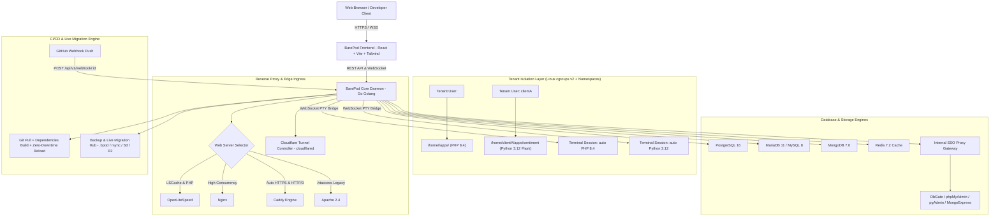

# Master Architecture & Development Plan: BarePod Panel
> **Document Version:** 0.3 (Prototype) — databases & caches module live end-to-end (SQLite file engine, Redis multi-tenant ACL, AES-256-GCM vault, live Reveal & Rotate, and Recycle Bin)
> **Last Updated:** October 11, 2026  
> **Status:** Active & Maintained

## Versioning policy

The number describes **completed milestones, not effort** — and nothing may
invent its own version.

- **0.x = prototype line.** The line is at **0.3** (the databases module) and stays
  in 0.x while the panel is a prototype (some views still mock, dry-run provisioning,
  no release artefact).
- **0.1 → 0.2 (reached):** the milestone was *"a website really runs end-to-end on
  a Linux host"*. Verified on Ubuntu 24.04 in an LXC container: unit active,
  service running as the tenant, cgroup limits applied, health check green, files
  created through the API owned by the tenant, per-site metrics from the cgroup.
  **What that claim covers, precisely: the daemon and its API.** The milestone was
  reached by driving `POST /websites` end-to-end, not by clicking the panel's
  Add-Website wizard — that wizard was prototype state (it updated local state and
  called nothing; the API client had no create call at all) until it was wired. A
  milestone is a claim about the daemon; a screen that does not call the daemon is
  still mock, and saying so is the point of this section.
- **0.2 → 0.3 (reached):** the milestone was *"databases and caches module"*. Verified
  end-to-end: SQLite file database in site directory owned by tenant, live size reporting,
  Redis ACL user per cache with key prefix and password rotation via resetpass, Recycle Bin
  with suspend & restore, AES-256-GCM password vault with elevated session, and UI Reveal /
  Rotate click-through.
- **It only moves when a milestone is finished**, e.g. `0.2` = a website really
  runs end-to-end on a Linux host; `0.3` = databases module; `1.0` = first
  release with the installer and a supported upgrade path. Commits, features in
  progress, and "looks almost done" never bump it.
- **One source of truth:** the daemon carries the version (`api.Version`,
  reported by `GET /health`) and the UI displays *that*; in simulation mode the
  UI falls back to `frontend/src/version.ts`. No component hardcodes its own
  version string (the footer previously drifted to "v0.6" — that is exactly
  what this rule prevents).

### Keeping these documents in sync

**The note is part of the change, not a follow-up.** A commit that alters
behaviour must update the documentation in the *same* commit:

| What changed | What must be updated with it |
|---|---|
| Any user-visible behaviour | §0 Frontend Changelog (a bullet, one line) |
| A module's real status | §4.1 Component Status Table (simulation / partially live / live) |
| An endpoint, payload or rule | `API_CONTRACT.md`: §4.x for the endpoint **and** §1 conventions when the shape moved |
| A module's design | the matching §3.x section |
| A milestone finishing | the version above **and** the phase checklist in §4.2 |

A claim in these documents that cannot be verified in the code is a **bug** —
fix the text or the code in the same commit. (Known drift so far: the status
table claimed metrics, files and the terminal were unbuilt after they shipped,
and the footer invented its own version. Both are why this rule exists.)

This document is the complete technical architecture blueprint, module specification, and development roadmap for **BarePod Panel**, a new-generation web hosting management, reverse proxy gateway, and hybrid container hosting platform that is secure, isolated, and easy to use.

---

## 0. What is live, and the decisions behind it

The detailed build log of every fix — with its measurements — is in this file's history (`git log -- MASTER_PLAN.md`). What follows is the durable part: what is real, and the decisions a later change must not undo. **Current state and the working loop live in `HANDOFF.md`; endpoints live in `API_CONTRACT.md`.**

**Real, verified on a Linux host (LXC, Ubuntu 24.04):** the daemon and its API (`mode: real`), sign-in with Argon2id + session cookies + CSRF + audit, websites deployed end to end (unit, tenant ownership, cgroup limits, health check) with redeploy and delete, a jailed tenant terminal, host and per-site metrics, a host file manager whose system paths are read-only by policy, databases and caches (0.3) with a vault, and a web port that answers a status page instead of "connection refused". **Still mock, and badged as such:** Pods/Docker, Domains, API & MCP, Backup & Migration, Cloudflare Tunnels, Users & Groups, and most of Panel Settings.

**Decisions that must not be silently reversed**

- **The isolation boundary is the tenant**, one Linux UID per account: the kernel refuses another tenant outright. A website's shell is opened in its own mount namespace with the tenant's other paths masked and the system bound read-only — and the namespace is made **private before masking**, because a shared propagation once published 12 298 mounts into the host's namespace and hid a tenant's real files behind them.
- **Uninstalling is a first-class operation, and it backs up before it deletes.** `barepod uninstall` is guided by default: it reads websites, tenant accounts, ledger records, containers and the lockout's table from the daemon's own state (never inferring them from unit files), prints the plan, and asks: the backup level is an arrow-key menu, the removals are one checklist the space bar toggles, and the last question is a box carrying the summary with **No preselected**, so pressing Enter can never be the destructive answer. Where a box cannot be drawn — a bare LXC console with `TERM=linux` — the same questions are asked in plain text and the typed word comes back as the last line of defence. With `--yes` nothing irreversible happens unless a flag names it (`--purge-data`, `--remove-tenants`, `--remove-tenant-data`, `--remove-volumes`). Two rules are structural rather than polite: the backup is written with the panel already stopped (SQLite in WAL mode loses its tail to a plain copy of a live database) and is **read back before the first deletion** — a failed backup followed by a delete is the worst possible order — and a backup directory inside anything the run deletes is **refused**, not quietly relocated, because the operator's reason for choosing a path may be the reason that path matters. A backup holds the panel database (accounts, records, settings, audit log) and the certificate, and with `--backup=full` also `/etc/barepod` and the unit files; it deliberately does **not** hold database contents, whose credentials are encrypted inside that same database, so the panel's Export is the honest tool for those. `scripts/uninstall.sh` and `scripts/restore.sh` remain for a host whose binary is gone, and the installer detects a backup left behind and says so.
- **A mock is a plan: kept and marked, never deleted and never silent.** Every unbuilt field carries a one-line caption in the same shape as the measured ones (`Not applied: nothing reads this choice yet.`); an unmarked mock is a bug, and so is a caption that contradicts a control elsewhere on the screen.
- **Manager GUIs are panel paths, never ports of their own**: `browser` (ours), pgweb, phpMyAdmin and DbGate — one container **per database** (a shared one could not serve two people), loopback only, credentials injected server-side, session-gated, stopped when idle. Adminer was left out rather than shipped without a zero-login; pgAdmin and redis-commander were dropped as too heavy or unnecessary. The DbGate image is pinned to 7.3.1 after measuring four candidates.
- **The panel talks to engines with pure-Go drivers** as that database's own user, with the clients needed only for the administrator steps of a host install. Quoting is per engine (backticks for MySQL/MariaDB). An engine refusal surfaces as the engine's own error, not as a one-column grid.
- **Engines can be containers or host installs, and the panel says which** (`mode` per engine), brings a container up on demand single-flight, keeps its admin credential encrypted, and treats suspend as per-database (never a container stop, which would take other tenants down with it).
- **Exposure is per record and applied in each engine's authorisation**, not its port; `public` is refused with `409 guard_required` unless the watchdog is enforcing. MariaDB is opened by the panel itself (it writes `bind-address` and restarts, restoring the file if MariaDB does not come back). MongoDB and Redis are honest exceptions where the panel cannot restrict per database.
- **The address shown is the one that demonstrably works** — the one the browser used, or a manual setting for a VPS. No external echo service: behind NAT it cannot be discovered from the inside, and it would add a dependency. Labels say what an address *is* (Private / Public / Loopback only).
- **HTTPS by default with a self-signed certificate** (honest about being self-signed), generated beside the panel database; port 80 stays free for websites. Behind a tunnel, `X-Forwarded-Proto` is believed, so a manager on an HTTPS page does not build HTTP URLs.
- **One version, from the daemon** (`api.Version`, surfaced by `/health`), never a number a component invents.

> **Versioning note:** the panel is still a prototype, so the document stays in the 0.x line (**0.3** — the databases module; see the policy at the top).

> **Note for the Go backend:** since URLs are path-based, the server MUST implement SPA fallback (unknown paths serve `index.html`) while `/api/*` answers JSON `404`. The contract is in §4 and `API_CONTRACT.md`.

## 1. Product Vision & Concept

**BarePod Panel** is designed to solve the dilemma of traditional server panels (such as cPanel, Plesk, AaPanel, CyberPanel, Coolify, and EasyPanel):
1. **Clean, Modern & Intuitive User Experience**: A responsive and aesthetic interface based on a modern color palette, with a tidy layout free of confusing stacked menu hierarchies.
2. **Total Multi-Tenant Isolation (Linux cgroups v2 + Namespaces)**: Each tenant user has its own Linux system user, isolated directory (`/home/<tenant>/apps/<app>`), and safe resource quotas.
3. **Smart CLI Automation (Auto-Switch Runtime)**: When a user opens a web terminal on a website, CLI commands such as `php -v`, `node -v`, or `python -v` automatically match the runtime version configured for that site without conflicting between tenants.
4. **Flexibility of 4 Web Server Engines**: Supports OpenLiteSpeed (OLS + LSCache), Nginx, Caddy (Auto-HTTPS & HTTP/3), and Apache 2.4 according to the user's application architecture needs.
5. **Complete Database & In-Memory Support**: PostgreSQL 16, MariaDB 11/MySQL 8, MongoDB 7.0, Redis 7.2, and file-based SQLite ready to use from a single panel, with databases and caches provisioned independently with a *Shared Daemon* or *Dedicated Pod* option.
6. **Built-in Database Web GUI (SSO)**: the panel hosts **pgweb** (PostgreSQL) and **phpMyAdmin** (MySQL/MariaDB) behind its own gated path — one loopback process each, no Apache or extra port, credentials injected server-side, closed when idle — plus its own in-panel **Data Browser & SQL** for every engine. DbGate (SQLite/MongoDB/Redis) is planned; pgAdmin and Adminer were dropped.
7. **Credential Password Protection**: Database passwords are encrypted and hidden. To display a password as plain text, the user must first enter their panel account password.
8. **File Manager Pro (cPanel / VS Code Grade)**:
   - Checkbox on every file/folder with a master *Select All* checkbox.
   - Multi-file batch actions: Download selected, Delete selected, Copy/Cut selected.
   - Complete right-click (context) menu (Open/Preview, Copy, Cut, Paste, Duplicate, Rename, Download, Delete).
   - In-browser Visual Previewers (SVG / Vector graphics, Image viewer, PDF viewer with zoom control).
   - In-browser Code Editor with persistent volume sync & syntax styling.
9. **GitHub Push-to-Deploy & 1-Click Redeploy**: Automatic webhook on pushing a commit to GitHub plus a manual redeploy button with streaming build logs and *zero-downtime*.
10. **Multi-Tenant Cloudflare Tunnel Isolation**: Expose domains and containers to the public internet simply by entering a private Tunnel Token per tenant, with no need for a static public IP or port forwarding.
11. **Dedicated Reverse Proxy Mode & Multi-Engine Path Routing**: The ease of creating a pure proxy gateway to forward domain traffic to internal ports, complete with WebSocket pass-through, real IP preservation, auto-SSL, upstream ping connectivity test, and live vhost preview (OpenLiteSpeed, Nginx, Caddy).
12. **World Traffic Map & Streaming Telemetry**:
    - Interactive world map with visual pulsing radar pins (ID, US, SG, DE, JP, AU, etc.).
    - Traffic filter per country with latency and ISP info.
    - Console log with Light/Dark toggle, log text wrap toggle, and expandable request detail inspector.
13. **Backup & 1-Click Server-to-Server Live Migration Hub**:
    - 1-Click Server-to-Server Live Migration Wizard (Pull from Old VPS via IP & Secret Token, live rsync & DB dump streaming).
    - Source VPS Token Generator (2-hour TTL).
    - Instant Portable Snapshot (`.bpod` / `.tar.gz`) with SHA-256 checksum & AES-256 encryption.
    - Restore from File (Drag-and-drop bundle restore + manifest inspector).
    - Remote Cloud Storage Sync & Scheduled Cron (Cloudflare R2, AWS S3, Google Cloud Storage, Wasabi / MinIO) with 7-90 day retention.
    - Per-App Export (`barepod-<app>.bpod`) on the App Detail Page and Per-Database Export (`.sql`) in the Database Details Modal.

---

## 2. System Architecture (High-Level Architecture)



---

## 3. Module Details & Technical Features

### 3.1. Web Server & Reverse Proxy Switching
- **OpenLiteSpeed (OLS)**:
  - Integrated LSCache module for ultra-fast PHP & WordPress performance.
  - Correct vhost syntax generator (`context / { type proxy; handler backend-primary; }`, `extprocessor`).
- **Nginx**:
  - Dynamic virtual host configuration for reverse proxying (Next.js, FastAPI, Flask, Go, Rust).
- **Caddy**:
  - Automatic Let's Encrypt / ZeroSSL and HTTP/3 engine without manual certificate configuration.
- **Apache 2.4**:
  - `.htaccess` file and `mod_rewrite` compatibility for conventional PHP applications.

### 3.2. Languages, Frameworks, & CLI Automation
- **Supported Languages & Frameworks**:
  - **Python**: Flask, FastAPI, Django, standalone scripts (Python 3.10, 3.11, 3.12).
  - **PHP (27 Frameworks & CMS Templates)**:
    - *Modern*: Laravel 12, Laravel 13, Symfony 7, Symfony 8, CodeIgniter 4, CakePHP 5, Slim 4, Laminas, Yii 2, Generic PHP.
    - *E-Commerce*: WooCommerce, Magento 2, PrestaShop 1.7, Shopware 6.
    - *CMS*: WordPress, Drupal 10, Drupal 11, Joomla 6, Contao 4, Neos 9, TYPO3 14.
    - *Cloud & Portals*: Nextcloud 34, OwnCloud 12, Moodle 5 (LMS), Matomo 5 (Analytics), Mautic 7 (CRM), WHMCS.
    - *Versions*: PHP 7.4, 8.0, 8.1, 8.2, 8.3, 8.4.
  - **Node.js**: Next.js, Express, NestJS, Astro, Nuxt (Node 18, 20, 22 LTS).
  - **Others**: Go (Gin/Fiber), Rust (Axum/Actix), Ruby on Rails, Static HTML.
- **Polyglot Hybrid Monorepo Sandbox**:
  - The tenant sandbox supports running a PHP backend (chosen version), Node.js 22 LTS build tools (Vite & npm), and Python 3.12 tasks harmoniously within a single terminal session.
- **PHP Extensions & Configuration Studio**:
  - 1-Click Extension Toggle (`redis`, `imagick`, `gd`, `intl`, `bcmath`, `zip`, `pdo_mysql`, `pdo_pgsql`, `pdo_sqlite`, `mongodb`, `swoole`, `opcache`, `pcntl`, `exif`, `sodium`, `soap`, `ioncube`).
  - PECL package installer & `php.ini` directives form.

### 3.3. Database Suite & SSO Web GUI
- **5 Integrated Engines**: PostgreSQL 16, MariaDB 11 / MySQL 8, MongoDB 7.0, Redis 7.2, and SQLite (file-based, no daemon). Databases and caches are separate resources — provision either, both, or neither.
- **Isolation Modes**:
  - *Shared Engine Daemon*: Shares an optimized server daemon to save RAM (suitable for small/medium databases).
  - *Dedicated Pod Container*: A standalone container with isolated CPU/RAM resources (suitable for heavy workload databases).
- **Max Connections Controller**:
  - Configures the maximum connection limit (`max_connections`) per database so that the database does not overload the server's RAM capacity.
- **Shared-engine naming isolation**:
  - On a shared daemon, database and user names are automatically prefixed with the tenant (`<tenant>_<name>`, `<tenant>_<user>`) so two tenants can both create `laravel_db` without colliding. The panel stores a friendly alias for display; the UI keeps showing the short name. Dedicated pods use their own instance and need no prefix.
- **Zero-Login Web GUI (SSO)**:
  - A manager is opened **behind the panel's own path**, never on a port of its own: `GET /databases/:id/gui/:tool/…` starts it on first access, injects that database's credential server-side, requires the panel session and is audited.
  - **pgweb** (one Go binary) is hosted for PostgreSQL, **phpMyAdmin** for MySQL/MariaDB (PHP's own built‑in server, one process), and **DbGate** for every engine (one container, its port on loopback only and scoped to a single database) — all started on demand, credentials injected server-side, closed when idle. The panel's own **Data Browser & SQL** (plus the Redis key inspector) needs no process. pgAdmin was dropped as the heavy Python service, and Adminer — though light — has no zero‑login in version 5, so it is not shipped pretending otherwise.
  - A manager that is not hosted answers `501` with the reason rather than pretending, and one that is installed costs nothing while unused (it is stopped after the idle window).
- **Password Vault Challenge & Connection String**:
  - Passwords are hidden behind panel account protection.
  - Direct connection string URL (`postgresql://...`, `mysql://...`, `mongodb://...`, `redis://...`, `sqlite:///...`).
  - **Rotate password** per database: confirm with the panel password, then generate a random password or type a custom one (min. 12 chars).
  - Instant Logical SQL Dump export per database.
- **Recycle Bin (soft delete)**:
  - Deleting a database suspends it and moves it to a Recycle Bin instead of dropping it: apps lose access (connections refused, grants/route withdrawn) while the data is retained.
  - Restore clears the suspension; items can also be purged manually or via "Empty Recycle Bin".
  - Automatic purge after a **30-day** retention window.
  - SQLite files are moved/renamed the same way (file kept until purge).

### 3.4. File Manager Pro (Visual & Multi-Selection)
- **Checkbox & Batch Actions**:
  - Checkbox per file/folder and master *Select All*.
  - Batch download (`.zip`) and batch delete.
- **Right-Click Context Menu**:
  - Preview, Copy, Cut, Paste, Duplicate, Rename/Move, Download, Delete.
- **Visual Previewers**:
  - SVG previewer with direct rendering.
  - Image viewer (PNG, JPG, WebP, GIF, ICO) with zoom control.
  - Interactive PDF viewer.
- **Code Editor**:
  - Live editing of `.env`, PHP, JS, Python, JSON files directly in the browser with persistent volume sync.

### 3.5. World Traffic Map & Streaming Telemetry
- **Interactive Visitor Map**:
  - Vector world map with live pulsing radar pins.
  - Tooltip with country, city, IP, request count, latency (ms), and ISP name.
  - Instant log filter based on the country clicked on the map.
- **Console Log Studio**:
  - Default Light Mode (`bg-white`) with a Dark Mode toggle (`bg-slate-950`).
  - Log Text Wrapping toggle (prevents text from being cut off).
  - Expandable Request Detail Inspector (`ChevronRight`/`ChevronDown`) for viewing complete headers, cookies, and user-agent.

### 3.6. Backup & Migration Hub (Plug and Play)
- **1-Click Server-to-Server Live Migration**:
  - *Pull from Old Server* mode: Enter the old server's IP and Migration Token.
  - Encrypted transfer via high-speed rsync stream without needing to download to a laptop.
  - *Source VPS Node* mode: Temporary migration token generator (valid for 2 hours).
- **Portable Snapshot (`.bpod` / `.tar.gz`)**:
  - The bundle package stores the codebase (`/var/www/apps/<app>`), `.env`, vhost routing config, logical database dump, and data volumes.
  - Optional AES-256 encryption and SHA-256 checksum validation.
- **Restore from File**:
  - Drag-and-drop a `.bpod` file with a manifest inspector.
- **Remote Cloud Storage Sync**:
  - Automatic sync to Cloudflare R2, AWS S3, Google Cloud Storage, or Wasabi/MinIO with a periodic cron schedule and a 7-90 day retention policy.

### 3.7. Hardware Health & Real-time Network Telemetry
- **S.M.A.R.T. Physical Disk Health Diagnostics**:
  - NVMe (`/dev/nvme0n1`) and SATA SSD (`/dev/sda`) status.
  - Wear index / drive age percentage %, TBW, TBR, Power-on hours, unsafe shutdowns, temperature (°C).
  - Interactive S.M.A.R.T. Self-Test feature (`smartctl -t short`).
- **Network Telemetry**:
  - Live Ingress (Rx Mbps) and Egress (Tx Mbps) sparklines.
  - Per-interface monitoring (`eth0`, `docker0`, `cloudflared0`, `lo`).
  - ICMP Edge Latency prober to Cloudflare (1.1.1.1), Google DNS (8.8.8.8), and the gateway.
  - TCP socket states counter and open listening ports inspector (`ss -tulpn`).

---

### 3.8. Additional UI Modules (outside §3.1–§3.7)

- **Docker Pods & Container Hosting**: deploy from an image / Dockerfile / docker-compose, env vars, volume mounts, port mapping, web-domain routing, restart policy.
- **Per-App Access Control**: HTTP 503 Maintenance Mode (with preview + IP bypass) and HTTP Basic Auth (`.htpasswd` + login simulator), plus **Anti-Brute Force** (max attempts + IP ban duration).
- **System & Docker Cleanup**: prune system and Docker resource waste (dangling images, stopped containers, unused volumes, build cache) on a cron schedule; list of recommended default cronjobs (metric retention, SSL renewal, security updates, logrotate, DB maintenance, fstrim, S.M.A.R.T., service watchdog, disk alert).
- **RBAC & Groups**: tenant groups have a 10-capability matrix (deploy apps, file manager, terminal, databases, backups, domains, cloudflare tunnels, monitoring, user management, API tokens & automation).
- **Panel Settings**: 9 tabs (general, monitoring policy, security, reverse proxy & SSL, backup policy, notifications, database defaults, PHP defaults, system & cleanup).
- **Domains & SSL** as well as **Overview/VPS Dashboard**.
- **URL routing per menu & deep-linking**: all menus and app sub-tabs are bookmark/refresh-safe; the production server must implement SPA fallback.
- **Guided Deploy wizard & provision presets**: 5-step deploy flow with source selection (scaffold / GitHub / upload / existing) and per-framework install + automation steps (`src/data/frameworkProvision.ts`).
- **Database, Cache & SQLite semantics**: databases and caches are separate resources; SQLite is a file database (path, no credentials) rather than a shared daemon.
- **API & MCP**: menu with API tokens, webhooks and the MCP tool catalog; API tokens are a new RBAC capability (10 total).
- **Profile & Account**: dedicated page (identity, password, 2FA, sessions, permissions) plus an app footer.
- **Site-type relevance**: the panel must not offer a control a site type cannot use. A **Reverse Proxy Only** site has no runtime of its own (its process lives in the upstream container), so its Terminal, File Manager, Environment, Deploy/Build and CI-CD entries are **hidden — not greyed out** — and the API refuses them with `409 not_applicable`. A **Static HTML** site keeps its files and shell but has no environment tab. The rules live in one place (`frontend/src/utils/siteRuntime.ts` and `validate.HasRuntime`) instead of being re-guessed per screen.
- **Recycle Bin**: soft delete for databases — suspend (apps cannot connect), restore, permanent delete, empty bin, 30-day retention.
- **Accounts, Groups & Permissions (per account, not global)**: the panel has **no built-in account** — the operator creates the root admin with `barepod admin create` at install time. The only built-in data is **three permission groups** (Superadmin (Root) / Developer / Read Only), and a group doubles as the **resource package** (CPU, RAM, tasks, disk quota, inodes, max sites, max databases — 0 = unlimited). Every endpoint is gated on a capability from the caller's group (`deployApps`, `fileManager`, `terminal`, `databases`, `backups`, `domains`, `cloudflareTunnels`, `monitoring`, `users`, `apiTokens`) and every resource endpoint is scoped to the caller's own resources — **admins are the single exception** and see all tenants. Backup, migration and every future module follow the same rule. A **capacity guard** rejects any package plan whose total exceeds the server's live capacity (so a scale-down is caught automatically).

## 4. Implementation Status & Development Roadmap

> [!IMPORTANT]
> **Current Real Condition:**
> **Phase 1 (frontend)**: complete as a **prototype**, and now **wired to the API where the daemon already covers it** — sign-in, the website list, per-website metrics and a real terminal are live. Monitoring charts, the file manager, databases, pods, backups, domains and tunnels still run on mock data.
> **Phase 2 (Go daemon)**: SQLite/WAL + migrations · Argon2id + opaque session cookies with CSRF, instant revoke, elevated mode, audit log · per-account RBAC where a group is also the resource package, with a **live capacity guard** · the `barepod` CLI (+ the `fs-exec` privilege-drop helper) · an **8-step asynchronous deploy pipeline** with a persisted job log over SSE · a **file manager** with a separator-safe path jail and tenant-credential helper · **PTY terminals** with one-time tickets · **host and per-website metrics** (raw numbers) · **LXC-aware capability reporting** with reasons and advice.
> **Execution modes are honest:** real work only on Linux with systemd; everywhere else **dry-run** — units and `.env` are written, nothing is started, and the API reports `mode: "dry-run"` instead of a fake success.
> **Next:** start from `HANDOFF.md` — it carries the verified state, the working loop, and the order the operator chose. In short: **Tenants & User Groups** (the tenancy model: ownership, list scoping, OS isolation), then **one PHP website end to end** (the php-fpm pool writer and the web-server → FPM connector do not exist yet), then domains & TLS, backups, pods and tunnels, which are still mocks. Databases & caches and the anti-brute-force watchdog are live and measured.

### 4.1. Component Status Table: Simulated Frontend vs Real Backend

| Feature / Module | Frontend UI & Simulation | Real Backend & OS Engine (Go / Linux) | Overall Real Status |
|---|---|---|---|
| **Design System & Panel Layout** | ✅ Complete (responsive) | N/A (frontend only) | **Complete (frontend)** |
| **Auth, Session & Profile** | ✅ Complete (profile, sessions **wired** to the daemon, 2FA mock, permissions) | ✅ Login/logout/me, verify (elevated), session list + revoke, **`GET /audit`** (own entries, or all for an admin); API tokens not yet | **Live (tokens/2FA pending)** |
| **RBAC, Groups & Packages** | ✅ Complete (10-capability matrix, package limits) | ✅ Capability middleware per account, built-in groups, package limits applied to systemd + quota, capacity guard | **Live** |
| **Websites & Runtime Selector** | ✅ Complete (27 PHP/Node/Python templates) | 🟡 List/detail + deploy pipeline live; vhost writer & runtime installers pending | **Partially live** |
| **Guided Deploy Wizard** | ✅ Complete (5 steps, source choice, presets) | ✅ `202` + job log + SSE, 8 steps incl. `.env`, DB/cache step, systemd unit render, health check — **verified end-to-end on a real Linux host** (see below) | **Live (verified on LXC)** |
| **Real-host verification (LXC)** | — | ✅ Ubuntu 24.04 LXC on Proxmox: `mode: real`, unit active, service runs as the tenant, cgroup limits applied (memory.max 1 GiB / cpu.max 100000 / pids.max 256), health check green, app answers, files created through the API owned by the tenant, per-site metrics from the cgroup | **Verified** |
| **Hybrid Upstream Routing** | ✅ Complete (form, mock ping, vhost preview) | ⏳ Not yet (write vhost config to the web server) | **UI Simulation** |
| **Site-type relevance** | ✅ Complete (proxy hides shell/files/env/CI) | ✅ `409 not_applicable` for `runtime: "proxy"` on files/PTY | **Live** |
| **File Manager Pro** | ✅ Site scope **and** an admin Host Files view (scope selector, Protected badges, dead buttons inside system trees) | ✅ Full API for a site, plus the scoped host/tenant-home family with a read-only system policy and `GET /tenants` for the picker | **Live** |
| **Databases & Caches** | ✅ List/create/bin/restore/reveal/rotate plus the **Data Browser & SQL tab** and the Detected (app-managed) badge, all wired and verified against a real host; the manager buttons call the real gate and open a hosted one on the panel's own path | ✅ Engines detected + probed with their **mode (docker/host/none)**, SQLite file-based (with size), PostgreSQL/MySQL/MariaDB plans with safe quoting, **Redis caches as ACL users scoped to their prefix**, engine containers with an on-demand orchestrator and a vaulted admin credential, recycle bin, rotate & reveal (elevated), audit, and a **reverse proxy that hosts pgweb for PostgreSQL and phpMyAdmin for MySQL/MariaDB** under `/databases/:id/gui/…` (session-gated, credential injected server-side on loopback only, sweeper + Reconcile) — MongoDB's user lifecycle runs through the panel's own driver (created inside its container, rotated, dropped on bin and recreated on restore), and Redis in a container is administered with its admin credential over loopback; **DbGate is hosted for every engine** (one container on first access, loopback port only, scoped to one database, SQLite file mounted as the tenant, removed when idle) | **Live** |
| **Web Terminal PTY** | ✅ Complete (session picker, real xterm pane, confinement reported) | ✅ `creack/pty` over ticket-authenticated WebSocket, tenant UID/GID, resize, idle timeout, process-group cleanup, **jailed into the site by a mount namespace + chroot — a minimal read-only system around the website and nowhere else to go** (`pty-exec`, `jailed`/`jailMode`/`masked` in the ready frame and the audit) | **Live** |
| **Metrics & Monitoring** | ✅ Complete (live when the daemon answers, clearly labelled simulation otherwise) | ✅ Host (`/proc`, statfs, `/proc/net/dev`) + per-website cgroup v2 sampler, ranges, honest "unavailable + reason" | **Live** |
| **Hardware S.M.A.R.T. & Network** | ✅ Complete (visual diagnostics, mock self-test) | 🟡 Capability detection + disk/network counters live; `smartctl` runs and fstrim are gated by capability | **Partially live** |
| **LXC / container support** | ✅ Complete (limits card) | ✅ Live detection (systemd/LXC/Docker/SMART/fstrim/quota) + `limitations[]` with reasons and advice | **Live** |
| **Database Suite & SSO** | ✅ Complete (detail modal, vault, export) | ⏳ Not yet (provisioner, rotate, SSO proxy) | **UI Simulation** |
| **Caches (Redis) & SQLite** | ✅ Complete (Caches tab, file-based SQLite) | ⏳ Not yet | **UI Simulation** |
| **Recycle Bin (Databases)** | ✅ Complete (soft delete, restore, purge) | ⏳ Not yet | **UI Simulation** |
| **Docker Pods & Containers** | ✅ Complete (PodsView, deploy/config modals) | ⏳ Not yet (Docker Engine SDK) | **UI Simulation** |
| **Backup & Migration Hub** | ✅ Complete (wizard, token, `.bpod`) | ⏳ Not yet (rsync stream, S3/R2) | **UI Simulation** |
| **World Traffic Map & Logs** | ✅ Complete (vector map, pins, log viewer) | ⏳ Not yet (daemon log streamer / WS) | **UI Simulation** |
| **Per-App Access Control** | ✅ Complete (503, Basic Auth, anti-brute-force) | ⏳ Not yet (vhost snippet, `.htpasswd`, fail2ban) | **UI Simulation** |
| **URL Routing & Deep-link** | ✅ Complete (`/apps/<slug>/<tab>`, `/settings/<tab>`, …) | ✅ SPA fallback in the daemon | **Live** |

---

### 4.2. Real Execution Phase Plan (Roadmap):

* **Phase 1: Frontend UI Prototyping (DONE ✅)**:
  Designing the entire user interface, user interactions, typed data architecture (TypeScript), and navigation flows so that the developer experience (DX) is perfectly validated before the backend is built.
* **Phase 2: Go Backend Core Daemon (IN PROGRESS 🚧)**:
  Initialize the daemon service in Go (Golang). **Skeleton landed in `backend/` and verified end-to-end**:
  - ✅ Local SQLite (WAL mode, `busy_timeout`, foreign keys) + schema migrations. **No seed data**: the panel starts empty and the operator creates their own account with `barepod admin create`.
  - ✅ HTTP router (`net/http` `ServeMux` patterns) with request logging and **SPA fallback** so the path-based UI routes survive a refresh.
  - ✅ Auth: **Argon2id** password hashing, opaque **session cookie + CSRF** (decision #4, *not* JWT), instant session revoke, **5-minute elevated (sudo) mode**, one-time WebSocket tickets, audit log.
  - ✅ `internal/secrets`: **AES-256-GCM** with an auto-generated `0600` key file.
  - ✅ `GET /system/capabilities` (systemd / LXC / Docker / S.M.A.R.T. / fstrim detection).
  - ✅ Pilot module **Websites**: list/detail from real rows, plus `POST /websites` → `202 Accepted` + `deployId`, an **8-step async provisioning pipeline** with a persisted job log, `GET .../deploy/{id}` polling and an **SSE stream** (`GET .../deploy/stream`) that ends with `event: done`.
  - ✅ **`barepod` CLI**: `admin create` (the operator creates their own root account — the panel refuses to start without one and has **no default user/password**), `admin passwd`, `user create --group`, `user list`, `user suspend|activate`.
  - ✅ **RBAC that is per account**: the only built-in data is **three permission groups** (Superadmin (Root) / Developer / Read Only). Every endpoint is gated on a capability resolved from the caller's group, and website endpoints are scoped to the caller's own resources — **admins are the exception** and see all tenants.
  - ✅ **Honest execution modes**: privileged commands run for real only on Linux+systemd; elsewhere the daemon is in **dry-run**, writes units/`.env`, reports `mode: "dry-run"` and leaves the website `stopped` instead of faking success. `POST /websites/prepare-directory` exists because tenants have no shell access.
  - ✅ **Resource packages & the capacity guard**: a group is also the tenant package (CPU / RAM / tasks / disk quota / inodes / max sites / max databases). Limits are applied to the systemd drop-in (cgroup v2 `MemoryMax`, `CPUQuota`, `TasksMax`) and to the tenant's disk quota; `PATCH /groups/:name` refuses a plan larger than the server with the numbers (`409 insufficient_capacity`); `GET /system/capacity` re-measures the host **live** (cgroup `cpu.max`, `cpu/online`, `/proc/meminfo`, `statfs`) so a scale up/down is detected without a daemon restart and a plan that stops fitting is reported + audited once. Pods will reuse the same `Limits` model for their Docker spec.
  - ✅ **`internal/tenant`**: Linux account lifecycle (`useradd --create-home`, `chmod 0750`/`chown`, `setquota`, `usermod --lock/--unlock`) behind the same real/dry-run runner, wired to `user create` / `user suspend|activate` and to `barepod tenant provision`; unsafe account names are rejected before the OS is touched.
  - ✅ **Bounded job history**: deploy jobs + logs are pruned to the newest 10 per website, so a site that redeploys often cannot grow the database without limit.
  - ✅ **File manager** (`internal/files`): listing, read/save for the editor (text or base64), create, mkdir, rename, copy, move, delete, multipart upload, download and batch `.zip`. Two-layer safety: a **separator-safe path jail** (`IsLocal` + `EvalSymlinks` on the deepest existing ancestor + `root+"/"` prefix test, so `/apps/site-evil` can never pass as `/apps/site`) and operations executed **as the tenant UID/GID** through a helper process (`barepod fs-exec`), so new files belong to the tenant instead of root.
  - ✅ **Terminal (PTY)** (`internal/terminal`): `WS /websites/:slug/pty` spawns an allow-listed shell **as the tenant** in the site directory, `WS /system/pty` is an admin-only host shell. One-time ticket auth (never a token in the URL), `{"type":"resize"}` → `pty.Setsize`, binary stdin/stdout, 30-minute idle timeout, process-group cleanup and audit on open/close.
  - ✅ **LXC-aware degradation**: `GET /system/capabilities` also returns a **`limitations[]`** list (reason + advice) for what an unprivileged container cannot do — S.M.A.R.T. (no block device), fstrim (no discard; use host `fstrim.timer` or pool `discard`/`autotrim`), `setquota` (use host-side quotas) — instead of showing an error. CPU/RAM capacity stays container-aware.
  - ✅ **Metrics** (`internal/metrics`): a background sampler (default 15s, ring buffer in memory) serves `GET /system/metrics?range=1h` and `GET /websites/:slug/metrics`. Host figures come from `/proc` (stat deltas, meminfo, diskstats, net/dev) with real deltas — the first sample reports rates as 0 instead of averaging over uptime — and per-website figures from cgroup v2 (`memory.current`, `memory.max`, `pids.current`, `cpu.stat`). Raw numbers + RFC3339 only; a metric the host cannot provide is **unavailable with a reason**, never a fake zero.
  - ✅ **Frontend wired to the API**: `src/api/client.ts` (session, websites, deploy SSE, files, terminal ticket, metrics, capacity), `useSession` (daemon reachable → real login; otherwise the prototype stays in simulation mode with its mock data), a real **sign-in screen** (with the `barepod admin create` hint), the website list loaded from the daemon with per-site metrics, a **live terminal pane** (`@xterm/xterm`) over the ticketed WebSocket — tenant shell per website, host shell switch for admins — and the **File Manager tab on real files** (list/save/create/rename/copy/move/delete/upload/zip/preview with a Live badge, mock tree only when no daemon answers).
  - ✅ **Website lifecycle**: `DELETE /websites/:slug` tears a site down for real (stop + disable the unit, remove the drop-in and reload systemd, delete the app directory **inside the sites root only**, forget the secrets and the row) and `POST /websites/:slug/redeploy` re-runs the pipeline from the source recorded at create time, keeping the existing database and cache. No more cleaning up by hand after a failed deploy.
  - ✅ **Version has one source**: `api.Version` (0.3.0-prototype) is what `/health` reports, what the CLI prints and what the footer shows.
  - ✅ **Self-install as a systemd service**: `barepod service install` writes the daemon unit from the same flags as `serve`, enables + starts it, and `service status|uninstall` manage it. Verified on the LXC: active + enabled, and killing the process by force brings it straight back (`Restart=always`).
  - ✅ **Deploys own their files as the tenant** (fixed): `Runner.RunAs` runs a command with the tenant's UID/GID and HOME, `RunInSite` and the GitHub clone go through it, and the source step ends with a `chown -R <tenant>` on the site directory — so a scaffolded `.venv` or a cloned repo belongs to the tenant instead of root, and sites deployed before the fix are repaired by their next deploy. Verified on the LXC: the old `root:root` `.venv` came back as `bptest:bptest` after a redeploy, and a fresh Flask scaffold had zero root-owned files. Install scripts no longer run as root either (a supply-chain win, not just tidiness).
  - ✅ **Databases & Caches module (0.3 reached)**: SQLite file engine with live `os.Stat` size reporting & `.trash` Recycle Bin, Redis multi-tenant ACL users with key prefix restrictions and password rotation, AES-256-GCM vault with elevated sessions, and live UI Reveal/Rotate click-through.
  - ✅ **A database manager is hosted for PostgreSQL**: `internal/dbtools` (one `Spec` per tool + a single-flight `Supervisor`) and a reverse proxy serve **pgweb** under `/api/v1/databases/:id/gui/pgweb/…` — started on first access, credential injected server-side, session-gated (401 without one), audited as `database.gui_open`, stopped after the idle window (`database.gui_idle`) with leftovers reconciled at start. Verified on the LXC (page + assets 200, a `select` through the proxy, loopback-only `127.0.0.1:8790`, Reconcile and idle stop both seen). MySQL/MariaDB/MongoDB/Redis use the panel's own Data Browser until DbGate ships.
  - ⏳ Next: **Tenants & User Groups**, then a **single PHP website end to end** (php-fpm pool + vhost + TLS), then the remaining mocked views. See `HANDOFF.md` for the verified state and the deploy loop.
* **Phase 3: Host OS & Container Integration (SCHEDULED 📋)**:
  - Docker Engine SDK (`docker/moby`) integration for container pod management.
  - File Manager backend API (reading/writing real Linux directories with isolated tenant user privileges).
  - WebSocket PTY terminal bridge (`creack/pty` + Xterm.js).
* **Phase 4: Web Server & Network Automations (SCHEDULED 📋)**:
  - Real vhost configuration generator (OpenLiteSpeed, Nginx, Caddy).
  - Automated Let's Encrypt / ZeroSSL.
  - `cloudflared` daemon controller.
* **Phase 5: Database Engine & SSO Gateway (SCHEDULED 📋)**:
  - Automated database user creation & schema grants in PostgreSQL, MySQL, Mongo, Redis.
  - Internal reverse proxy gateway for autologin to DbGate / phpMyAdmin.
* **Phase 6: Live Migration Daemon & Installer (SCHEDULED 📋)**:
  - Daemon-to-daemon encrypted stream transfer via rsync.
  - `.bpod` snapshot packager (tar.gz + metadata + sql dump).
  - 1-line installation script for Ubuntu/Debian VPS (`curl -fsSL https://get.barepod.com | bash`).

---

## 5. Installation Support (AMD64 / ARM64 / LXC)

BarePod Panel is designed for **64-bit Linux** and is verified to run on **both AMD64 and ARM64**, whether on bare metal, a VPS, or an **LXC/LXD** container.

- **Architecture**: `linux/amd64` (x86_64) and `linux/arm64` (aarch64). 32-bit ARM is not supported.
  - All components (Node.js/Vite frontend, Go daemon, highlight.js/react-icons) have official arm64 builds.
  - `scripts/install.sh` detects the architecture automatically (`uname -m` → `amd64` / `arm64`).
- **LXC/LXD Containers** — important notes:
  - cgroups **v2 (unified)** is required for tenant isolation.
  - Docker-in-LXC (container pods) requires `security.nesting=true` (+ `keyctl=1`).
  - Cloudflare Tunnel requires `/dev/net/tun` (`lxc.cgroup2.devices.allow: c 10:200 rwm`).
  - S.M.A.R.T. disk diagnostics and `fstrim` are generally unavailable in unprivileged containers — the UI must display a "not available" status (not an error) when the backend detects this.
- **Install script**: `scripts/install.sh` performs environment checks (OS, arch, virtualization, cgroups v2, Node.js, Docker) and already rejects unsupported platforms with a clear message.

---

## 6. Unified Repository Structure

```
BarePod-Panel/
├── frontend/                     # Dashboard Web UI (React + Vite + Tailwind)
│   ├── src/
│   │   ├── components/           # AppsView, AppDetailPage, DatabasesView, BackupMigrationView,
│   │   │                         # FileManagerModal, WebTerminalView, ServerMonitoringView, etc.
│   │   ├── types/                # TypeScript Interfaces & Model Definitions
│   │   ├── data/                 # Static data (worldMapPath, defaultPhpExtensions, databaseEngines, permissions, frameworkProvision)
│   │   ├── hooks/                # useSubRoute (URL tabs), usePanelSize (S/M/L presets)
│   │   ├── utils/                # Helpers (zip.ts, highlight.ts)
│   │   ├── App.tsx               # URL Routers (/apps, /apps/<name>/<tab>) & Layout Controller
│   │   ├── index.css             # Tailwind Design System & Custom Utilities
│   │   └── main.tsx              # React Entrypoint
│   └── package.json
├── backend/                      # Core Daemon (Go / Golang) — Phase 2 skeleton
│   ├── cmd/
│   │   └── barepod/              # Single binary: `serve`, `admin`, `user`
│   ├── internal/
│   │   ├── api/                  # Router, middleware (logging, auth+CSRF, capability), handlers
│   │   ├── rbac/                 # Capability set + built-in permission groups
│   │   ├── config/               # Flags + environment configuration
│   │   ├── store/                # SQLite (WAL), migrations, queries, groups
│   │   ├── resources/            # Limits/Capacity model, live detection, overcommit guard
│   │   ├── metrics/              # Host (/proc, sysctl) + per-website (cgroup v2) sampling
│   │   ├── tenant/               # Linux account lifecycle (useradd, quota, lock/unlock)
│   │   ├── files/                # File manager: path jail, ops, zip
│   │   ├── terminal/             # PTY sessions (tenant credentials, resize)
│   │   ├── deploy/               # Async provisioning pipeline + persisted job log
│   │   ├── host/                 # Privileged operations (real vs dry-run runner)
│   │   ├── dbengine/             # Engine detection, provision/rotate/purge plans, container recipes
│   │   ├── dbtools/              # On-demand managers (pgweb): Spec + single-flight supervisor
│   │   ├── supervisor/           # systemd template unit + per-site drop-in
│   │   ├── provision/            # Runtime/framework package & start commands
│   │   ├── auth/                 # Argon2id password hashing
│   │   ├── secrets/              # AES-256-GCM for stored credentials (0600 key file)
│   │   ├── sysinfo/              # Host capability detection (systemd / LXC / Docker / SMART / fstrim)
│   │   ├── validate/             # Input rules (FQDN, slug, tenant, runtime, engine)
│   │   └── id/                   # ULID & token generation
│   ├── go.mod
│   └── .gitignore
│   # implemented: api/ rbac/ config/ store/ dbengine/ dbtools/ resources/ metrics/
│   #   tenant/ files/ terminal/ deploy/ host/ supervisor/ provision/ auth/ secrets/
│   #   sysinfo/ validate/ id/  ·  planned: pods/ (Docker SDK), backup/, proxy/ (vhosts)
├── scripts/
│   └── install.sh                # 1-line installation script for Ubuntu/Debian VPS
├── MASTER_PLAN.md                # Master Plan & Main Architecture Document
├── README.md
└── LICENSE
```

---

## 7. Agent Automation & Integration (REST API · Webhook · MCP Server)

The panel must be automatable without the UI — for users, CI/CD, and **AI agents**.

- **Per-user API Token**: `bp_live_<random>` (only the hash is stored), limited scope = the intersection with the owner's group permissions, with expiry/revoke/IP allowlist, rate limit, and an **audit log** for every request. New capability: `apiTokens` in `GroupPermissions`.
- **Open specification**: `GET /openapi.json` (OpenAPI 3) covering all §4 endpoints.
- **Outgoing webhooks**: events `website.deployed`, `backup.completed`, `migration.completed`, `cleanup.completed`, `cert.expiring`, `disk.threshold` (HMAC-SHA256 `X-BarePod-Signature`). **Incoming webhooks**: `POST /hooks/:token/run?action=…`.
- **MCP Server (Model Context Protocol)**: a **standalone** MCP server that wraps the REST API (runs on the agent/CI machine, authenticates with an API token) so that Claude/Command Code/Cursor can call tools such as `list_websites`, `create_website`, `redeploy_website`, `create_backup`, `run_cleanup`, `list_users`.
  - **Read-only** by default; write/delete requires an explicit scope; destructive actions are 2-step (`preview_*` → `apply_*`).
  - Resources: `barepod://websites`, `barepod://system/capabilities`. Prompts: `deploy-website`, `migrate-server`.
- **Security principles**: MCP never receives the panel password (only tokens); all agent actions remain constrained by tenant cgroup/capabilities; the panel server can disable automation per group (`apiTokens=false`).

> Contract details (token/webhook endpoints, MCP tool list, client configuration examples) are in [`API_CONTRACT.md`](./API_CONTRACT.md) §7.

---

## 8. Architecture Decisions (backend kickoff)

Locked decisions to be implemented in Phase 2/3:

1. **Tenant isolation model — Hybrid (LOCKED).**
   - **Websites** run **native**: one Linux user per tenant, app directory `/home/<tenant>/apps/<site>`, per-app service, resource limits via **cgroups v2**. Native-first because it is light, instant to start, and works in **LXC without `security.nesting`** (AMD64/ARM64 friendly).
   - **Pods** run as **Docker containers** (Phase 3, Docker SDK): images / Dockerfile / compose for heavier services and prebuilt images.
   - Consequence: two operational paths (files, terminal, logs, backup) — the daemon must abstract them behind one interface so the UI stays the same.
2. **Process supervision — Hybrid (LOCKED).**
   - **Long-running services** (Node, Python, Go, Rust, Ruby, and other daemons) run as **systemd units**, generated from a **template** `barepod-app@<site>.service` with a per-site drop-in: `User=<tenant>`, `WorkingDirectory=/home/<tenant>/apps/<site>`, `EnvironmentFile=.env`, `Restart=always`, `RestartSec=3`, `MemoryMax=`, `CPUQuota=`, `ProtectSystem=strict`, `ReadWritePaths=/home/<tenant>`, `PrivateTmp=yes`. Units are `enable`d so apps come back after a reboot; logs are read via `journalctl -u`.
   - **PHP websites** do not get a per-app unit — their "service" is a **per-site PHP-FPM pool** (FPM reload instead of a service restart).
   - **One-shot jobs** (build/deploy, migrations, rsync backup, prune, terminal sessions) are **managed by the daemon itself** as short-lived jobs in their own cgroup session — they are not daemons.
   - Fallback: if systemd is unavailable (minimal containers), the daemon can supervise long-running services internally; this capability is reported by `GET /system/capabilities`.
3. **Web server config ownership — global defaults + per-site override (LOCKED).** Admin manages **global defaults** in Panel Settings (default engine, global snippets/templates, shared-daemon versions & ports, PHP extension blueprint). Each website stores a **custom override diff** on top of the template; the effective config is resolved as *global template → per-site override*. Precedent already in the UI: global PHP blueprint vs per-app PHP tab.
4. **Secrets & auth — LOCKED.**
   - **Panel passwords:** **Argon2id** (memory-hard, per-user salt). Login is rate-limited/locked out (ties into Anti-Brute Force); optional TOTP 2FA.
   - **Secrets that must be readable back** (database passwords, tunnel tokens, git/R2/S3 credentials): **AES-256-GCM** at rest, random nonce per secret, key file `/etc/barepod/secret.key` (`0600`, root-only) auto-generated at install, with a `key_id` to allow rotation. Revealing a secret requires panel re-auth and is written to the audit log; secrets never appear in logs. On a full `.bpod` export the secrets are decrypted and re-embedded as self-contained config, not shipped as the raw key.
   - **Browser session:** **opaque session cookie** (random id stored in SQLite WAL, `HttpOnly` + `Secure` + `SameSite`) with a CSRF token for state-changing requests. Sessions are revocable instantly — this powers the Active Sessions list on the Profile page. (Stateful sessions are chosen over stateless JWT precisely so `DELETE /sessions/:id` and user suspension take effect immediately.)
   - **Elevated (sudo) mode:** after `POST /auth/verify`, elevated access (reveal/rotate credentials) lives for **5 minutes** in the session, so users are not re-prompted for every modal.
   - **API/MCP tokens:** bearer tokens `bp_live_…` stored as `sha256` + prefix, scoped (intersection with group permissions), expirable, revocable, IP allowlist, rate-limited, audited.
   - **WebSocket:** short-lived one-time ticket from `POST /ws/ticket` (never a token in the URL, which would end up in logs).
   - Every sensitive action is audited; the UI keeps its 60-second secret reveal auto-lock.

All four kickoff decisions are **LOCKED** — Phase 2 can start.

---
