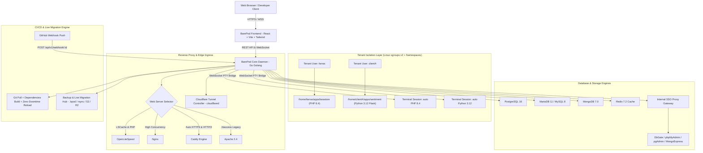

# Master Architecture & Development Plan: BarePod Panel
> **Document Version:** 0.1 (Prototype) — Frontend UI prototype complete; Go backend daemon & OS engine not implemented yet  
> **Last Updated:** October 10, 2026  
> **Status:** Active & Maintained

This document is the complete technical architecture blueprint, module specification, and development roadmap for **BarePod Panel**, a new-generation web hosting management, reverse proxy gateway, and hybrid container hosting platform that is secure, isolated, and easy to use.

---

## 0. Frontend Changelog (Prototype — v0.1)

Changes in Phase 1 (React UI prototype):

> **Versioning note:** this is still a prototype/simulation (no backend yet), so the
> document stays on **0.1** until the Go backend + OS engine are actually running.

- **Guided Deploy wizard**: "Deploy New Website" is now a 5-step flow (Basics → Engine & Runtime → Source → Database & Cache → Review), with per-mode step sets for reverse proxy and static sites.
- **Source selection**: Scaffold/Download (framework preset), GitHub repository (branch + auto-deploy webhook), Upload archive, or Existing files (with directory verification that blocks deploy when the folder is missing).
- **Framework provision presets** (`src/data/frameworkProvision.ts`): per-framework install command plus post-deploy automation (Laravel `composer create-project` + migrate/seed, WordPress `wp core download` + installer, Symfony, Drupal, CodeIgniter, CakePHP, Django, Next.js, Nuxt, Astro, NestJS, Express, Rails, Python venv, Go/Rust/Ruby). The dropdown lists only templates with an automated download, plus a **Generic** ("bring your own code") option.
- **Database vs Cache split**: the wizard provisions a database and a cache (Redis) independently — either, both, or neither — and generates a combined `.env`.
- **Caches tab**: the Databases menu separates caches from databases (All Databases / PostgreSQL / MySQL / MongoDB / SQLite / **Caches (Redis)**), bookmarkable at `/databases/caches`.
- **SQLite modeled correctly**: treated as a file database, not a daemon — file path instead of host:port, no user/password/max-connections, no SSO web GUI, "embedded file" execution mode, and `.sqlite` file download.
- **Rotate database password**: confirm with the panel password, then either generate a random password or type a **custom** one (min. 12 chars), shown once with copy.
- **Profile & Account page** (`/profile`): identity, change password, 2FA toggle, API tokens shortcut, active sessions with revoke, and effective permissions. The account menu now points there.
- **API & MCP menu** (`/api`): blueprint screens for API tokens (create with scopes, reveal-once, revoke, audit log), webhooks, and the MCP server tool catalog.
- **App footer**: brand, version, "100% free hobby project (MIT)", platform targets and a GitHub link.
- **Validation**: FQDN validation on the domain field (bare hostname, no scheme).

- **Term "App" → "Website"** across the entire UI (sidebar, list, detail, deploy modal, overview).
- **Granular RBAC**: `GroupPermissions` type (10 capabilities) on tenant groups, matrix editor in the Create Group Modal, and an "Access Permissions" column in the group table (`src/data/permissions.ts`).
- **Brand icons**: emoji replaced with **lucide-react** (UI icons) + **react-icons / Simple Icons** (brand logos: Python, PHP, Node.js, Go, Rust, Ruby, Flask, FastAPI, Django, Laravel, Symfony, WordPress, Next.js, Express, React, PostgreSQL, MySQL, MariaDB, MongoDB, Redis, phpMyAdmin) via `src/utils/brandIcons.tsx`.
- **Server Monitoring**: time range filter is now real state + **Historical Trends** charts (CPU, Memory, Network I/O, Disk I/O); the **Terminal** tab (host root shell) is **admin-only**.
- **App detail**: **World Traffic Map** promoted to its own tab; **File Manager** is now a tab (`/apps/<app>/files`, not a modal); the editor uses **highlight.js** (syntax highlighting).
- **Panel size**: **S/M/L** presets (`PanelSizeControl`) for File Manager, Host Terminal, and Isolated Web Terminal (replacing free-drag so it cannot be stretched to extremes).
- **File Manager**: real **.zip** batch download (store-only ZIP writer), 60-second vault auto-lock, complete Apache vhost generator.
- **Tenant terminal**: the Isolated Web Terminal menu shows a session picker first before opening a PTY.
- **README**: rewritten in English + a note that this is a *100% free hobby project (MIT)*.

- **Client-side URL routing per menu**: each menu has its own endpoint (`/apps`, `/databases`, `/backup`, `/terminal`, etc.). Refresh & back/forward buttons restore the correct menu.
- **Deep-link App Detail**: `/apps/<app-name>` along with its sub-tabs are part of the URL (`/apps/<app>/logs`, `/routing`, `/deploy`, etc.) so refreshing does not lose position.
- **Terminal session picker**: opening the Terminal menu shows session choices first; the PTY is only opened after selecting one. The Terminal button on the App page still opens that app's session directly.
- **Users — Edit**: user edit functionality (role, plan/group, status, email) via `AddUserModal` in edit mode. The Linux username is locked while editing; the status column follows the data.
- **Database vault**: 60-second auto-lock (countdown) when revealing a password; `CredentialRevealModal` is now actually used via the Reveal button in the table.
- **Vhost generator**: the **Apache** engine is now generated correctly in `AddAppModal` (previously it fell back to Nginx) — all 4 engines complete (OLS/Nginx/Caddy/Apache).
- **File Manager**: multi-select (Select All) batch Cut/Copy/Paste fixed; batch download produces a real **.zip** archive (store-only ZIP writer in `src/utils/zip.ts`).
- **Per-app security**: added **Anti-Brute Force Protection** (on/off, max failed attempts, IP ban duration) in the Security tab.
- **World Traffic Map**: replaced with a real world map (Natural Earth 110m, equirectangular, `src/data/worldMapPath.ts`) so continent shapes are correct and pins precise (same projection); pulse animation fix (`transform-box: fill-box`); threat (WAF) marker consistent across pins & filter badges.
- **Branding**: "PRO" badge and per-menu badges in the sidebar removed; favicon aligned with the BarePod logo.
- **Overview**: content enriched (secondary metrics, app status list, recent activity) and moved to the very top of the sidebar.
- **Panel Settings**: fake version badge ("v1.0.4 Release") replaced with "Prototype UI • Simulation"; tabs renamed to "Monitoring Policy (Retention)" & "Backup Policy (Schedule)" to distinguish them from the operational Server Monitoring & Backup & Migration menus.
- **Live Migration Stream**: changed from hardcoded dark to the light theme for consistency.

> **Note for the Go Backend (Phase 2):** since URLs are now path-based, the production server MUST implement SPA fallback (all unknown paths serve `index.html`). The REST/WS contract expected by the UI remains as described in §4.

---

## 1. Product Vision & Concept

**BarePod Panel** is designed to solve the dilemma of traditional server panels (such as cPanel, Plesk, AaPanel, CyberPanel, Coolify, and EasyPanel):
1. **Clean, Modern & Intuitive User Experience**: A responsive and aesthetic interface based on a modern color palette, with a tidy layout free of confusing stacked menu hierarchies.
2. **Total Multi-Tenant Isolation (Linux cgroups v2 + Namespaces)**: Each tenant user has its own Linux system user, isolated directory (`/home/<tenant>/apps/<app>`), and safe resource quotas.
3. **Smart CLI Automation (Auto-Switch Runtime)**: When a user opens a web terminal on a website, CLI commands such as `php -v`, `node -v`, or `python -v` automatically match the runtime version configured for that site without conflicting between tenants.
4. **Flexibility of 4 Web Server Engines**: Supports OpenLiteSpeed (OLS + LSCache), Nginx, Caddy (Auto-HTTPS & HTTP/3), and Apache 2.4 according to the user's application architecture needs.
5. **Complete Database & In-Memory Support**: PostgreSQL 16, MariaDB 11/MySQL 8, MongoDB 7.0, Redis 7.2, and file-based SQLite ready to use from a single panel, with databases and caches provisioned independently with a *Shared Daemon* or *Dedicated Pod* option.
6. **Built-in Database Web GUI (SSO)**: GUI access (DbGate, phpMyAdmin, pgAdmin, Mongo Express, Redis Commander) is protected behind an internal proxy and logs in automatically without requiring you to enter database credentials repeatedly.
7. **Credential Password Protection**: Database passwords are encrypted and hidden. To display a password as plain text, the user must first enter their panel account password.
8. **File Manager Pro (cPanel / VS Code Grade)**:
   - Checkbox on every file/folder with a master *Select All* checkbox.
   - Multi-file batch actions: Download selected, Delete selected, Copy/Cut selected.
   - Complete right-click (context) menu (Open/Preview, Copy, Cut, Paste, Duplicate, Rename, Download, Delete).
   - In-browser Visual Previewers (SVG / Vector graphics, Image viewer, PDF viewer with zoom control).
   - In-browser Code Editor with persistent volume sync & syntax styling.
9. **GitHub Push-to-Deploy & 1-Click Redeploy**: Automatic webhook on pushing a commit to GitHub plus a manual redeploy button with streaming build logs and *zero-downtime*.
10. **Multi-Tenant Cloudflare Tunnel Isolation**: Expose domains and containers to the public internet simply by entering a private Tunnel Token per tenant, with no need for a static public IP or port forwarding.
11. **Dedicated Reverse Proxy Mode & Multi-Engine Path Routing**: The ease of creating a pure proxy gateway to forward domain traffic to internal ports, complete with WebSocket pass-through, real IP preservation, auto-SSL, upstream ping connectivity test, and live vhost preview (OpenLiteSpeed, Nginx, Caddy).
12. **World Traffic Map & Streaming Telemetry**:
    - Interactive world map with visual pulsing radar pins (ID, US, SG, DE, JP, AU, etc.).
    - Traffic filter per country with latency and ISP info.
    - Console log with Light/Dark toggle, log text wrap toggle, and expandable request detail inspector.
13. **Backup & 1-Click Server-to-Server Live Migration Hub**:
    - 1-Click Server-to-Server Live Migration Wizard (Pull from Old VPS via IP & Secret Token, live rsync & DB dump streaming).
    - Source VPS Token Generator (2-hour TTL).
    - Instant Portable Snapshot (`.bpod` / `.tar.gz`) with SHA-256 checksum & AES-256 encryption.
    - Restore from File (Drag-and-drop bundle restore + manifest inspector).
    - Remote Cloud Storage Sync & Scheduled Cron (Cloudflare R2, AWS S3, Google Cloud Storage, Wasabi / MinIO) with 7-90 day retention.
    - Per-App Export (`barepod-<app>.bpod`) on the App Detail Page and Per-Database Export (`.sql`) in the Database Details Modal.

---

## 2. System Architecture (High-Level Architecture)



---

## 3. Module Details & Technical Features

### 3.1. Web Server & Reverse Proxy Switching
- **OpenLiteSpeed (OLS)**:
  - Integrated LSCache module for ultra-fast PHP & WordPress performance.
  - Correct vhost syntax generator (`context / { type proxy; handler backend-primary; }`, `extprocessor`).
- **Nginx**:
  - Dynamic virtual host configuration for reverse proxying (Next.js, FastAPI, Flask, Go, Rust).
- **Caddy**:
  - Automatic Let's Encrypt / ZeroSSL and HTTP/3 engine without manual certificate configuration.
- **Apache 2.4**:
  - `.htaccess` file and `mod_rewrite` compatibility for conventional PHP applications.

### 3.2. Languages, Frameworks, & CLI Automation
- **Supported Languages & Frameworks**:
  - **Python**: Flask, FastAPI, Django, standalone scripts (Python 3.10, 3.11, 3.12).
  - **PHP (27 Frameworks & CMS Templates)**:
    - *Modern*: Laravel 12, Laravel 13, Symfony 7, Symfony 8, CodeIgniter 4, CakePHP 5, Slim 4, Laminas, Yii 2, Generic PHP.
    - *E-Commerce*: WooCommerce, Magento 2, PrestaShop 1.7, Shopware 6.
    - *CMS*: WordPress, Drupal 10, Drupal 11, Joomla 6, Contao 4, Neos 9, TYPO3 14.
    - *Cloud & Portals*: Nextcloud 34, OwnCloud 12, Moodle 5 (LMS), Matomo 5 (Analytics), Mautic 7 (CRM), WHMCS.
    - *Versions*: PHP 7.4, 8.0, 8.1, 8.2, 8.3, 8.4.
  - **Node.js**: Next.js, Express, NestJS, Astro, Nuxt (Node 18, 20, 22 LTS).
  - **Others**: Go (Gin/Fiber), Rust (Axum/Actix), Ruby on Rails, Static HTML.
- **Polyglot Hybrid Monorepo Sandbox**:
  - The tenant sandbox supports running a PHP backend (chosen version), Node.js 22 LTS build tools (Vite & npm), and Python 3.12 tasks harmoniously within a single terminal session.
- **PHP Extensions & Configuration Studio**:
  - 1-Click Extension Toggle (`redis`, `imagick`, `gd`, `intl`, `bcmath`, `zip`, `pdo_mysql`, `pdo_pgsql`, `pdo_sqlite`, `mongodb`, `swoole`, `opcache`, `pcntl`, `exif`, `sodium`, `soap`, `ioncube`).
  - PECL package installer & `php.ini` directives form.

### 3.3. Database Suite & SSO Web GUI
- **5 Integrated Engines**: PostgreSQL 16, MariaDB 11 / MySQL 8, MongoDB 7.0, Redis 7.2, and SQLite (file-based, no daemon). Databases and caches are separate resources — provision either, both, or neither.
- **Isolation Modes**:
  - *Shared Engine Daemon*: Shares an optimized server daemon to save RAM (suitable for small/medium databases).
  - *Dedicated Pod Container*: A standalone container with isolated CPU/RAM resources (suitable for heavy workload databases).
- **Max Connections Controller**:
  - Configures the maximum connection limit (`max_connections`) per database so that the database does not overload the server's RAM capacity.
- **Zero-Login Web GUI (SSO)**:
  - Access DbGate, phpMyAdmin, pgAdmin, Mongo Express without needing to enter a password repeatedly.
- **Password Vault Challenge & Connection String**:
  - Passwords are hidden behind panel account protection.
  - Direct connection string URL (`postgresql://...`, `mysql://...`, `mongodb://...`, `redis://...`, `sqlite:///...`).
  - **Rotate password** per database: confirm with the panel password, then generate a random password or type a custom one (min. 12 chars).
  - Instant Logical SQL Dump export per database.
- **Recycle Bin (soft delete)**:
  - Deleting a database suspends it and moves it to a Recycle Bin instead of dropping it: apps lose access (connections refused, grants/route withdrawn) while the data is retained.
  - Restore clears the suspension; items can also be purged manually or via "Empty Recycle Bin".
  - Automatic purge after a **30-day** retention window.
  - SQLite files are moved/renamed the same way (file kept until purge).

### 3.4. File Manager Pro (Visual & Multi-Selection)
- **Checkbox & Batch Actions**:
  - Checkbox per file/folder and master *Select All*.
  - Batch download (`.zip`) and batch delete.
- **Right-Click Context Menu**:
  - Preview, Copy, Cut, Paste, Duplicate, Rename/Move, Download, Delete.
- **Visual Previewers**:
  - SVG previewer with direct rendering.
  - Image viewer (PNG, JPG, WebP, GIF, ICO) with zoom control.
  - Interactive PDF viewer.
- **Code Editor**:
  - Live editing of `.env`, PHP, JS, Python, JSON files directly in the browser with persistent volume sync.

### 3.5. World Traffic Map & Streaming Telemetry
- **Interactive Visitor Map**:
  - Vector world map with live pulsing radar pins.
  - Tooltip with country, city, IP, request count, latency (ms), and ISP name.
  - Instant log filter based on the country clicked on the map.
- **Console Log Studio**:
  - Default Light Mode (`bg-white`) with a Dark Mode toggle (`bg-slate-950`).
  - Log Text Wrapping toggle (prevents text from being cut off).
  - Expandable Request Detail Inspector (`ChevronRight`/`ChevronDown`) for viewing complete headers, cookies, and user-agent.

### 3.6. Backup & Migration Hub (Plug and Play)
- **1-Click Server-to-Server Live Migration**:
  - *Pull from Old Server* mode: Enter the old server's IP and Migration Token.
  - Encrypted transfer via high-speed rsync stream without needing to download to a laptop.
  - *Source VPS Node* mode: Temporary migration token generator (valid for 2 hours).
- **Portable Snapshot (`.bpod` / `.tar.gz`)**:
  - The bundle package stores the codebase (`/var/www/apps/<app>`), `.env`, vhost routing config, logical database dump, and data volumes.
  - Optional AES-256 encryption and SHA-256 checksum validation.
- **Restore from File**:
  - Drag-and-drop a `.bpod` file with a manifest inspector.
- **Remote Cloud Storage Sync**:
  - Automatic sync to Cloudflare R2, AWS S3, Google Cloud Storage, or Wasabi/MinIO with a periodic cron schedule and a 7-90 day retention policy.

### 3.7. Hardware Health & Real-time Network Telemetry
- **S.M.A.R.T. Physical Disk Health Diagnostics**:
  - NVMe (`/dev/nvme0n1`) and SATA SSD (`/dev/sda`) status.
  - Wear index / drive age percentage %, TBW, TBR, Power-on hours, unsafe shutdowns, temperature (°C).
  - Interactive S.M.A.R.T. Self-Test feature (`smartctl -t short`).
- **Network Telemetry**:
  - Live Ingress (Rx Mbps) and Egress (Tx Mbps) sparklines.
  - Per-interface monitoring (`eth0`, `docker0`, `cloudflared0`, `lo`).
  - ICMP Edge Latency prober to Cloudflare (1.1.1.1), Google DNS (8.8.8.8), and the gateway.
  - TCP socket states counter and open listening ports inspector (`ss -tulpn`).

---

### 3.8. Additional UI Modules (outside §3.1–§3.7)

- **Docker Pods & Container Hosting**: deploy from an image / Dockerfile / docker-compose, env vars, volume mounts, port mapping, web-domain routing, restart policy.
- **Per-App Access Control**: HTTP 503 Maintenance Mode (with preview + IP bypass) and HTTP Basic Auth (`.htpasswd` + login simulator), plus **Anti-Brute Force** (max attempts + IP ban duration).
- **System & Docker Cleanup**: prune system and Docker resource waste (dangling images, stopped containers, unused volumes, build cache) on a cron schedule; list of recommended default cronjobs (metric retention, SSL renewal, security updates, logrotate, DB maintenance, fstrim, S.M.A.R.T., service watchdog, disk alert).
- **RBAC & Groups**: tenant groups have a 10-capability matrix (deploy apps, file manager, terminal, databases, backups, domains, cloudflare tunnels, monitoring, user management, API tokens & automation).
- **Panel Settings**: 9 tabs (general, monitoring policy, security, reverse proxy & SSL, backup policy, notifications, database defaults, PHP defaults, system & cleanup).
- **Domains & SSL** as well as **Overview/VPS Dashboard**.
- **URL routing per menu & deep-linking**: all menus and app sub-tabs are bookmark/refresh-safe; the production server must implement SPA fallback.
- **Guided Deploy wizard & provision presets**: 5-step deploy flow with source selection (scaffold / GitHub / upload / existing) and per-framework install + automation steps (`src/data/frameworkProvision.ts`).
- **Database, Cache & SQLite semantics**: databases and caches are separate resources; SQLite is a file database (path, no credentials) rather than a shared daemon.
- **API & MCP**: menu with API tokens, webhooks and the MCP tool catalog; API tokens are a new RBAC capability (10 total).
- **Profile & Account**: dedicated page (identity, password, 2FA, sessions, permissions) plus an app footer.
- **Recycle Bin**: soft delete for databases — suspend (apps cannot connect), restore, permanent delete, empty bin, 30-day retention.

## 4. Implementation Status & Development Roadmap

> [!IMPORTANT]
> **Current Real Condition:**
> All features visible in the panel today are at **Phase 1: Frontend UI & Interactive Simulation (React 19 + Vite 8 + TypeScript)**.
> Button interactions, wizard forms, the file manager, and process simulations currently run on **client-side state (mock data)**.
> The **Backend Core Daemon (Go / Linux OS Engine)** that will execute real commands on the server (such as systemd daemons, real Docker containers, real database engines, real rsync streams, and a vhost generator that writes to Linux system files) is **NOT YET IMPLEMENTED** and is the next technical milestone.

### 4.1. Component Status Table: Simulated Frontend vs Real Backend

| Feature / Module | Frontend UI & Simulation (React) | Real Backend & OS Engine (Go / Linux) | Overall Real Status |
|---|---|---|---|
| **Design System & Panel Layout** | ✅ Complete (Responsive, Modern UI) | N/A (Frontend Only) | **Complete (Frontend)** |
| **Websites & Runtime Selector** | ✅ Complete (27 PHP, Node, Python templates) | ⏳ Not yet (Chroot / Docker Runtime Engine) | **UI Simulation Complete** |
| **Hybrid Upstream Routing** | ✅ Complete (Form, mock ping, vhost preview) | ⏳ Not yet (Write config to `/usr/local/lsws/conf/`) | **UI Simulation Complete** |
| **Database Suite & SSO** | ✅ Complete (Detail modal, vault mask, export dump) | ⏳ Not yet (Real DB provisioner & SSO proxy token) | **UI Simulation Complete** |
| **File Manager Pro** | ✅ Complete (Checklist, batch action, previewer, edit) | ⏳ Not yet (Host FS `/home/<user>/apps/` API) | **UI Simulation Complete** |
| **World Traffic Map & Logs** | ✅ Complete (Vector map, pulsing pin, log viewer) | ⏳ Not yet (Real-time daemon log streamer / WSS) | **UI Simulation Complete** |
| **Backup & Migration Hub** | ✅ Complete (Wizard UI, Token gen, .bpod download) | ⏳ Not yet (Rsync daemon stream & S3 backend upload) | **UI Simulation Complete** |
| **Hardware S.M.A.R.T. & Network** | ✅ Complete (Visual diagnostics, mock self-test, ping) | ⏳ Not yet (`smartctl` CLI & `/proc/net/dev` parser) | **UI Simulation Complete** |
| **Web Terminal PTY** | ✅ Complete (Mock terminal & CLI shim commands) | ⏳ Not yet (Go `creack/pty` bridge via WebSocket) | **UI Simulation Complete** |
| **Docker Pods & Container Hosting** | ✅ Complete (`PodsView`, `DeployPodModal`, `PodConfigModal`) | ⏳ Not yet (Docker Engine SDK) | **UI Simulation Complete** |
| **Per-App Access Control** (503 Maintenance, Basic Auth, Anti-Brute Force) | ✅ Complete (toggle + simulator) | ⏳ Not yet (vhost snippet, `.htpasswd`, fail2ban) | **UI Simulation Complete** |
| **System & Docker Cleanup + Cron** | ✅ Complete (Panel Settings → System & Cleanup) | ⏳ Not yet (systemd timer / cron writer, `docker system prune`) | **UI Simulation Complete** |
| **RBAC & Multi-Tenant Groups** | ✅ Complete (10-capability matrix per group) | ⏳ Not yet (JWT + policy enforcement) | **UI Simulation Complete** |
| **URL Routing & Deep-link** | ✅ Complete (`/apps/<name>/<tab>`, `/settings/<tab>`, `/monitoring/<tab>`, etc.) | N/A (Frontend Only) | **Complete (Frontend)** |
| **Guided Deploy Wizard** | ✅ Complete (5 steps, source choice, provision presets, .env/vhost preview) | ⏳ Not yet (scaffold runner, archive extractor, .env writer) | **UI Simulation Complete** |
| **Caches (Redis) & SQLite** | ✅ Complete (Caches tab, file-based SQLite modeling, rotate password) | ⏳ Not yet (Redis ACL provisioning, SQLite file provisioning) | **UI Simulation Complete** |
| **Recycle Bin (Databases)** | ✅ Complete (soft delete, suspended state, restore / purge / empty bin, 30-day notice) | ⏳ Not yet (suspend DB, retention job, purge) | **UI Simulation Complete** |
| **API & MCP** | ✅ Complete (token / webhook / MCP blueprint screens) | ⏳ Not yet (token store, webhook sender, MCP server) | **UI Simulation Complete** |
| **Profile & Account** | ✅ Complete (identity, 2FA, sessions, permissions, footer) | ⏳ Not yet (session store, password change, TOTP) | **UI Simulation Complete** |

---

### 4.2. Real Execution Phase Plan (Roadmap):

* **Phase 1: Frontend UI Prototyping (DONE ✅)**:
  Designing the entire user interface, user interactions, typed data architecture (TypeScript), and navigation flows so that the developer experience (DX) is perfectly validated before the backend is built.
* **Phase 2: Go Backend Core Daemon (NEXT MILESTONE 🚀)**:
  Initialize the daemon service in Go (Golang):
  - Local SQLite setup (WAL mode) for the panel's internal database.
  - REST API & WebSocket router (replacing the mock data in React).
  - JWT Authentication & RBAC (Multi-tenant user manager).
* **Phase 3: Host OS & Container Integration (SCHEDULED 📋)**:
  - Docker Engine SDK (`docker/moby`) integration for container pod management.
  - File Manager backend API (reading/writing real Linux directories with isolated tenant user privileges).
  - WebSocket PTY terminal bridge (`creack/pty` + Xterm.js).
* **Phase 4: Web Server & Network Automations (SCHEDULED 📋)**:
  - Real vhost configuration generator (OpenLiteSpeed, Nginx, Caddy).
  - Automated Let's Encrypt / ZeroSSL.
  - `cloudflared` daemon controller.
* **Phase 5: Database Engine & SSO Gateway (SCHEDULED 📋)**:
  - Automated database user creation & schema grants in PostgreSQL, MySQL, Mongo, Redis.
  - Internal reverse proxy gateway for autologin to DbGate / phpMyAdmin.
* **Phase 6: Live Migration Daemon & Installer (SCHEDULED 📋)**:
  - Daemon-to-daemon encrypted stream transfer via rsync.
  - `.bpod` snapshot packager (tar.gz + metadata + sql dump).
  - 1-line installation script for Ubuntu/Debian VPS (`curl -fsSL https://get.barepod.com | bash`).

---

## 5. Installation Support (AMD64 / ARM64 / LXC)

BarePod Panel is designed for **64-bit Linux** and is verified to run on **both AMD64 and ARM64**, whether on bare metal, a VPS, or an **LXC/LXD** container.

- **Architecture**: `linux/amd64` (x86_64) and `linux/arm64` (aarch64). 32-bit ARM is not supported.
  - All components (Node.js/Vite frontend, Go daemon, highlight.js/react-icons) have official arm64 builds.
  - `scripts/install.sh` detects the architecture automatically (`uname -m` → `amd64` / `arm64`).
- **LXC/LXD Containers** — important notes:
  - cgroups **v2 (unified)** is required for tenant isolation.
  - Docker-in-LXC (container pods) requires `security.nesting=true` (+ `keyctl=1`).
  - Cloudflare Tunnel requires `/dev/net/tun` (`lxc.cgroup2.devices.allow: c 10:200 rwm`).
  - S.M.A.R.T. disk diagnostics and `fstrim` are generally unavailable in unprivileged containers — the UI must display a "not available" status (not an error) when the backend detects this.
- **Install script**: `scripts/install.sh` performs environment checks (OS, arch, virtualization, cgroups v2, Node.js, Docker) and already rejects unsupported platforms with a clear message.

---

## 6. Unified Repository Structure

```
BarePod-Panel/
├── frontend/                     # Dashboard Web UI (React + Vite + Tailwind)
│   ├── src/
│   │   ├── components/           # AppsView, AppDetailPage, DatabasesView, BackupMigrationView,
│   │   │                         # FileManagerModal, WebTerminalView, ServerMonitoringView, etc.
│   │   ├── types/                # TypeScript Interfaces & Model Definitions
│   │   ├── data/                 # Static data (worldMapPath, defaultPhpExtensions, databaseEngines, permissions, frameworkProvision)
│   │   ├── hooks/                # useSubRoute (URL tabs), usePanelSize (S/M/L presets)
│   │   ├── utils/                # Helpers (zip.ts, highlight.ts)
│   │   ├── App.tsx               # URL Routers (/apps, /apps/<name>/<tab>) & Layout Controller
│   │   ├── index.css             # Tailwind Design System & Custom Utilities
│   │   └── main.tsx              # React Entrypoint
│   └── package.json
├── backend/                      # Core Daemon (Go / Golang) [Planned]
│   ├── cmd/
│   │   └── barepod-daemon/       # Entrypoint binary daemon
│   ├── internal/
│   │   ├── api/                  # REST API & WebSocket handlers
│   │   ├── docker/               # Docker SDK & Container execution
│   │   ├── tenant/               # Linux user jail & cgroups v2 isolation
│   │   ├── proxy/                # Caddy / Nginx / OLS config generator
│   │   ├── database/             # PostgreSQL, MySQL, MongoDB, Redis driver
│   │   ├── backup/               # Snapshot, rsync migration & S3/R2 sync engine
│   │   ├── git/                  # Webhook & build runner
│   │   └── pty/                  # Pseudo-terminal WebSocket bridge
│   └── go.mod
├── scripts/
│   └── install.sh                # 1-line installation script for Ubuntu/Debian VPS
├── MASTER_PLAN.md                # Master Plan & Main Architecture Document
├── README.md
└── LICENSE
```

---

## 7. Agent Automation & Integration (REST API · Webhook · MCP Server)

The panel must be automatable without the UI — for users, CI/CD, and **AI agents**.

- **Per-user API Token**: `bp_live_<random>` (only the hash is stored), limited scope = the intersection with the owner's group permissions, with expiry/revoke/IP allowlist, rate limit, and an **audit log** for every request. New capability: `apiTokens` in `GroupPermissions`.
- **Open specification**: `GET /openapi.json` (OpenAPI 3) covering all §4 endpoints.
- **Outgoing webhooks**: events `website.deployed`, `backup.completed`, `migration.completed`, `cleanup.completed`, `cert.expiring`, `disk.threshold` (HMAC-SHA256 `X-BarePod-Signature`). **Incoming webhooks**: `POST /hooks/:token/run?action=…`.
- **MCP Server (Model Context Protocol)**: a **standalone** MCP server that wraps the REST API (runs on the agent/CI machine, authenticates with an API token) so that Claude/Command Code/Cursor can call tools such as `list_websites`, `create_website`, `redeploy_website`, `create_backup`, `run_cleanup`, `list_users`.
  - **Read-only** by default; write/delete requires an explicit scope; destructive actions are 2-step (`preview_*` → `apply_*`).
  - Resources: `barepod://websites`, `barepod://system/capabilities`. Prompts: `deploy-website`, `migrate-server`.
- **Security principles**: MCP never receives the panel password (only tokens); all agent actions remain constrained by tenant cgroup/capabilities; the panel server can disable automation per group (`apiTokens=false`).

> Contract details (token/webhook endpoints, MCP tool list, client configuration examples) are in [`API_CONTRACT.md`](./API_CONTRACT.md) §7.

---

## 8. Architecture Decisions (backend kickoff)

Locked decisions to be implemented in Phase 2/3:

1. **Tenant isolation model — Hybrid (LOCKED).**
   - **Websites** run **native**: one Linux user per tenant, app directory `/home/<tenant>/apps/<site>`, per-app service, resource limits via **cgroups v2**. Native-first because it is light, instant to start, and works in **LXC without `security.nesting`** (AMD64/ARM64 friendly).
   - **Pods** run as **Docker containers** (Phase 3, Docker SDK): images / Dockerfile / compose for heavier services and prebuilt images.
   - Consequence: two operational paths (files, terminal, logs, backup) — the daemon must abstract them behind one interface so the UI stays the same.
2. **Process supervision — proposed: systemd units per app.** The daemon generates and manages one unit per app (e.g. `barepod-<site>.service`) and calls `systemctl` (start/stop/restart/reload, `journalctl` for logs). Avoids writing a custom supervisor and reuses cgroup accounting. *(needs confirmation)*
3. **Web server config ownership — global defaults + per-site override (LOCKED).** Admin manages **global defaults** in Panel Settings (default engine, global snippets/templates, shared-daemon versions & ports, PHP extension blueprint). Each website stores a **custom override diff** on top of the template; the effective config is resolved as *global template → per-site override*. Precedent already in the UI: global PHP blueprint vs per-app PHP tab.
4. **Secrets & auth — proposed:** Argon2id for panel passwords; **AES-256-GCM** for database passwords at rest (key file `/etc/barepod/secret.key`, `0600`); JWT access token (~15 min) + rotating refresh token (~7 d); API tokens stored as `sha256` with a visible `bp_live_…` prefix; every API request audited. *(needs confirmation)*

Remaining to confirm: **#2 (supervisor)** and **#4 (secrets/auth)**.

---
